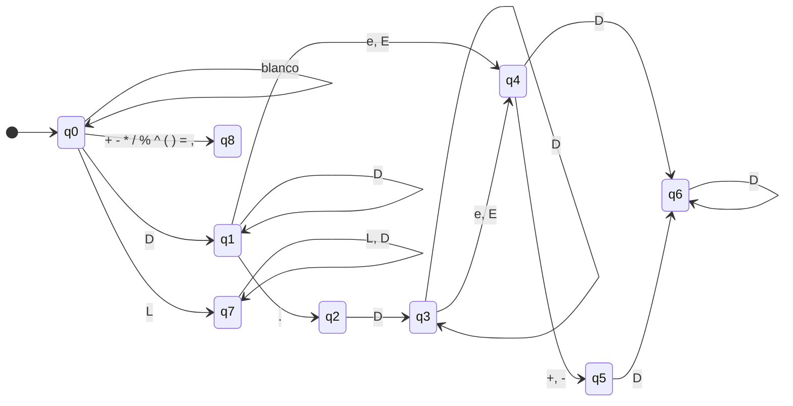

# Fase 2 — Especificación formal

**Proyecto 04 · Intérprete de expresiones matemáticas**

Este documento define el lenguaje que acepta la calculadora: su léxico, su sintaxis, su semántica y el código intermedio que genera. Todo el código de la Fase 4 se implementa a partir de esta especificación.

Convenciones:
- Las columnas se cuentan desde 1.
- `ε` es la cadena vacía y `$` el fin de la entrada (token `EOF`).
- En la gramática, `num`, `id` y `fn` abrevian los tokens `NUMERO`, `IDENT` y `FUNCION`.

---

## 1. Análisis léxico

### 1.1 Alfabeto

| Clase | Caracteres |
|---|---|
| Dígito `D` | `0`–`9` |
| Letra `L` | `a`–`z`, `A`–`Z`, `_` |
| Operadores y signos | `+ - * / % ^ ( ) = ,` |
| Punto | `.` |
| Blancos | espacio, tabulador (se ignoran) |

Cualquier otro carácter produce el error léxico **L01**.

### 1.2 Tokens

| Token | Expresión regular | Ejemplos |
|---|---|---|
| `NUMERO` | `[0-9]+(\.[0-9]+)?([eE][+-]?[0-9]+)?` | `42`, `3.14`, `1e10`, `2.5E-3` |
| `FUNCION` | `sqrt \| abs \| sin \| cos \| tan \| ln \| log \| min \| max \| round` | `sqrt`, `max` |
| `IDENT` | `[A-Za-z_][A-Za-z0-9_]*` (que no sea `FUNCION`) | `x`, `total`, `x2`, `pi` |
| `MAS` | `\+` | `+` |
| `MENOS` | `-` | `-` |
| `POR` | `\*` | `*` |
| `DIV` | `/` | `/` |
| `MOD` | `%` | `%` |
| `POT` | `\^` | `^` |
| `PAR_IZQ` | `\(` | `(` |
| `PAR_DER` | `\)` | `)` |
| `ASIGNA` | `=` | `=` |
| `COMA` | `,` | `,` |
| `EOF` | fin de la entrada | |

Cada token guarda: `tipo`, `lexema`, `valor` (solo `NUMERO`) y `columna` (la de su primer carácter).

Notas:
- **Funciones como palabras reservadas.** El lexer reconoce un identificador y lo busca en la tabla de funciones. Si está, emite `FUNCION`; si no, `IDENT`. Así `x(3)` siempre es `x · 3`.
- **Constantes.** `pi` y `e` son `IDENT` predefinidos de solo lectura en la tabla de símbolos, no tokens especiales.
- **`xy` es un solo identificador**, no `x · y`. Para multiplicar se escribe `x y` o `x*y`.
- El `-` siempre es `MENOS`. Decidir si es binario o unario le corresponde a la gramática, no al lexer.

### 1.3 Autómata finito determinista



| Estado | Significado | ¿Acepta? | Token |
|---|---|---|---|
| q0 | Inicio | no | |
| q1 | Parte entera | **sí** | `NUMERO` |
| q2 | Punto leído, falta la parte decimal | no | |
| q3 | Parte decimal | **sí** | `NUMERO` |
| q4 | `e`/`E` leída, falta el exponente | no | |
| q5 | Signo del exponente leído | no | |
| q6 | Exponente | **sí** | `NUMERO` |
| q7 | Identificador | **sí** | `IDENT` o `FUNCION` |
| q8 | Operador o signo | **sí** | según el carácter |

**Tabla de transiciones.** "fin" significa que se emite el token del estado actual y se vuelve a q0 con el mismo carácter.

| Estado | `D` | `e` `E` | otra `L` | `.` | `+` `-` | `* / % ^ ( ) = ,` | blanco | otro |
|---|---|---|---|---|---|---|---|---|
| q0 | q1 | q7 | q7 | L01 | q8 | q8 | q0 | L01 |
| q1 | q1 | q4 | fin | q2 | fin | fin | fin | fin |
| q2 | q3 | L02 | L02 | L02 | L02 | L02 | L02 | L02 |
| q3 | q3 | q4 | fin | fin | fin | fin | fin | fin |
| q4 | q6 | retroceso | retroceso | retroceso | q5 | retroceso | retroceso | retroceso |
| q5 | q6 | retroceso | retroceso | retroceso | retroceso | retroceso | retroceso | retroceso |
| q6 | q6 | fin | fin | fin | fin | fin | fin | fin |
| q7 | q7 | q7 | q7 | fin | fin | fin | fin | fin |
| q8 | fin | fin | fin | fin | fin | fin | fin | fin |

**Coincidencia más larga con retroceso.** El lexer consume todo lo que puede. Si queda en un estado que no acepta (q4 o q5), retrocede hasta el último estado de aceptación (q1 o q3), emite el `NUMERO` hasta antes de la `e` y sigue leyendo desde la `e`. Esto resuelve el conflicto con la constante `e`:

| Entrada | Tokens |
|---|---|
| `2e3` | `NUMERO(2000)` |
| `2e+1` | `NUMERO(20)` |
| `2e` | `NUMERO(2)` `IDENT(e)` → `2 · e` |
| `2e+x` | `NUMERO(2)` `IDENT(e)` `MAS` `IDENT(x)` → `2·e + x` |
| `2x` | `NUMERO(2)` `IDENT(x)` → `2 · x` |

En cambio, un punto sin dígitos después (`3.`, `3.+1`) **no retrocede** y produce el error **L02**, porque casi siempre es un número a medio escribir.

---

## 2. Análisis sintáctico

### 2.1 Precedencia y asociatividad

| Nivel | Operador | Asociatividad | Regla que lo implementa |
|---|---|---|---|
| 1 (menor) | `=` | derecha | `sentencia` |
| 2 | `+` `-` binarios | izquierda | `expresion` |
| 3 | `*` `/` `%` y multiplicación implícita | izquierda | `termino` |
| 4 | `-` unario | derecha | `unario` |
| 5 (mayor) | `^` | derecha | `potencia` |
| — | `( )`, llamadas a función | agrupan | `primario` |

Cada nivel tiene su propia regla. Una regla solo llama a la del nivel siguiente, así que los operadores de mayor precedencia quedan más abajo en el árbol y se evalúan primero. La asociatividad izquierda se obtiene con repetición (`( op X )*`, que se pliega por la izquierda) y la derecha con recursión por la derecha.

### 2.2 Gramática en EBNF (la que se implementa)

```
sentencia  → expresion ( '=' sentencia )?
expresion  → termino ( ( '+' | '-' ) termino )*
termino    → unario ( ( '*' | '/' | '%' ) unario | atomo potencia_resto )*
unario     → '-' unario | potencia
potencia   → primario potencia_resto
potencia_resto → ( '^' unario )?
primario   → NUMERO | atomo
atomo      → IDENT | FUNCION '(' argumentos ')' | '(' expresion ')'
argumentos → expresion ( ',' expresion )*
```

Decisiones de diseño:

- **Asignación.** No es `IDENT '=' expresion` porque eso necesitaría ver dos tokens adelante (`x` puede ser el inicio de una expresión o de una asignación). Se analiza `expresion ( '=' sentencia )?` y luego se verifica que el lado izquierdo sea una sola variable (error **S06** si no). Así la gramática sigue siendo LL(1) y `a = b = 4` se asocia por la derecha.
- **Multiplicación implícita.** Es la alternativa `atomo potencia_resto` de `termino`. Como un `atomo` solo puede empezar por `IDENT`, `FUNCION` o `(`, un número a la derecha nunca se multiplica implícitamente: `2 3` es error **S03**.
- **`-2 ^ 2 = -4`.** El `-` unario está en un nivel menor que `^`, así que se aplica al resultado de la potencia.
- **`2 ^ -1 = 0.5`.** El exponente de `^` es un `unario`, por lo que admite signo.

### 2.3 Gramática en BNF (para el análisis LL(1))

Es la misma gramática, con la repetición reemplazada por no terminales con prima.

| # | Producción |
|---|---|
| 1 | S → E S' |
| 2 | S' → = S |
| 3 | S' → ε |
| 4 | E → T E' |
| 5 | E' → + T E' |
| 6 | E' → - T E' |
| 7 | E' → ε |
| 8 | T → U T' |
| 9 | T' → * U T' |
| 10 | T' → / U T' |
| 11 | T' → % U T' |
| 12 | T' → A P' T' |
| 13 | T' → ε |
| 14 | U → - U |
| 15 | U → P |
| 16 | P → R P' |
| 17 | P' → ^ U |
| 18 | P' → ε |
| 19 | R → num |
| 20 | R → A |
| 21 | A → id |
| 22 | A → fn ( L ) |
| 23 | A → ( E ) |
| 24 | L → E L' |
| 25 | L' → , E L' |
| 26 | L' → ε |

Correspondencia: S = `sentencia`, E = `expresion`, T = `termino`, U = `unario`, P = `potencia`, P' = `potencia_resto`, R = `primario`, A = `atomo`, L = `argumentos`.

La gramática **no tiene recursión por la izquierda** ni prefijos comunes entre alternativas.

### 2.4 Conjuntos PRIMEROS y SIGUIENTES

| No terminal | PRIMEROS | SIGUIENTES |
|---|---|---|
| S | `- num id fn (` | `$` |
| S' | `= ε` | `$` |
| E | `- num id fn (` | `= ) , $` |
| E' | `+ - ε` | `= ) , $` |
| T | `- num id fn (` | `+ - = ) , $` |
| T' | `* / % id fn ( ε` | `+ - = ) , $` |
| U | `- num id fn (` | `* / % id fn ( + - = ) , $` |
| P | `num id fn (` | `* / % id fn ( + - = ) , $` |
| P' | `^ ε` | `* / % id fn ( + - = ) , $` |
| R | `num id fn (` | `^ * / % id fn ( + - = ) , $` |
| A | `id fn (` | `^ * / % id fn ( + - = ) , $` |
| L | `- num id fn (` | `)` |
| L' | `, ε` | `)` |

### 2.5 Demostración de que es LL(1)

Una gramática es LL(1) si, para cada no terminal con varias alternativas, (a) los PRIMEROS de las alternativas son disjuntos y (b) si una alternativa deriva `ε`, los PRIMEROS de las demás no se cruzan con los SIGUIENTES del no terminal.

| No terminal | Alternativas no vacías | SIGUIENTES (por la alternativa `ε`) | Intersección |
|---|---|---|---|
| S' | `{=}` | `{$}` | ∅ ✔ |
| E' | `{+}`, `{-}` | `{= ) , $}` | ∅ ✔ |
| T' | `{*}`, `{/}`, `{%}`, `{id fn (}` | `{+ - = ) , $}` | ∅ ✔ |
| U | `{-}`, `{num id fn (}` | — | ∅ ✔ |
| P' | `{^}` | `{* / % id fn ( + - = ) , $}` | ∅ ✔ |
| R | `{num}`, `{id fn (}` | — | ∅ ✔ |
| A | `{id}`, `{fn}`, `{(}` | — | ∅ ✔ |
| L' | `{,}` | `{)}` | ∅ ✔ |

Todas las intersecciones son vacías, así que **la gramática es LL(1)**. El caso delicado es T': la multiplicación implícita empieza por `id fn (` y ninguno de esos tokens puede seguir a un término, por eso no hay conflicto con `T' → ε`. Excluir `num` del inicio de la multiplicación implícita no es necesario para que la gramática sea LL(1). Es una decisión de diseño para rechazar entradas ambiguas para el usuario, como `2 3` o `x 2`.

### 2.6 Tabla de análisis LL(1)

Cada celda indica qué producción aplicar según el no terminal (fila) y el token actual (columna). Las celdas vacías son errores de sintaxis.

| | num | id | fn | ( | ) | + | - | * | / | % | ^ | = | , | $ |
|---|---|---|---|---|---|---|---|---|---|---|---|---|---|---|
| **S** | 1 | 1 | 1 | 1 | | | 1 | | | | | | | |
| **S'** | | | | | | | | | | | | 2 | | 3 |
| **E** | 4 | 4 | 4 | 4 | | | 4 | | | | | | | |
| **E'** | | | | | 7 | 5 | 6 | | | | | 7 | 7 | 7 |
| **T** | 8 | 8 | 8 | 8 | | | 8 | | | | | | | |
| **T'** | | 12 | 12 | 12 | 13 | 13 | 13 | 9 | 10 | 11 | | 13 | 13 | 13 |
| **U** | 15 | 15 | 15 | 15 | | | 14 | | | | | | | |
| **P** | 16 | 16 | 16 | 16 | | | | | | | | | | |
| **P'** | | 18 | 18 | 18 | 18 | 18 | 18 | 18 | 18 | 18 | 17 | 18 | 18 | 18 |
| **R** | 19 | 20 | 20 | 20 | | | | | | | | | | |
| **A** | | 21 | 22 | 23 | | | | | | | | | | |
| **L** | 24 | 24 | 24 | 24 | | | 24 | | | | | | | |
| **L'** | | | | | 26 | | | | | | | | 25 | |

Ninguna celda tiene dos producciones, lo que confirma que la gramática es LL(1).

El intérprete usa un **parser descendente recursivo**: una función por no terminal, que decide la producción mirando el token actual como en esta tabla. La pila del autómata de pila es, en ese caso, la pila de llamadas de las funciones.

### 2.7 Ejemplo: autómata de pila con `-2 ^ 2`

Tokens: `- num ^ num $`. La pila se escribe con el tope a la derecha.

| Pila | Entrada | Acción |
|---|---|---|
| `$ S` | `- num ^ num $` | 1: S → E S' |
| `$ S' E` | `- num ^ num $` | 4: E → T E' |
| `$ S' E' T` | `- num ^ num $` | 8: T → U T' |
| `$ S' E' T' U` | `- num ^ num $` | 14: U → - U |
| `$ S' E' T' U -` | `- num ^ num $` | emparejar `-` |
| `$ S' E' T' U` | `num ^ num $` | 15: U → P |
| `$ S' E' T' P` | `num ^ num $` | 16: P → R P' |
| `$ S' E' T' P' R` | `num ^ num $` | 19: R → num |
| `$ S' E' T' P' num` | `num ^ num $` | emparejar `num` |
| `$ S' E' T' P'` | `^ num $` | 17: P' → ^ U |
| `$ S' E' T' U ^` | `^ num $` | emparejar `^` |
| `$ S' E' T' U` | `num $` | 15: U → P |
| `$ S' E' T' P` | `num $` | 16: P → R P' |
| `$ S' E' T' P' R` | `num $` | 19: R → num |
| `$ S' E' T' P' num` | `num $` | emparejar `num` |
| `$ S' E' T' P'` | `$` | 18: P' → ε |
| `$ S' E' T'` | `$` | 13: T' → ε |
| `$ S' E'` | `$` | 7: E' → ε |
| `$ S'` | `$` | 3: S' → ε |
| `$` | `$` | **aceptar** |

El `^` quedó dentro del alcance del `-` unario: la expresión es `-(2 ^ 2) = -4`.

### 2.8 Árboles de derivación y sintácticos

**`2 + 3 * x`.** Derivación por la izquierda (resumida):

```
S ⇒ E S' ⇒ T E' S' ⇒* num E' S' ⇒ num + T E' S' ⇒* num + num T' E' S'
  ⇒ num + num * U T' E' S' ⇒* num + num * id T' E' S' ⇒* num + num * id
```

Árbol de derivación (algunas ramas que derivan `ε` se omiten para simplificar):

```
                 S
                 |
                 E
          ┌──────┴──────┐
          T             E'
          |       ┌─────┼─────┐
          U       +     T     E'(ε)
          |          ┌──┴──┐
          P          U     T'
          |          |   ┌─┼──┐
          R          P   *  U  T'(ε)
          |          |      |
         num(2)      R      P
                     |      |
                   num(3)   R
                            |
                            A
                            |
                          id(x)
```

Árbol sintáctico abstracto (AST), que es lo que muestra la interfaz:

```
      +
     / \
    2   *
       / \
      3   x
```

**`2 ^ 3 ^ 2`** (asociatividad derecha) y **`10 - 4 - 3`** (asociatividad izquierda):

```
    ^                 -
   / \               / \
  2   ^             -   3
     / \           / \
    3   2        10   4
  = 2^9 = 512    = 6 - 3 = 3
```

**`1 / 2x`** (multiplicación implícita con la precedencia de `*`):

```
      *
     / \
    /   x
   / \
  1   2      = (1/2)·x
```

---

## 3. Análisis semántico

### 3.1 Tabla de símbolos

| Nombre | Tipo | Valor inicial | Modificable |
|---|---|---|---|
| `pi` | constante | 3.141592653589793 | no |
| `e` | constante | 2.718281828459045 | no |
| variables del usuario | variable | se crea al asignar | sí |

Las variables duran mientras la sesión esté abierta.

### 3.2 Funciones predefinidas

| Función | Aridad | Dominio | Descripción |
|---|---|---|---|
| `sqrt(a)` | 1 | a ≥ 0 | raíz cuadrada |
| `abs(a)` | 1 | todos | valor absoluto |
| `sin(a)`, `cos(a)`, `tan(a)` | 1 | todos (radianes) | trigonométricas |
| `ln(a)` | 1 | a > 0 | logaritmo natural |
| `log(a)` | 1 | a > 0 | logaritmo base 10 |
| `round(a)` | 1 | todos | redondeo al entero más cercano |
| `min(a, b, …)`, `max(a, b, …)` | 1 o más | todos | mínimo y máximo |

### 3.3 Reglas semánticas

| Construcción | Regla |
|---|---|
| Variable | Debe existir en la tabla de símbolos (si no, **E01**). |
| `a / b`, `a % b` | `b ≠ 0` (si no, **E02**). |
| `a % b` | El resultado toma el signo de `a`: `-7 % 3 = -1`. |
| `a ^ b` | `0 ^ 0 = 1`. `0 ^ negativo` es una división por cero (**E02**). |
| Llamada a función | El número de argumentos debe coincidir con la aridad (**E03**) y cada argumento debe estar en el dominio (**E05**). |
| Asignación | El lado izquierdo debe ser una variable (**S06**) y no una constante (**E04**). Su valor es el valor asignado. |
| Cualquier resultado | Debe ser un número finito (si no, **E06**). |
| Presentación | El resultado se redondea a 10 decimales y se quitan los ceros a la derecha. Los valores distintos de 0 con valor absoluto menor que 1e-6 se muestran en notación científica con 10 cifras significativas (`1e-15`, no `0`). |

### 3.4 Definición dirigida por la sintaxis (construcción del AST)

| Regla EBNF | Acción semántica |
|---|---|
| `sentencia → expresion ( '=' sentencia )?` | Si hay `=`: comprobar que `expresion` sea `Variable(v)`; nodo = `Asignacion(v, sentencia.nodo)`. Si no: nodo = `expresion.nodo`. |
| `expresion → termino₁ ( op termino₂ )*` | nodo = `termino₁.nodo`; por cada repetición: nodo = `Binario(op, nodo, termino₂.nodo)` (pliegue por la izquierda). |
| `termino → unario₁ ( op unario₂ \| atomo potencia_resto )*` | Igual que `expresion`. En la alternativa implícita, `atomo potencia_resto` se construye como una `potencia` y nodo = `Binario('*', nodo, ese nodo, implicita = true)`. |
| `unario → '-' unario₁` | nodo = `Unario('-', unario₁.nodo)` |
| `potencia → primario ( '^' unario )?` | nodo = `Binario('^', primario.nodo, unario.nodo)` si hay `^`; si no, `primario.nodo`. |
| `primario → NUMERO` | nodo = `Numero(valor)` |
| `atomo → IDENT` | nodo = `Variable(nombre)` |
| `atomo → FUNCION '(' argumentos ')'` | nodo = `Llamada(nombre, [args])` |
| `atomo → '(' expresion ')'` | nodo = `expresion.nodo` (los paréntesis no generan nodo). |

---

## 4. Código intermedio

Los tres formatos se generan con un **recorrido en postorden** del AST: primero los hijos de izquierda a derecha y después el nodo.

### 4.1 Notación polaca inversa (RPN)

| Nodo | RPN |
|---|---|
| `Numero(n)` | `n` |
| `Variable(v)` | `v` |
| `Binario(op, i, d)` | `i d op` |
| `Unario('-', h)` | `h neg` (se usa `neg` para no confundirlo con la resta) |
| `Llamada(f, a₁…aₙ)` | `a₁ … aₙ f[n]` |
| `Asignacion(v, e)` | `&v e =` (`&v` indica la variable destino, no su valor) |

**Evaluación con pila:**

| Elemento | Acción |
|---|---|
| número | apilar |
| variable `v` | apilar su valor (**E01** si no existe) |
| `&v` | apilar la referencia a `v` |
| `+ - * / % ^` | desapilar `d`, desapilar `i`, apilar `i op d` |
| `neg` | desapilar `a`, apilar `-a` |
| `f[n]` | desapilar `n` valores, apilar `f(…)` |
| `=` | desapilar el valor, desapilar `&v`, guardar en `v`, apilar el valor |

Al final, la pila tiene un solo elemento: el resultado.

### 4.2 Tripletes

Formato: `(i) operador arg1 arg2`. Un argumento es un número, una variable o una referencia `(k)` al resultado del triplete `k`.

| Nodo | Tripletes emitidos | Dirección del resultado |
|---|---|---|
| `Numero`, `Variable` | ninguno | el propio número o nombre |
| `Binario(op, i, d)` | `(k) op dir(i) dir(d)` | `(k)` |
| `Unario('-', h)` | `(k) neg dir(h) —` | `(k)` |
| `Llamada(f, a₁…aₙ)` | primero se generan todos los argumentos; luego `param dir(aⱼ) —` por cada uno y `(k) call f n` | `(k)` |
| `Asignacion(v, e)` | `(k) = v dir(e)` | `(k)` |

Si la expresión es solo un número o una variable, no se emiten tripletes.

### 4.3 Cuádruplos

Formato: `(operador, arg1, arg2, resultado)`. Es igual que en los tripletes, pero cada resultado se guarda en un temporal nuevo `t1, t2, …` en lugar de referirse por posición. La asignación se escribe `(=, dir(e), —, v)` y `param` no tiene resultado.

### 4.4 Ejemplos

**`a = b * c + d`**

| Tripletes | Cuádruplos |
|---|---|
| `(0) * b c` | `(*, b, c, t1)` |
| `(1) + (0) d` | `(+, t1, d, t2)` |
| `(2) = a (1)` | `(=, t2, —, a)` |

RPN: `&a b c * d + =`

**`-2 ^ 2`**

| Tripletes | Cuádruplos |
|---|---|
| `(0) ^ 2 2` | `(^, 2, 2, t1)` |
| `(1) neg (0) —` | `(neg, t1, —, t2)` |

RPN: `2 2 ^ neg`

**`(x + 1)(x - 1)`**

| Tripletes | Cuádruplos |
|---|---|
| `(0) + x 1` | `(+, x, 1, t1)` |
| `(1) - x 1` | `(-, x, 1, t2)` |
| `(2) * (0) (1)` | `(*, t1, t2, t3)` |

RPN: `x 1 + x 1 - *`

**`y = max(2, sqrt(9)) / 2`**

| Tripletes | Cuádruplos |
|---|---|
| `(0) param 9 —` | `(param, 9, —, —)` |
| `(1) call sqrt 1` | `(call, sqrt, 1, t1)` |
| `(2) param 2 —` | `(param, 2, —, —)` |
| `(3) param (1) —` | `(param, t1, —, —)` |
| `(4) call max 2` | `(call, max, 2, t2)` |
| `(5) / (4) 2` | `(/, t2, 2, t3)` |
| `(6) = y (5)` | `(=, t3, —, y)` |

RPN: `&y 2 9 sqrt[1] max[2] 2 / =` → `y = 1.5`

---

## 5. Catálogo de errores

Todo error se reporta con **código, tipo, mensaje y columna**. La interfaz subraya la columna en la entrada.

| Código | Tipo | Causa | Ejemplo | Mensaje |
|---|---|---|---|---|
| L01 | Léxico | Carácter no válido | `3 + $` | Carácter no válido '$' (columna 5). |
| L02 | Léxico | Número incompleto | `3.` | Se esperaba un dígito después del punto decimal (columna 2). |
| S01 | Sintáctico | Falta un operando | `3 + * 4` | Se esperaba un número, variable, función o '(' y se encontró '*' (columna 5). |
| S02 | Sintáctico | Paréntesis sin cerrar | `(2 + 3` | Falta ')' para cerrar el '(' de la columna 1 (columna 7). |
| S03 | Sintáctico | Sobra un token / falta un operador | `2 3`, `2 + 3)` | Se esperaba un operador o el fin de la expresión y se encontró '3' (columna 3). |
| S04 | Sintáctico | Función sin paréntesis | `sqrt 4` | Se esperaba '(' después de 'sqrt' (columna 6). |
| S05 | Sintáctico | Entrada vacía | ` ` | La expresión está vacía. |
| S06 | Sintáctico | Destino de asignación inválido | `x + 1 = 3` | Solo se puede asignar a una variable (columna 7). |
| S07 | Sintáctico | Más de 1000 tokens (agregado en la Fase 5) | `((((…1…))))` con 3000 paréntesis | La expresión es demasiado larga (máximo 1000 tokens) (columna N). |
| E01 | Semántico | Variable no definida | `y + 1` | La variable 'y' no está definida (columna 1). |
| E02 | Semántico | División por cero | `5 / 0`, `5 % 0`, `0 ^ -1` | División por cero (columna 3). |
| E03 | Semántico | Aridad incorrecta | `sqrt(1, 2)` | 'sqrt' espera 1 argumento y recibió 2 (columna 1). |
| E04 | Semántico | Asignación a constante | `pi = 3` | 'pi' es una constante y no se puede modificar (columna 1). |
| E05 | Semántico | Fuera de dominio | `sqrt(-1)`, `ln(0)` | 'sqrt' no está definida para -1 (columna 1). |
| E06 | Semántico | Resultado no finito | `10 ^ 400` | El resultado es demasiado grande (columna 4). |

Ajuste respecto a la Fase 1: como las funciones son palabras reservadas, un nombre desconocido seguido de `(` (`foo(3)`) se interpreta como `foo · 3`. Si `foo` no existe se reporta **E01** con la pista "¿quisiste llamar a una función? Disponibles: sqrt, abs, …".

El análisis se detiene en el **primer error**. No hay recuperación de errores, porque cada entrada es una sola expresión corta.

---

## 6. Casos de prueba esperados

Los casos se ejecutan en orden, en una misma sesión (las variables persisten).

### 6.1 Casos válidos

| # | Entrada | RPN | Resultado | Qué prueba |
|---|---|---|---|---|
| 1 | `2 + 3 * 4` | `2 3 4 * +` | 14 | precedencia |
| 2 | `(2 + 3) * 4` | `2 3 + 4 *` | 20 | paréntesis |
| 3 | `10 - 4 - 3` | `10 4 - 3 -` | 3 | asociatividad izquierda |
| 4 | `100 / 10 / 5` | `100 10 / 5 /` | 2 | asociatividad izquierda |
| 5 | `2 ^ 3 ^ 2` | `2 3 2 ^ ^` | 512 | asociatividad derecha |
| 6 | `-2 ^ 2` | `2 2 ^ neg` | -4 | unario vs. potencia |
| 7 | `(-2) ^ 2` | `2 neg 2 ^` | 4 | unario entre paréntesis |
| 8 | `2 ^ -1` | `2 1 neg ^` | 0.5 | exponente negativo |
| 9 | `--4` | `4 neg neg` | 4 | unario anidado |
| 10 | `7 % 3 + 1` | `7 3 % 1 +` | 2 | módulo |
| 11 | `2.5e-3 * 1e3` | `2.5e-3 1e3 *` | 2.5 | notación científica |
| 12 | `x = 3` | `&x 3 =` | 3 | asignación |
| 13 | `2x` | `2 x *` | 6 | multiplicación implícita |
| 14 | `2x^2` | `2 x 2 ^ *` | 18 | implícita vs. potencia |
| 15 | `(x + 1)(x - 1)` | `x 1 + x 1 - *` | 8 | implícita entre paréntesis |
| 16 | `1 / 2x` | `1 2 / x *` | 1.5 | implícita con precedencia de `*` |
| 17 | `x(3)` | `x 3 *` | 9 | variable seguida de paréntesis |
| 18 | `sqrt(16) + max(2, 7)` | `16 sqrt[1] 2 7 max[2] +` | 11 | funciones |
| 19 | `round(10 / 3)` | `10 3 / round[1]` | 3 | función con expresión |
| 20 | `2pi` | `2 pi *` | 6.2831853072 | constante |
| 21 | `2e` | `2 e *` | 5.4365636569 | retroceso del lexer |
| 22 | `2e+1` | `2e+1` | 20 | coincidencia más larga |
| 23 | `a = b = 4` | `&a &b 4 = =` | 4 | asignación encadenada |
| 24 | `a + b` | `a b +` | 8 | variables persistentes |

### 6.2 Casos de error

| # | Entrada | Código | Columna |
|---|---|---|---|
| 25 | `3 + $` | L01 | 5 |
| 26 | `3.` | L02 | 2 |
| 27 | `3 + * 4` | S01 | 5 |
| 28 | `(2 + 3` | S02 | 7 |
| 29 | `2 3` | S03 | 3 |
| 30 | `sqrt 4` | S04 | 6 |
| 31 | *(vacío)* | S05 | 1 |
| 32 | `x + 1 = 3` | S06 | 7 |
| 33 | `y + 1` | E01 | 1 |
| 34 | `5 / 0` | E02 | 3 |
| 35 | `sqrt(1, 2)` | E03 | 1 |
| 36 | `pi = 3` | E04 | 1 |
| 37 | `sqrt(-1)` | E05 | 1 |
| 38 | `10 ^ 400` | E06 | 4 |

### 6.3 Casos de código intermedio

Los cuatro ejemplos de la sección 4.4 son casos de prueba de tripletes y cuádruplos.
