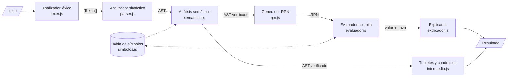
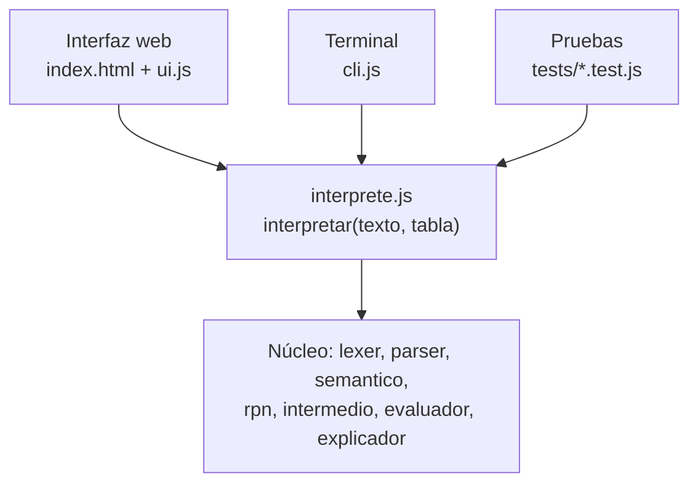
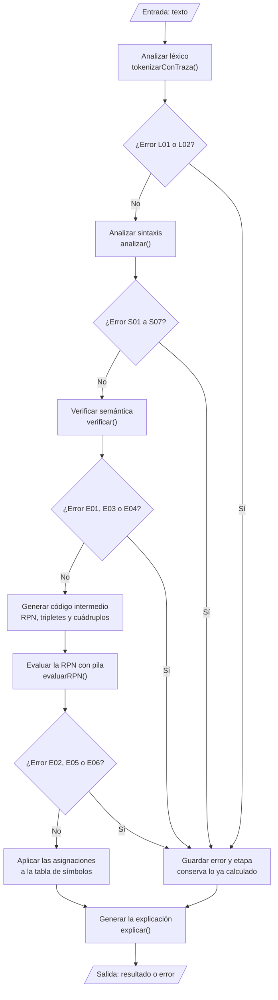
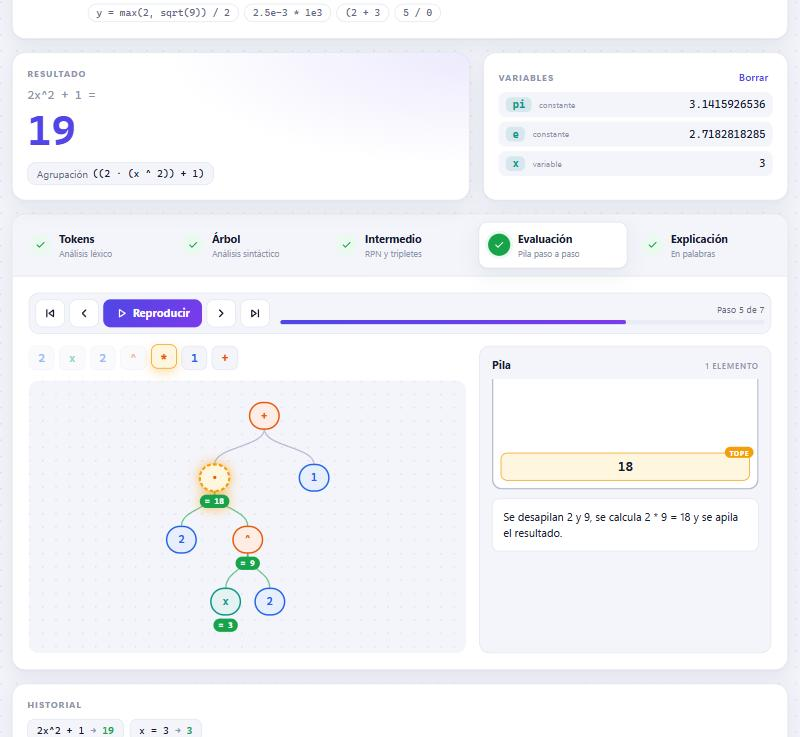
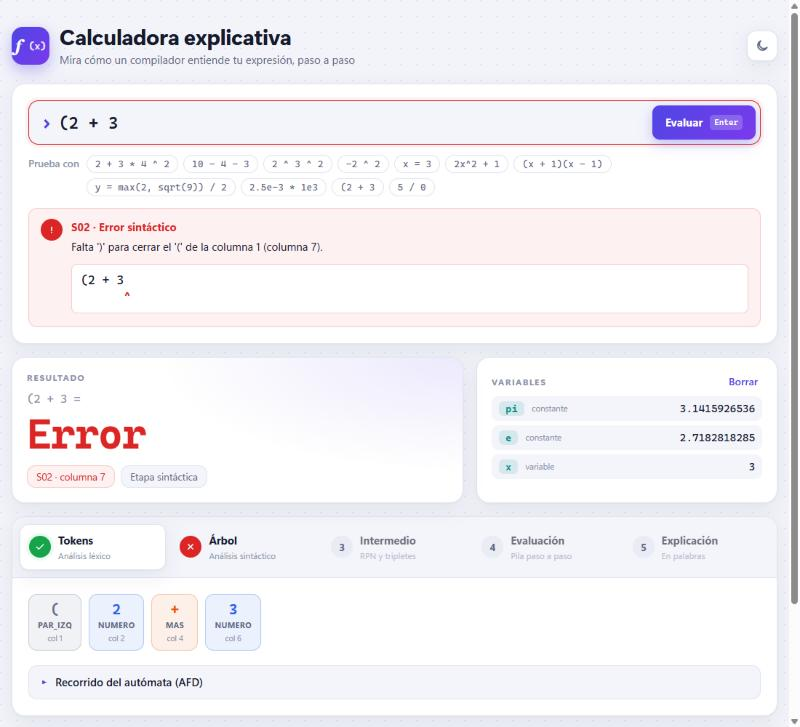
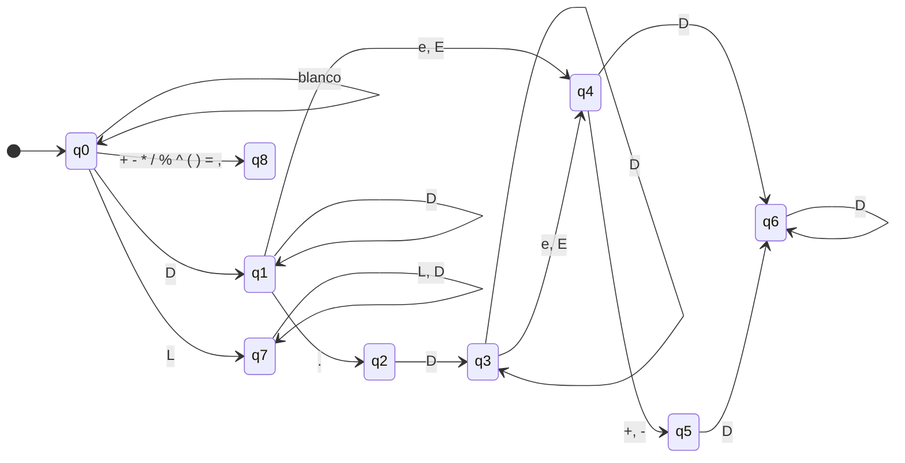

# Fase 3 — Diseño

**Proyecto 04 · Intérprete de expresiones matemáticas**

Este documento describe cómo se organiza el software que implementa la [especificación formal](../fase-2-especificacion/02-especificacion.md): módulos, estructuras de datos, flujo de ejecución, interfaz y plan de pruebas.

---

## 1. Arquitectura

El intérprete es una **tubería de etapas**, igual que las fases de un compilador. Cada etapa recibe la salida de la anterior y es una función pura, salvo el evaluador, que modifica la tabla de símbolos.



Por encima de la tubería hay una **fachada** (`interprete.js`) que ejecuta todas las etapas y devuelve un único objeto con lo que produjo cada una. La interfaz web, la CLI y las pruebas usan solo esa fachada, así que el núcleo no depende de cómo se muestre.



### 1.1 Separación de los errores por etapa

| Etapa | Detecta | Códigos |
|---|---|---|
| Léxico | caracteres no válidos, números incompletos | L01, L02 |
| Sintáctico | estructura incorrecta, destino de asignación inválido, expresión demasiado larga | S01–S07 |
| Semántico (estático, antes de ejecutar) | variable no definida, aridad, asignación a constante | E01, E03, E04 |
| Evaluación (en tiempo de ejecución) | división por cero, dominio, desbordamiento | E02, E05, E06 |

El análisis semántico puede hacerse antes de evaluar porque, dentro de una sentencia, todos los usos de variables están en la expresión de la derecha y se evalúan **antes** de cualquier asignación. Por ejemplo, en `a = b = a + 1` se comprueba que exista `a` antes de calcular nada.

### 1.2 Diagrama de flujo de entradas y salidas

La **entrada** es el texto de una expresión y la tabla de símbolos de la sesión. La **salida** es el objeto `Resultado` (sección 3.7), que contiene lo producido por cada etapa y, si hubo un error, su código, tipo y columna. Cada etapa decide si el proceso continúa. Si detecta un error, se guarda junto con la etapa donde ocurrió y se pasa directamente a generar la explicación.



---

## 2. Módulos

| Archivo | Responsabilidad | Entrada | Salida |
|---|---|---|---|
| `src/errores.js` | Clase `ErrorCalc` y catálogo de mensajes | código, columna, datos | excepción |
| `src/tokens.js` | Tipos de token y palabras reservadas | — | constantes |
| `src/lexer.js` | AFD de la sección 1.3 de la especificación | `string` | `Token[]` |
| `src/ast.js` | Constructores de nodos del AST | datos del nodo | `Nodo` |
| `src/parser.js` | Parser descendente recursivo, una función por regla | `Token[]` | `Nodo` |
| `src/simbolos.js` | Tabla de símbolos y funciones predefinidas | — | `TablaSimbolos`, `FUNCIONES` |
| `src/semantico.js` | Verificación estática (E01, E03, E04) | `Nodo`, `TablaSimbolos` | nada, o lanza `ErrorCalc` |
| `src/rpn.js` | Recorrido en postorden → notación polaca inversa | `Nodo` | `ElementoRPN[]` |
| `src/intermedio.js` | Recorrido en postorden → tripletes y cuádruplos | `Nodo` | `Triplete[]`, `Cuadruplo[]` |
| `src/evaluador.js` | Evaluación de la RPN con pila | `ElementoRPN[]`, `TablaSimbolos` | `{ valor, traza, asignaciones }` |
| `src/explicador.js` | Explicación en lenguaje natural | `Resultado` | `string[]` |
| `src/interprete.js` | Fachada que ejecuta la tubería | `string`, `TablaSimbolos` | `Resultado` |
| `src/formato.js` | Presentación de números (10 decimales) y del AST como texto | valores | `string` |
| `src/ui.js` | Lógica de la interfaz web | eventos del DOM | DOM |
| `index.html`, `estilos.css` | Estructura y estilo de la interfaz | — | — |
| `cli.js` | Bucle interactivo en la terminal | líneas de texto | texto |
| `servidor.js` | Servidor estático local (sin dependencias) | — | HTTP en `localhost:8080` |

### 2.1 Interfaces públicas

```js
// lexer.js
tokenizar(texto: string): Token[]                  // lanza ErrorCalc L01, L02
tokenizarConTraza(texto: string): { tokens, traza } // además, cada transición del AFD

// parser.js
analizar(tokens: Token[]): Nodo                    // lanza ErrorCalc S01–S07

// ast.js
crearNumero(valor, lexema, columna): Nodo
crearVariable(nombre, columna): Nodo
crearUnario(op, operando, columna): Nodo
crearBinario(op, izq, der, columna, implicita = false): Nodo
crearLlamada(nombre, args, columna): Nodo
crearAsignacion(nombre, valor, columna): Nodo
hijos(nodo: Nodo): Nodo[]                          // de izquierda a derecha
reiniciarIds(): void                               // lo llama analizar() en cada árbol

// semantico.js
verificar(ast: Nodo, tabla: TablaSimbolos): void   // lanza ErrorCalc E01, E03, E04

// rpn.js
generarRPN(ast: Nodo): ElementoRPN[]

// intermedio.js
generarTripletes(ast: Nodo): Triplete[]
generarCuadruplos(ast: Nodo): Cuadruplo[]

// evaluador.js
evaluarRPN(rpn: ElementoRPN[], tabla: TablaSimbolos): { valor, traza, asignaciones }
                                                   // lanza ErrorCalc E01, E02, E04, E05, E06

// explicador.js
explicar(resultado: Resultado): string[]

// formato.js
formatearNumero(valor: number): string             // 10 decimales, sin ceros sobrantes
astComoTexto(ast: Nodo): string                    // árbol con sangría
astComoExpresion(ast: Nodo): string                // con todos los paréntesis
etiquetaNodo(nodo: Nodo): string

// interprete.js
interpretar(texto: string, tabla: TablaSimbolos): Resultado   // un ErrorCalc va en Resultado.error
```

`ui.js` y `cli.js` no exportan funciones: son los puntos de entrada y solo llaman a `interpretar()` y a las utilidades de `formato.js`. La tabla de símbolos se describe en la sección 3.6.

### 2.2 Contratos entre módulos

Cada módulo garantiza lo que produce, y el siguiente puede confiar en esa garantía sin volver a comprobarla.

| Productor → consumidor | Dato | Garantía |
|---|---|---|
| `lexer.js` → `parser.js` | `Token[]` | La lista termina en `EOF`. Todo lexema es válido según el AFD y cada token trae su columna, contada desde 1. |
| `parser.js` → `semantico.js` | `Nodo` (AST) | La expresión cumple la gramática, tiene como máximo 1000 tokens y todo destino de asignación es una variable. |
| `semantico.js` → `rpn.js`, `intermedio.js`, `evaluador.js` | `Nodo` verificado | Las variables usadas existen, cada función recibe los argumentos que admite y no se asigna a constantes. |
| `rpn.js` → `evaluador.js` | `ElementoRPN[]` | Está en postorden, así que cada operador encuentra sus operandos en la pila. Cada elemento trae `nodoId` y `columna`. |
| `evaluador.js` → `simbolos.js` | Asignaciones | Solo se aplican si toda la evaluación termina sin errores. |
| `evaluador.js` → `explicador.js` | Traza | Tiene un paso por cada elemento ejecutado, con la pila antes y después y el `nodoId` que enlaza con el AST. |
| `interprete.js` → `ui.js`, `cli.js`, pruebas | `Resultado` | Un `ErrorCalc` nunca se propaga: se devuelve en `error` y `etapaFallida`, y las etapas anteriores conservan lo que produjeron. Cualquier otra excepción es un fallo interno y sí se propaga. |

---

## 3. Estructuras de datos

### 3.1 Token

```js
{ tipo: 'NUMERO', lexema: '2.5e-3', valor: 0.0025, columna: 1 }
{ tipo: 'IDENT',  lexema: 'x',                     columna: 6 }
{ tipo: 'MAS',    lexema: '+',                     columna: 8 }
```

`tipo` es uno de los definidos en `tokens.js`. `valor` solo existe en `NUMERO`. El último token siempre es `EOF`, con la columna `longitud + 1`.

### 3.2 Nodos del AST

Todos los nodos tienen `id` (entero único, para enlazar el árbol con la traza en la interfaz), `tipo` y `columna`.

| Tipo | Campos propios | Columna que guarda |
|---|---|---|
| `Numero` | `valor`, `lexema` | inicio del número |
| `Variable` | `nombre` | inicio del nombre |
| `Unario` | `op: '-'`, `operando` | el `-` |
| `Binario` | `op`, `izq`, `der`, `implicita: boolean` | el operador, o el inicio del operando derecho si es implícita |
| `Llamada` | `nombre`, `args: Nodo[]` | inicio del nombre de la función |
| `Asignacion` | `nombre`, `valor: Nodo` | inicio del nombre de la variable |

Además, todo nodo puede tener `entreParentesis: true`. Los paréntesis no generan nodo propio, pero el explicador necesita saberlo para decir "se evalúa primero porque está entre paréntesis".

Una `Variable` seguida directamente de `(` en una multiplicación implícita (`foo(3)`) lleva además `seguidaDeParentesis: true`. Si la variable no existe, el análisis semántico usa esa marca para agregar a E01 la pista con las funciones disponibles.

Ejemplo, `2x + 1`:

```js
{ id: 5, tipo: 'Binario', op: '+', columna: 4, implicita: false,
  izq: { id: 3, tipo: 'Binario', op: '*', columna: 2, implicita: true,
         izq: { id: 1, tipo: 'Numero', valor: 2, lexema: '2', columna: 1 },
         der: { id: 2, tipo: 'Variable', nombre: 'x', columna: 2 } },
  der: { id: 4, tipo: 'Numero', valor: 1, lexema: '1', columna: 6 } }
```

### 3.3 Elemento de la RPN

```js
{ clase: 'num',  texto: '2',       valor: 2,                   nodoId: 1, columna: 1 }
{ clase: 'var',  texto: 'x',       nombre: 'x',                nodoId: 2, columna: 2 }
{ clase: 'ref',  texto: '&y',      nombre: 'y',                nodoId: 9, columna: 1 }
{ clase: 'op',   texto: '*',       op: '*', implicita: true,   nodoId: 3, columna: 2 }
{ clase: 'neg',  texto: 'neg',                                 nodoId: 6, columna: 1 }
{ clase: 'fn',   texto: 'max[2]',  nombre: 'max', aridad: 2,   nodoId: 7, columna: 1 }
{ clase: 'asig', texto: '=',       nombre: 'y',                nodoId: 9, columna: 1 }
```

`nodoId` permite resaltar en el árbol el nodo que se está evaluando, y `columna` sirve para reportar errores de ejecución en la posición correcta.

### 3.4 Triplete y cuádruplo

```js
// Triplete: arg1 y arg2 son texto: un número, un nombre, '(k)' o '—'
{ indice: 0, op: '*', arg1: 'b', arg2: 'c' }

// Cuádruplo: resultado es un temporal 't1', una variable o '—'
{ op: '*', arg1: 'b', arg2: 'c', resultado: 't1' }
```

### 3.5 Paso de la traza

```js
{
  paso: 5,
  elemento: '*',                          // texto del elemento RPN
  clase: 'op',                            // clase del elemento RPN
  columna: 7,
  accion: 'operar',                       // apilar | operar | negar | llamar | asignar
  operandos: [3, 16],
  resultado: 48,
  pilaAntes: [2, 3, 16],
  pilaDespues: [2, 48],
  nodoId: 3,
  descripcion: 'Se desapilan 3 y 16, se calcula 3 * 16 = 48 y se apila el resultado.'
}
```

### 3.6 Tabla de símbolos

```js
class TablaSimbolos {
  existe(nombre): boolean
  obtener(nombre, columna): number      // lanza E01 si no existe
  esConstante(nombre): boolean
  asignar(nombre, valor, columna): void // lanza E04 si es constante
  variables(): { nombre, valor, constante }[]
  reiniciar(): void                // borra las variables del usuario
}
```

Las funciones predefinidas se describen en una tabla aparte, no en la de símbolos, porque son palabras reservadas:

```js
FUNCIONES = {
  sqrt: { aridadMin: 1, aridadMax: 1, dominio: ([a]) => a >= 0, calcular: ([a]) => Math.sqrt(a) },
  max:  { aridadMin: 1, aridadMax: Infinity, dominio: () => true, calcular: (args) => Math.max(...args) },
  ...
}
```

### 3.7 Resultado de `interpretar`

```js
{
  entrada: 'y = 2x + 1',
  tokens: Token[] | null,
  trazaLexica: PasoAFD[] | null,
  ast: Nodo | null,
  rpn: ElementoRPN[] | null,
  tripletes: Triplete[] | null,
  cuadruplos: Cuadruplo[] | null,
  traza: PasoTraza[] | null,
  valor: number | null,
  asignaciones: { nombre, valor }[],
  explicacion: string[],
  error: ErrorCalc | null,
  etapaFallida: 'lexico' | 'sintactico' | 'semantico' | 'evaluacion' | null
}
```

Si una etapa falla, las anteriores conservan su resultado y las siguientes quedan en `null`. Así la interfaz puede mostrar, por ejemplo, los tokens de una expresión con error de sintaxis.

Además, `trazaLexica` guarda el recorrido del AFD (`tokenizarConTraza`), y se conserva aunque falle el lexer. Si falla la evaluación, `traza` tiene los pasos ejecutados hasta el error (`ErrorCalc.trazaParcial`), y la interfaz marca en la RPN el elemento que falló.

### 3.8 Error

```js
class ErrorCalc extends Error {
  codigo   // 'S02'
  tipo     // 'léxico' | 'sintáctico' | 'semántico'
  columna  // 7
  pista    // texto opcional, p. ej. la lista de funciones disponibles
}
```

Los mensajes viven en un solo catálogo (`errores.js`) con plantillas como `"Falta ')' para cerrar el '(' de la columna {abre}"`. Así todos los textos de error están en un único lugar y son fáciles de revisar.

---

## 4. Flujo de ejecución

```
interpretar(texto, tabla):
  r ← resultado vacío
  intentar:
    {r.tokens, r.trazaLexica} ← tokenizarConTraza(texto)  etapa = léxico
    r.ast        ← analizar(r.tokens)                     etapa = sintáctico
    verificar(r.ast, tabla)                               etapa = semántico
    r.rpn        ← generarRPN(r.ast)
    r.tripletes  ← generarTripletes(r.ast)
    r.cuadruplos ← generarCuadruplos(r.ast)
    {valor, traza, asignaciones} ← evaluarRPN(r.rpn, tabla)   etapa = evaluación
  si ocurre ErrorCalc e:
    r.error ← e;  r.etapaFallida ← etapa
    conservar las trazas parciales de e
  r.explicacion ← explicar(r)                             // también cuando hubo error
  devolver r
```

**Evaluación transaccional.** El evaluador anota las asignaciones en una lista temporal y solo las aplica a la tabla de símbolos si toda la evaluación termina sin errores. Así, una expresión que falla nunca deja variables a medio asignar.

### 4.1 Parser descendente recursivo

Una función por regla de la gramática EBNF. Cada una mira el token actual (`actual`) con `es(...tipos)` y avanza con `consumir()`. Si el token no es el esperado, lanza directamente el error sintáctico correspondiente.

```
sentencia():
  izq ← expresion()
  si actual es '=':
    col ← consumir '='
    si izq no es Variable → error S06 en col
    devolver Asignacion(izq.nombre, sentencia())     // recursión → asociatividad derecha
  devolver izq

expresion():
  nodo ← termino()
  mientras actual ∈ {'+', '-'}:
    op ← consumir
    nodo ← Binario(op, nodo, termino())             // pliegue → asociatividad izquierda
  devolver nodo

termino():
  nodo ← unario()
  repetir:
    si actual ∈ {'*', '/', '%'}:      op ← consumir; nodo ← Binario(op, nodo, unario())
    si actual ∈ {IDENT, FUNCION, '('}: nodo ← Binario('*', nodo, potenciaResto(atomo()), implícita)
    si no: salir
  devolver nodo

analizar(tokens):
  si actual es EOF → error S05 (expresión vacía)
  si hay más de 1000 tokens → error S07
  ast ← sentencia()
  si actual no es EOF → error S03 (sobra un token o falta un operador)
  devolver ast
```

### 4.2 Explicador

Para cada paso de la traza que hace una operación, el explicador busca el nodo en el AST y su padre, y elige el motivo con estas reglas, en orden:

| Condición | Motivo que muestra |
|---|---|
| El nodo está entre paréntesis | "porque está entre paréntesis" |
| El padre es una llamada a función | "porque es un argumento de `sqrt`" |
| El padre es una asignación | "que es el valor que se asigna a `x`" |
| El nodo es una llamada a función y el padre un operador | "porque es un operando de `+`" |
| El operador tiene mayor precedencia que el del padre | "porque `*` tiene mayor precedencia que `+`" |
| Mismo nivel que el padre y es el hijo izquierdo (salvo `^` y el menos unario) | "por asociatividad izquierda: entre operadores del mismo nivel se resuelve primero la operación de la izquierda" |
| Es `^` y es el hijo derecho de otro `^` | "por asociatividad derecha: las potencias se resuelven de derecha a izquierda" |
| Cualquier otro caso | "porque es un operando de `^`" |

La raíz del árbol no lleva motivo: si hubo operaciones antes, la frase empieza con "Por último". Una multiplicación implícita agrega "(multiplicación implícita)" después del cálculo. El menos unario se escribe como `-(4) = -4`, y la asignación como "Se asigna `x = 5`."

Antes de las operaciones, la explicación resume los tokens, la agrupación y la RPN. Ejemplo, con `2 + 3 * 4 ^ 2`:

1. Análisis léxico: se reconocieron 7 tokens: `[2] [+] [3] [*] [4] [^] [2]`
2. Análisis sintáctico: la expresión se agrupa como `(2 + (3 * (4 ^ 2)))`
3. Código intermedio en notación polaca inversa: `2 3 4 2 ^ * +`
4. Se calcula `4 ^ 2 = 16`, porque `^` tiene mayor precedencia que `*`.
5. Se calcula `3 * 16 = 48`, porque `*` tiene mayor precedencia que `+`.
6. Por último, se calcula `2 + 48 = 50`.
7. Resultado: **50**

### 4.3 Analizador léxico

Ejecuta el AFD de la sección 8.1 con una tabla de transiciones. Reconoce un token por llamada y recuerda el último estado de aceptación para poder retroceder.

```
siguienteToken(texto, inicio):
  estado ← q0;  pos ← inicio;  ultimaAceptacion ← ninguna
  repetir:
    c ← texto[pos]
    si estado es q0 y no hay más texto → devolver EOF
    accion ← TRANSICIONES[estado][clasificar(c)]
    según accion:
      fin:        devolver crearToken(estado, texto[inicio..pos])
      retroceso:  devolver crearToken(ultimaAceptacion.estado, texto[inicio..ultimaAceptacion.pos])
      L01:        error L01 en pos
      L02:        error L02 en el punto decimal
      otro estado:
        pos ← pos + 1
        si el nuevo estado es q0 → inicio ← pos              // se descartó un blanco
        estado ← accion
        si estado es de aceptación → ultimaAceptacion ← (estado, pos)
```

### 4.4 Análisis semántico

Recorre el AST en preorden, antes de ejecutar nada, y se detiene en el primer error.

```
verificar(n, tabla):
  según n.tipo:
    Variable:    si no existe en la tabla → error E01 (con pista si le sigue un paréntesis)
    Llamada:     si el número de argumentos no está en la aridad de la función → error E03
    Asignacion:  si n.nombre es una constante → error E04
  para cada hijo h de n: verificar(h, tabla)
```

### 4.5 Traductor a código intermedio

Los tres formatos salen de un recorrido en postorden del AST. La RPN emite cada nodo después de sus hijos. Para tripletes y cuádruplos, `dir(n)` emite las instrucciones del subárbol y devuelve dónde queda su resultado.

```
generarRPN(n):
  Asignacion: emitir &v;  visitar(valor);  emitir =
  otro nodo:  visitar sus hijos de izquierda a derecha;  emitir n

dir(n):
  Numero, Variable:  devolver el número o el nombre          // no emite instrucciones
  Binario:           a ← dir(izq);  b ← dir(der);  devolver emitir(op, a, b)
  Unario:            devolver emitir(neg, dir(operando))
  Llamada:           args ← dir de cada argumento
                     emitir param por cada arg;  devolver emitir(call, f, n)
  Asignacion:        devolver emitir(=, v, dir(valor))
```

`emitir` devuelve `(k)`, la posición de la instrucción, en los tripletes, y un temporal nuevo `tk` en los cuádruplos. En los cuádruplos, la asignación devuelve la propia variable.

### 4.6 Evaluador con pila

Es una máquina de pila que ejecuta la RPN de izquierda a derecha y registra cada paso en la traza.

```
evaluarRPN(rpn, tabla):
  pila ← vacía;  asignaciones ← vacía
  para cada elemento el de rpn:
    según el.clase:
      num:   apilar el.valor
      var:   apilar tabla.obtener(el.nombre)
      ref:   apilar &nombre
      op:    d ← desapilar;  i ← desapilar
             si (/ o %) y d = 0, o (^) con i = 0 y d < 0 → error E02
             r ← i op d
             si r no es un número → error E05;  si r no es finito → error E06
             apilar r
      neg:   apilar -desapilar
      fn:    args ← desapilar el.aridad valores
             si args está fuera del dominio → error E05
             r ← f(args);  si r no es finito → error E06;  apilar r
      asig:  v ← desapilar;  desapilar &nombre
             anotar (nombre, v) en asignaciones;  apilar v
    registrar el paso con la pila antes y después
  aplicar asignaciones a la tabla                  // solo si no hubo errores
  devolver el único valor de la pila
```

---

## 5. Interfaz web

### 5.1 Boceto y pantallas

```
┌────────────────────────────────────────────────────────────────────────┐
│  f(x) Calculadora explicativa                                  [tema]  │
├────────────────────────────────────────────────────────────────────────┤
│  ┌──────────────────────────────────────────────────────┐ ┌──────────┐ │
│  │ > 2 + 3 * 4 ^ 2                                      │ │ Evaluar  │ │
│  └──────────────────────────────────────────────────────┘ └──────────┘ │
│  Prueba con: [2 + 3 * 4 ^ 2] [10 - 4 - 3] [2 ^ 3 ^ 2] [-2 ^ 2] [x = 3] │
│                                                                        │
│  ┌ Resultado ─────────────┐  ┌ Variables ───────────────────[Borrar]┐  │
│  │ 2 + 3 * 4 ^ 2 =        │  │ pi  constante         3.1415926536   │  │
│  │ 50                     │  │ e   constante         2.7182818285   │  │
│  └────────────────────────┘  │ x   variable          3              │  │
│                              └──────────────────────────────────────┘  │
│  1 Tokens | 2 Árbol | 3 Intermedio | 4 Evaluación | 5 Explicación      │
│  ┌──────────────────────────────────────────────────────────────────┐  │
│  │ [|<] [<] [Reproducir] [>] [>|]             Paso 5 de 7           │  │
│  │ 2 3 4 2 [^] * +                                                  │  │
│  │            (+)                     Pila:                         │  │
│  │           /   \                      [ 16 ] tope                 │  │
│  │         2     (*)                    [  3 ]                      │  │
│  │              /   \                   [  2 ]                      │  │
│  │             3    [^]  = 16                                       │  │
│  │                 /   \              "Se desapilan 4 y 2, se       │  │
│  │                4     2              calcula 4 ^ 2 = 16..."       │  │
│  └──────────────────────────────────────────────────────────────────┘  │
│  Historial: 2 + 3 * 4 ^ 2 -> 50 | x = 3 -> 3 | 2x -> 6                 │
└────────────────────────────────────────────────────────────────────────┘
```

Con un error, aparece un aviso debajo de la entrada y se marca la columna del error:

```
  (2 + 3
        ^
  S02 · Error sintáctico: Falta ')' para cerrar el '(' de la columna 1 (columna 7).
```

Estas son dos pantallas de la interfaz: la evaluación a mitad de la traza y un error de sintaxis.





### 5.2 Etapas

| Etapa | Contenido |
|---|---|
| Tokens | Una ficha por token, con un color por tipo (número, identificador, función, operador) y su columna. Incluye el recorrido del AFD. |
| Árbol | AST dibujado en SVG. Cada nodo se colorea por tipo y las multiplicaciones implícitas se marcan con borde punteado. |
| Intermedio | Tres vistas: RPN, tripletes y cuádruplos. |
| Evaluación | Traza paso a paso con la pila dibujada como columna de celdas. Se avanza con botones o con las flechas del teclado, y el nodo del paso actual se resalta en el árbol. |
| Explicación | La lista de frases del explicador. |

**Diseño visual.** Las etapas se muestran como una línea de 5 pasos numerados. Cada etapa se marca como completada (✓ verde), fallida (✕ roja) o no alcanzada según `etapaFallida`, así el usuario ve de un vistazo en qué fase del compilador se detuvo la expresión. Hay además:
- un botón de tema claro u oscuro, que se recuerda en `localStorage` y, si no hay elección, sigue la preferencia del sistema;
- aristas curvas en el árbol, con el valor calculado de cada nodo en una insignia;
- una pila dibujada como recipiente, con una animación al apilar y una barra de progreso de la traza;
- la explicación como línea de tiempo, con el cálculo de cada paso resaltado.

Las animaciones se desactivan con `prefers-reduced-motion`.

### 5.3 Dibujo del árbol

Algoritmo sencillo en dos pasadas, sin librerías:
1. **Posición horizontal:** recorrido de los hijos de izquierda a derecha. Cada hoja ocupa la siguiente columna libre y cada nodo interno se centra entre su primer y su último hijo.
2. **Posición vertical:** profundidad del nodo × separación fija.

Después se dibujan las aristas como curvas (`<path>`) y los nodos (`<rect>` + `<text>`). El tamaño del SVG se ajusta al número de hojas y a la profundidad.

### 5.4 Ejecución en el navegador

Los navegadores bloquean los módulos ES (`<script type="module">`) cuando la página se abre con doble clic (`file://`). Por eso se incluye `servidor.js`, un servidor estático de unas 50 líneas que usa `node:http`, sin dependencias externas:

```bash
npm start        # sirve la carpeta en http://localhost:8080
```

Alternativa sin Node: `python -m http.server 8080`.

Esto ajusta la decisión de la Fase 1 ("basta con abrirla en el navegador"): sigue sin haber dependencias, pero hace falta ese único comando.

### 5.5 Terminal (`cli.js`)

```
$ npm run cli
calc> 2 + 3 * 4
  Tokens:      2  +  3  *  4
  Agrupación:  (2 + (3 * 4))
  Árbol:
    +
    ├── 2
    └── *
        ├── 3
        └── 4
  RPN:         2 3 4 * +
  Tripletes:   (0) * 3 4 | (1) + 2 (0)
  Cuádruplos:  (*, 3, 4, t1) | (+, 2, t1, t2)
  Pila:        [2] → [2, 3] → [2, 3, 4] → [2, 12] → [14]
  Explicación:
    - Se calcula 3 * 4 = 12, porque * tiene mayor precedencia que +.
    - Por último, se calcula 2 + 12 = 14.
  = 14
calc> :vars      muestra la tabla de símbolos
calc> :borrar    borra las variables
calc> :ayuda     muestra la sintaxis
calc> :salir
```

---

## 6. Plan de pruebas

Se usa `node --test`, sin dependencias. Los 38 casos de la especificación se guardan una sola vez en `tests/casos.js` y los usan varias pruebas.

| Archivo | Qué verifica | Paso |
|---|---|---|
| `tests/lexer.test.js` | Tokens y columnas, notación científica, retroceso con `e`, funciones reservadas, L01 y L02 | 1 |
| `tests/errores.test.js` | Catálogo de errores y formato de los mensajes | 1 |
| `tests/parser.test.js` | Forma del AST: precedencia, asociatividad, unarios, implícita, asignación encadenada, S01–S07 | 2 |
| `tests/semantico.test.js` | Tabla de símbolos, funciones predefinidas, E01, E03 y E04 antes de evaluar | 2 |
| `tests/formato.test.js` | Redondeo a 10 decimales y árbol como texto | 2 |
| `tests/intermedio.test.js` | RPN de los casos 1–24; tripletes y cuádruplos de los ejemplos de la sección 4.4 de la especificación | 3 |
| `tests/evaluador.test.js` | Valores, traza de la pila, E02, E05, E06, evaluación transaccional | 3 |
| `tests/interprete.test.js` | Los 38 casos de extremo a extremo, en orden y en una misma sesión; resultados parciales y explicación | 4 |

El criterio de salida de la Fase 4 es que `npm test` pase completo.

---

## 7. Plan de implementación

La implementación se construye de abajo hacia arriba, siguiendo la tubería: cada paso usa lo que produce el anterior y empieza cuando las pruebas del paso anterior pasan.

| Paso | Qué se implementa | Archivos | Se termina cuando |
|---|---|---|---|
| 1. Análisis léxico | Tokens, catálogo de errores y AFD con retroceso. | `errores.js`, `tokens.js`, `lexer.js` | Los casos 25 y 26 dan L01 y L02 en su columna. |
| 2. Análisis sintáctico y semántico | Una función por regla, AST, tabla de símbolos y verificación estática. | `ast.js`, `parser.js`, `simbolos.js`, `semantico.js`, `formato.js` | La agrupación respeta precedencia y asociatividad. Los casos 27 a 33, 35 y 36 dan su código y columna. |
| 3. Código intermedio y evaluación | RPN, tripletes, cuádruplos y evaluador con pila. | `rpn.js`, `intermedio.js`, `evaluador.js` | La RPN, los tripletes y los cuádruplos coinciden con la especificación. Los casos 34, 37 y 38 dan su error. |
| 4. Explicación e interfaces | Explicador, fachada, interfaz web, terminal y servidor local. | `explicador.js`, `interprete.js`, `ui.js`, `index.html`, `estilos.css`, `cli.js`, `servidor.js` | Los 38 casos pasan de extremo a extremo y la interfaz muestra las 5 etapas. |

---

## 8. Modelos formales

Esta sección resume los modelos que guían el diseño. La definición completa, con la demostración LL(1), está en el documento de la Fase 2 (Especificación formal).

### 8.1 Autómata finito determinista del lexer

El analizador léxico es el autómata M = (Q, Σ, δ, q0, F), donde:

- Q = {q0, q1, q2, q3, q4, q5, q6, q7, q8}.
- Σ son los dígitos, las letras, `_`, los operadores y signos, el punto y los blancos.
- δ es la tabla de transiciones (especificación, sección 1.3).
- q0 es el estado inicial.
- F = {q1, q3, q6, q7, q8} son los estados de aceptación.



Los lenguajes que reconoce son:

```
NUMERO   [0-9]+(\.[0-9]+)?([eE][+-]?[0-9]+)?
IDENT    [A-Za-z_][A-Za-z0-9_]*   (que no sea palabra reservada)
FUNCION  sqrt | abs | sin | cos | tan | ln | log | min | max | round
```

### 8.2 Gramática libre de contexto

La sintaxis la define esta gramática LL(1), con `sentencia` como símbolo inicial:

```
sentencia      → expresion ( '=' sentencia )?
expresion      → termino ( ( '+' | '-' ) termino )*
termino        → unario ( ( '*' | '/' | '%' ) unario | atomo potencia_resto )*
unario         → '-' unario | potencia
potencia       → primario potencia_resto
potencia_resto → ( '^' unario )?
primario       → NUMERO | atomo
atomo          → IDENT | FUNCION '(' argumentos ')' | '(' expresion ')'
argumentos     → expresion ( ',' expresion )*
```

### 8.3 Precedencia y asociatividad

| Nivel | Operador | Asociatividad | Regla |
|---|---|---|---|
| 1 (menor) | `=` | derecha | `sentencia` |
| 2 | `+` `-` binarios | izquierda | `expresion` |
| 3 | `*` `/` `%` y multiplicación implícita | izquierda | `termino` |
| 4 | `-` unario | derecha | `unario` |
| 5 (mayor) | `^` | derecha | `potencia` |

### 8.4 Reglas semánticas

| Construcción | Regla | Error |
|---|---|---|
| Variable | Debe existir en la tabla de símbolos. | E01 |
| `a / b`, `a % b` | `b` no puede ser 0. | E02 |
| `a ^ b` | `0 ^ negativo` es una división por cero. Una base negativa con exponente no entero está fuera de dominio. | E02, E05 |
| Llamada a función | El número de argumentos debe estar en la aridad y los valores en el dominio. | E03, E05 |
| Asignación | El destino debe ser una variable y no una constante. | S06, E04 |
| Cualquier resultado | Debe ser un número finito. | E06 |

### 8.5 Esquema de traducción

| Nodo | RPN | Triplete | Cuádruplo |
|---|---|---|---|
| `Numero(n)` | `n` | ninguno; la dirección es `n` | ninguno |
| `Variable(v)` | `v` | ninguno; la dirección es `v` | ninguno |
| `Binario(op, i, d)` | `i d op` | `(k) op dir(i) dir(d)` | `(op, dir(i), dir(d), tk)` |
| `Unario('-', h)` | `h neg` | `(k) neg dir(h) —` | `(neg, dir(h), —, tk)` |
| `Llamada(f, a₁…aₙ)` | `a₁ … aₙ f[n]` | `param dir(aⱼ) —` por cada argumento y `(k) call f n` | `(param, dir(aⱼ), —, —)` y `(call, f, n, tk)` |
| `Asignacion(v, e)` | `&v e =` | `(k) = v dir(e)` | `(=, dir(e), —, v)` |

### 8.6 Máquina de pila

La RPN se ejecuta en una máquina cuyo estado es la pila y la tabla de símbolos. Cada elemento hace una transición (sección 4.6). Al terminar, la pila tiene un solo elemento: el resultado.

---

## 9. Trazabilidad entre reglas formales y módulos

Estas tablas enlazan cada regla formal con el módulo que la implementa y la prueba que la verifica. La columna "Espec." indica la sección del documento de la Fase 2. La prueba se nombra por su archivo y su grupo.

### 9.1 Análisis léxico

| Regla formal | Espec. | Módulo y función | Prueba |
|---|---|---|---|
| Alfabeto y clases de caracteres | 1.1 | `lexer.js`: `clasificar`, `CLASES` | `lexer.test.js`: "autómata" |
| Tokens de un solo carácter | 1.2 | `tokens.js`: `TIPOS_TOKEN`, `OPERADORES`; `lexer.js`: `crearToken` | `lexer.test.js`: "tokens básicos" |
| Identificadores y palabras reservadas | 1.2 | `tokens.js`: `PALABRAS_RESERVADAS`; `lexer.js`: `crearToken` | `lexer.test.js`: "identificadores y funciones" |
| Tabla de transiciones (q0 a q8) | 1.3 | `lexer.js`: `TRANSICIONES`, `ACEPTACION` | `lexer.test.js`: "autómata", "números" |
| Coincidencia más larga y retroceso | 1.3 | `lexer.js`: `siguienteToken` | `lexer.test.js`: "coincidencia más larga y retroceso" |
| Errores L01 y L02 | 5 | `lexer.js`: `siguienteToken`; `errores.js`: `ErrorCalc`, `CATALOGO` | `lexer.test.js`: "errores léxicos" |

### 9.2 Análisis sintáctico

| Regla formal | Espec. | Módulo y función | Prueba |
|---|---|---|---|
| `sentencia` (asignación, asociatividad derecha) | 2.2 | `parser.js`: `sentencia` | `parser.test.js`: "asociatividad", "funciones, asignación y paréntesis" |
| `expresion` (nivel 2, asociatividad izquierda) | 2.1, 2.2 | `parser.js`: `expresion` | `parser.test.js`: "precedencia", "asociatividad" |
| `termino` (nivel 3) | 2.1, 2.2 | `parser.js`: `termino` | `parser.test.js`: "precedencia", "asociatividad" |
| Multiplicación implícita | 2.2 | `parser.js`: `termino` | `parser.test.js`: "multiplicación implícita" |
| `unario` (nivel 4) | 2.1, 2.2 | `parser.js`: `unario` | `parser.test.js`: "precedencia" |
| `potencia` y `potencia_resto` (nivel 5, asociatividad derecha) | 2.1, 2.2 | `parser.js`: `potencia`, `potenciaResto` | `parser.test.js`: "asociatividad" |
| `primario` | 2.2 | `parser.js`: `primario` | `parser.test.js`: "funciones, asignación y paréntesis" |
| `atomo` y `argumentos` | 2.2 | `parser.js`: `atomo`, `argumentos` | `parser.test.js`: "funciones, asignación y paréntesis" |
| Decisión LL(1) con el token actual | 2.5, 2.6 | `parser.js`: `actual`, `es`, `consumir` | `parser.test.js`: "precedencia" |
| Construcción del AST | 3.4 | `ast.js`: `crearNumero`, `crearVariable`, `crearUnario`, `crearBinario`, `crearLlamada`, `crearAsignacion` | `parser.test.js`: "funciones, asignación y paréntesis" |
| Error S01 | 5 | `parser.js`: `primario` | `parser.test.js`: "errores sintácticos" |
| Error S02 | 5 | `parser.js`: `cerrarParentesis` | `parser.test.js`: "errores sintácticos" |
| Errores S03, S05 y S07 | 5 | `parser.js`: `analizar` | `parser.test.js`: "errores sintácticos" |
| Error S04 | 5 | `parser.js`: `atomo` | `parser.test.js`: "errores sintácticos" |
| Error S06 | 5 | `parser.js`: `sentencia` | `parser.test.js`: "errores sintácticos" |

### 9.3 Análisis semántico

| Regla formal | Espec. | Módulo y función | Prueba |
|---|---|---|---|
| Tabla de símbolos y constantes | 3.1 | `simbolos.js`: `TablaSimbolos` | `semantico.test.js`: "tabla de símbolos" |
| Funciones, aridad y dominio | 3.2 | `simbolos.js`: `FUNCIONES`, `describirAridad` | `semantico.test.js`: "funciones predefinidas" |
| Errores E01, E03 y E04 | 3.3, 5 | `semantico.js`: `verificar` | `semantico.test.js`: "verificación semántica" |
| Errores E02, E05 y E06 | 3.3, 5 | `evaluador.js`: `evaluarRPN`, `comprobarFinito` | `evaluador.test.js`: "errores de ejecución" |
| Asignación transaccional | 3.3 | `evaluador.js`: `evaluarRPN` | `evaluador.test.js`: "asignaciones" |
| Presentación a 10 decimales | 3.3 | `formato.js`: `formatearNumero` | `formato.test.js`: "formatearNumero redondea" |

### 9.4 Código intermedio y evaluación

| Regla formal | Espec. | Módulo y función | Prueba |
|---|---|---|---|
| Traducción a RPN | 4.1 | `rpn.js`: `generarRPN`, `rpnComoTexto` | `intermedio.test.js`: "notación polaca inversa" |
| Evaluación con pila | 4.1 | `evaluador.js`: `evaluarRPN`, `OPERACIONES` | `evaluador.test.js`: "valores", "traza de la pila" |
| Tripletes | 4.2 | `intermedio.js`: `generarTripletes` | `intermedio.test.js`: "tripletes y cuádruplos" |
| Cuádruplos | 4.3 | `intermedio.js`: `generarCuadruplos` | `intermedio.test.js`: "tripletes y cuádruplos" |
| Casos de prueba esperados | 6 | `interprete.js`: `interpretar` | `interprete.test.js`: "los 38 casos", "código intermedio de extremo a extremo" |

### 9.5 Módulos sin regla formal propia

Estos módulos no implementan una regla formal: unen las etapas o presentan sus resultados.

- `interprete.js` ejecuta la tubería y es la fachada de las interfaces.
- `explicador.js` redacta la explicación. Usa los niveles de precedencia de la sección 8.3.
- `formato.js` también presenta el AST como texto (`astComoTexto`, `astComoExpresion`).
- `ui.js`, `cli.js` y `servidor.js` son la interfaz web, la terminal y el servidor local.
