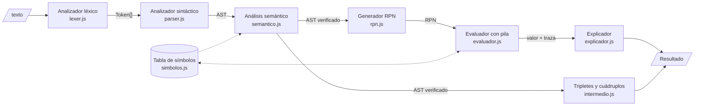
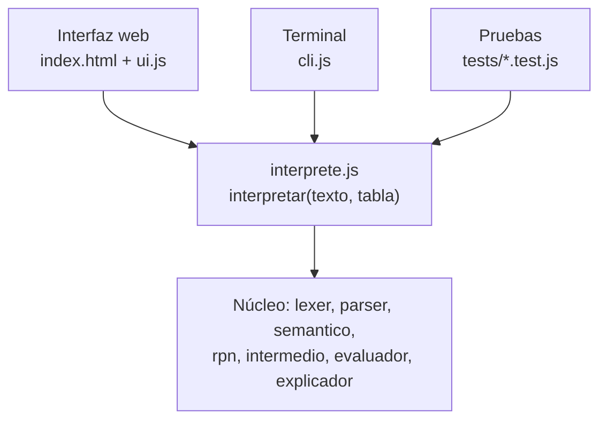

# Fase 3 — Diseño

**Proyecto 04 · Intérprete de expresiones matemáticas**

Este documento describe cómo se organiza el software que implementa la [especificación formal](../fase-2-especificacion/02-especificacion.md): módulos, estructuras de datos, flujo de ejecución, interfaz y plan de pruebas.

---

## 1. Arquitectura

El intérprete es una **tubería de etapas**, igual que las fases de un compilador. Cada etapa recibe la salida de la anterior y es una función pura, salvo el evaluador, que modifica la tabla de símbolos.



Por encima de la tubería hay una **fachada** (`interprete.js`) que ejecuta todas las etapas y devuelve un único objeto con lo que produjo cada una. La interfaz web, la CLI y las pruebas usan solo esa fachada, así que el núcleo no depende de cómo se muestre.



### 1.1 Separación de los errores por etapa

| Etapa | Detecta | Códigos |
|---|---|---|
| Léxico | caracteres no válidos, números incompletos | L01, L02 |
| Sintáctico | estructura incorrecta, destino de asignación inválido, expresión demasiado larga | S01–S07 |
| Semántico (estático, antes de ejecutar) | variable no definida, aridad, asignación a constante | E01, E03, E04 |
| Evaluación (en tiempo de ejecución) | división por cero, dominio, desbordamiento | E02, E05, E06 |

El análisis semántico puede hacerse antes de evaluar porque, dentro de una sentencia, todos los usos de variables están en la expresión de la derecha y se evalúan **antes** de cualquier asignación. Por ejemplo, en `a = b = a + 1` se comprueba que exista `a` antes de calcular nada.

---

## 2. Módulos

| Archivo | Responsabilidad | Entrada | Salida |
|---|---|---|---|
| `src/errores.js` | Clase `ErrorCalc` y catálogo de mensajes | código, columna, datos | excepción |
| `src/tokens.js` | Tipos de token y palabras reservadas | — | constantes |
| `src/lexer.js` | AFD de la sección 1.3 de la especificación | `string` | `Token[]` |
| `src/ast.js` | Constructores de nodos del AST | datos del nodo | `Nodo` |
| `src/parser.js` | Parser descendente recursivo, una función por regla | `Token[]` | `Nodo` |
| `src/simbolos.js` | Tabla de símbolos y funciones predefinidas | — | `TablaSimbolos`, `FUNCIONES` |
| `src/semantico.js` | Verificación estática (E01, E03, E04) | `Nodo`, `TablaSimbolos` | nada, o lanza `ErrorCalc` |
| `src/rpn.js` | Recorrido en postorden → notación polaca inversa | `Nodo` | `ElementoRPN[]` |
| `src/intermedio.js` | Recorrido en postorden → tripletes y cuádruplos | `Nodo` | `Triplete[]`, `Cuadruplo[]` |
| `src/evaluador.js` | Evaluación de la RPN con pila | `ElementoRPN[]`, `TablaSimbolos` | `{ valor, traza, asignaciones }` |
| `src/explicador.js` | Explicación en lenguaje natural | `Resultado` | `string[]` |
| `src/interprete.js` | Fachada que ejecuta la tubería | `string`, `TablaSimbolos` | `Resultado` |
| `src/formato.js` | Presentación de números (10 decimales) y del AST como texto | valores | `string` |
| `src/ui.js` | Lógica de la interfaz web | eventos del DOM | DOM |
| `index.html`, `estilos.css` | Estructura y estilo de la interfaz | — | — |
| `cli.js` | Bucle interactivo en la terminal | líneas de texto | texto |
| `servidor.js` | Servidor estático local (sin dependencias) | — | HTTP en `localhost:8080` |

### 2.1 Interfaces públicas

```js
// lexer.js
tokenizar(texto: string): Token[]                  // lanza ErrorCalc L01, L02
tokenizarConTraza(texto: string): { tokens, traza } // además, cada transición del AFD

// parser.js
analizar(tokens: Token[]): Nodo                    // lanza ErrorCalc S01–S07

// semantico.js
verificar(ast: Nodo, tabla: TablaSimbolos): void   // lanza ErrorCalc E01, E03, E04

// rpn.js
generarRPN(ast: Nodo): ElementoRPN[]

// intermedio.js
generarTripletes(ast: Nodo): Triplete[]
generarCuadruplos(ast: Nodo): Cuadruplo[]

// evaluador.js
evaluarRPN(rpn: ElementoRPN[], tabla: TablaSimbolos): { valor, traza, asignaciones }
                                                   // lanza ErrorCalc E01, E02, E05, E06

// explicador.js
explicar(resultado: Resultado): string[]

// interprete.js
interpretar(texto: string, tabla: TablaSimbolos): Resultado   // nunca lanza
```

---

## 3. Estructuras de datos

### 3.1 Token

```js
{ tipo: 'NUMERO', lexema: '2.5e-3', valor: 0.0025, columna: 1 }
{ tipo: 'IDENT',  lexema: 'x',                     columna: 6 }
{ tipo: 'MAS',    lexema: '+',                     columna: 8 }
```

`tipo` es uno de los definidos en `tokens.js`. `valor` solo existe en `NUMERO`. El último token siempre es `EOF`, con la columna `longitud + 1`.

### 3.2 Nodos del AST

Todos los nodos tienen `id` (entero único, para enlazar el árbol con la traza en la interfaz), `tipo` y `columna`.

| Tipo | Campos propios | Columna que guarda |
|---|---|---|
| `Numero` | `valor`, `lexema` | inicio del número |
| `Variable` | `nombre` | inicio del nombre |
| `Unario` | `op: '-'`, `operando` | el `-` |
| `Binario` | `op`, `izq`, `der`, `implicita: boolean` | el operador, o el inicio del operando derecho si es implícita |
| `Llamada` | `nombre`, `args: Nodo[]` | inicio del nombre de la función |
| `Asignacion` | `nombre`, `valor: Nodo` | inicio del nombre de la variable |

Además, todo nodo puede tener `entreParentesis: true`. Los paréntesis no generan nodo propio, pero el explicador necesita saberlo para decir "se evalúa primero porque está entre paréntesis".

Una `Variable` seguida directamente de `(` en una multiplicación implícita (`foo(3)`) lleva además `seguidaDeParentesis: true`. Si la variable no existe, el análisis semántico usa esa marca para agregar a E01 la pista con las funciones disponibles.

Ejemplo, `2x + 1`:

```js
{ id: 4, tipo: 'Binario', op: '+', columna: 4, implicita: false,
  izq: { id: 3, tipo: 'Binario', op: '*', columna: 2, implicita: true,
         izq: { id: 1, tipo: 'Numero', valor: 2, lexema: '2', columna: 1 },
         der: { id: 2, tipo: 'Variable', nombre: 'x', columna: 2 } },
  der: { id: 5, tipo: 'Numero', valor: 1, lexema: '1', columna: 6 } }
```

### 3.3 Elemento de la RPN

```js
{ clase: 'num',  texto: '2',       valor: 2,                   nodoId: 1, columna: 1 }
{ clase: 'var',  texto: 'x',       nombre: 'x',                nodoId: 2, columna: 2 }
{ clase: 'ref',  texto: '&y',      nombre: 'y',                nodoId: 9, columna: 1 }
{ clase: 'op',   texto: '*',       op: '*',                    nodoId: 3, columna: 2 }
{ clase: 'neg',  texto: 'neg',                                 nodoId: 6, columna: 1 }
{ clase: 'fn',   texto: 'max[2]',  nombre: 'max', aridad: 2,   nodoId: 7, columna: 1 }
{ clase: 'asig', texto: '=',                                   nodoId: 9, columna: 3 }
```

`nodoId` permite resaltar en el árbol el nodo que se está evaluando, y `columna` sirve para reportar errores de ejecución en la posición correcta.

### 3.4 Triplete y cuádruplo

```js
// Triplete: arg1 y arg2 son texto: un número, un nombre, '(k)' o '—'
{ indice: 0, op: '*', arg1: 'b', arg2: 'c' }

// Cuádruplo: resultado es un temporal 't1', una variable o '—'
{ op: '*', arg1: 'b', arg2: 'c', resultado: 't1' }
```

### 3.5 Paso de la traza

```js
{
  paso: 5,
  elemento: '*',                          // texto del elemento RPN
  accion: 'operar',                       // apilar | operar | negar | llamar | asignar
  operandos: [3, 16],
  resultado: 48,
  pilaAntes: [2, 3, 16],
  pilaDespues: [2, 48],
  nodoId: 3,
  descripcion: 'Se desapilan 3 y 16, se calcula 3 * 16 = 48 y se apila el resultado.'
}
```

### 3.6 Tabla de símbolos

```js
class TablaSimbolos {
  existe(nombre): boolean
  obtener(nombre): number          // lanza E01 si no existe
  esConstante(nombre): boolean
  asignar(nombre, valor): void     // lanza E04 si es constante
  variables(): { nombre, valor, constante }[]
  reiniciar(): void                // borra las variables del usuario
}
```

Las funciones predefinidas se describen en una tabla aparte, no en la de símbolos, porque son palabras reservadas:

```js
FUNCIONES = {
  sqrt: { aridadMin: 1, aridadMax: 1, dominio: ([a]) => a >= 0, calcular: ([a]) => Math.sqrt(a) },
  max:  { aridadMin: 1, aridadMax: Infinity, dominio: () => true, calcular: (args) => Math.max(...args) },
  ...
}
```

### 3.7 Resultado de `interpretar`

```js
{
  entrada: 'y = 2x + 1',
  tokens: Token[] | null,
  ast: Nodo | null,
  rpn: ElementoRPN[] | null,
  tripletes: Triplete[] | null,
  cuadruplos: Cuadruplo[] | null,
  traza: PasoTraza[] | null,
  valor: number | null,
  asignaciones: { nombre, valor }[],
  explicacion: string[],
  error: ErrorCalc | null,
  etapaFallida: 'lexico' | 'sintactico' | 'semantico' | 'evaluacion' | null
}
```

Si una etapa falla, las anteriores conservan su resultado y las siguientes quedan en `null`. Así la interfaz puede mostrar, por ejemplo, los tokens de una expresión con error de sintaxis.

Además, `trazaLexica` guarda el recorrido del AFD (`tokenizarConTraza`), y se conserva aunque falle el lexer. Si falla la evaluación, `traza` tiene los pasos ejecutados hasta el error (`ErrorCalc.trazaParcial`), y la interfaz marca en la RPN el elemento que falló.

### 3.8 Error

```js
class ErrorCalc extends Error {
  codigo   // 'S02'
  tipo     // 'léxico' | 'sintáctico' | 'semántico'
  columna  // 7
  pista    // texto opcional, p. ej. la lista de funciones disponibles
}
```

Los mensajes viven en un solo catálogo (`errores.js`) con plantillas como `"Falta ')' para cerrar el '(' de la columna {abre}"`. Así todos los textos de error están en un único lugar y son fáciles de revisar.

---

## 4. Flujo de ejecución

```
interpretar(texto, tabla):
  r ← resultado vacío
  intentar:
    r.tokens     ← tokenizar(texto)                     etapa = léxico
    r.ast        ← analizar(r.tokens)                   etapa = sintáctico
    verificar(r.ast, tabla)                             etapa = semántico
    r.rpn        ← generarRPN(r.ast)
    r.tripletes  ← generarTripletes(r.ast)
    r.cuadruplos ← generarCuadruplos(r.ast)
    {valor, traza, asignaciones} ← evaluarRPN(r.rpn, tabla)   etapa = evaluación
    r.explicacion ← explicar(r)
  si ocurre ErrorCalc e:
    r.error ← e;  r.etapaFallida ← etapa
  devolver r
```

**Evaluación transaccional.** El evaluador anota las asignaciones en una lista temporal y solo las aplica a la tabla de símbolos si toda la evaluación termina sin errores. Así, una expresión que falla nunca deja variables a medio asignar.

### 4.1 Parser descendente recursivo

Una función por regla de la gramática EBNF. Cada una mira el token actual (`actual()`) y consume con `esperar(tipo)`, que lanza el error sintáctico correspondiente si el token no coincide.

```
sentencia():
  izq ← expresion()
  si actual es '=':
    col ← consumir '='
    si izq no es Variable → error S06 en col
    devolver Asignacion(izq.nombre, sentencia())     // recursión → asociatividad derecha
  devolver izq

expresion():
  nodo ← termino()
  mientras actual ∈ {'+', '-'}:
    op ← consumir
    nodo ← Binario(op, nodo, termino())             // pliegue → asociatividad izquierda
  devolver nodo

termino():
  nodo ← unario()
  repetir:
    si actual ∈ {'*', '/', '%'}:      op ← consumir; nodo ← Binario(op, nodo, unario())
    si actual ∈ {IDENT, FUNCION, '('}: nodo ← Binario('*', nodo, potenciaDesde(atomo()), implícita)
    si no: salir
  devolver nodo

analizar(tokens):
  ast ← sentencia()
  si actual no es EOF → error S03 (sobra un token o falta un operador)
  devolver ast
```

### 4.2 Explicador

Para cada paso de la traza que hace una operación, el explicador busca el nodo en el AST y su padre, y elige el motivo con estas reglas, en orden:

| Condición | Motivo que muestra |
|---|---|
| El nodo está entre paréntesis | "porque está entre paréntesis" |
| Es `Binario` con `implicita` | "multiplicación implícita: `2x` equivale a `2 * x`" |
| El padre es un operador de menor precedencia | "porque `*` tiene mayor precedencia que `+`" |
| El padre es el mismo nivel y el nodo es el hijo izquierdo | "por asociatividad izquierda, se resuelve primero la operación de la izquierda" |
| Es `^` y es el hijo derecho de otro `^` | "por asociatividad derecha, la potencia se resuelve de derecha a izquierda" |
| Es `Unario` | "menos unario: cambia el signo" |
| Es `Llamada` | "se aplica la función `sqrt` a su argumento" |

Ejemplo, con `2 + 3 * 4 ^ 2`:

1. Se reconocieron 7 tokens: `2`, `+`, `3`, `*`, `4`, `^`, `2`.
2. Se calcula `4 ^ 2 = 16` primero, porque `^` tiene mayor precedencia que `*`.
3. Se calcula `3 * 16 = 48`, porque `*` tiene mayor precedencia que `+`.
4. Se calcula `2 + 48 = 50`.
5. Resultado: **50**.

---

## 5. Interfaz web

### 5.1 Boceto

```
┌────────────────────────────────────────────────────────────────────────┐
│  Calculadora explicativa                                               │
├────────────────────────────────────────────────────────────────────────┤
│  ┌──────────────────────────────────────────────────────┐ ┌──────────┐ │
│  │ 2 + 3 * 4 ^ 2                                        │ │ Evaluar  │ │
│  └──────────────────────────────────────────────────────┘ └──────────┘ │
│  Ejemplos: [2+3*4] [2^3^2] [-2^2] [2x] [(x+1)(x-1)] [sqrt(16)+max(2,7)] │
│                                                                        │
│  ┌ Resultado ─────────────┐  ┌ Variables ───────────────────────────┐  │
│  │          50            │  │ pi  3.1415926536  (constante)        │  │
│  └────────────────────────┘  │ e   2.7182818285  (constante)        │  │
│                              │ x   3                         [borrar]│  │
│                              └──────────────────────────────────────┘  │
│  [ Tokens ] [ Árbol ] [ Código intermedio ] [ Evaluación ] [ Explicación ]
│  ┌──────────────────────────────────────────────────────────────────┐  │
│  │            (+)                     Paso 3 de 7                    │  │
│  │           /   \                    Elemento: ^                    │  │
│  │         2     (*)                  Pila: [2, 3, 4, 2] → [2, 3, 16]│  │
│  │              /   \                                                │  │
│  │             3    [^]  ← resaltado  "4 ^ 2 = 16, porque ^ tiene    │  │
│  │                 /   \               mayor precedencia que *"      │  │
│  │                4     2                                            │  │
│  │                                    [⏮] [◀] [▶] [⏭] [▶ Reproducir]│  │
│  └──────────────────────────────────────────────────────────────────┘  │
│  Historial: 2 + 3 * 4 ^ 2 = 50 · x = 3 · 2x = 6                        │
└────────────────────────────────────────────────────────────────────────┘
```

Con un error, aparece un aviso debajo de la entrada y el carácter culpable se subraya:

```
  ( 2 + 3
         ^
  S02 · Error sintáctico: falta ')' para cerrar el '(' de la columna 1 (columna 7).
```

### 5.2 Pestañas

| Pestaña | Contenido |
|---|---|
| Tokens | Una ficha por token, con un color por tipo (número, identificador, función, operador) y su columna. |
| Árbol | AST dibujado en SVG. Cada nodo se colorea por tipo y las multiplicaciones implícitas se marcan con línea punteada. |
| Código intermedio | Tres subtablas: RPN, tripletes y cuádruplos. |
| Evaluación | Traza paso a paso con la pila dibujada como columna de celdas. Se avanza con botones o con las flechas del teclado, y el nodo del paso actual se resalta en el árbol. |
| Explicación | La lista de frases del explicador. |

**Diseño visual (versión final).** Las pestañas se muestran como una línea de 5 etapas numeradas. Cada etapa se marca como completada (✓ verde), fallida (✕ roja) o no alcanzada según `etapaFallida`, así el usuario ve de un vistazo en qué fase del compilador se detuvo la expresión. Hay además:
- un botón de tema claro u oscuro, que se recuerda en `localStorage` y, si no hay elección, sigue la preferencia del sistema;
- aristas curvas en el árbol, con el valor calculado de cada nodo en una insignia;
- una pila dibujada como recipiente, con una animación al apilar y una barra de progreso de la traza;
- la explicación como línea de tiempo, con el cálculo de cada paso resaltado.

Las animaciones se desactivan con `prefers-reduced-motion`.

### 5.3 Dibujo del árbol

Algoritmo sencillo en dos pasadas, sin librerías:
1. **Posición horizontal:** recorrido en inorden. Cada hoja ocupa la siguiente columna libre y cada nodo interno se centra entre su primer y su último hijo.
2. **Posición vertical:** profundidad del nodo × separación fija.

Después se dibujan las aristas (`<line>`) y los nodos (`<circle>` + `<text>`). El tamaño del SVG se ajusta al número de hojas y a la profundidad.

### 5.4 Ejecución en el navegador

Los navegadores bloquean los módulos ES (`<script type="module">`) cuando la página se abre con doble clic (`file://`). Por eso se incluye `servidor.js`, un servidor estático de unas 30 líneas que usa solo `node:http`:

```bash
npm start        # sirve la carpeta en http://localhost:8080
```

Alternativa sin Node: `python -m http.server 8080`.

Esto ajusta la decisión de la Fase 1 ("basta con abrirla en el navegador"): sigue sin haber dependencias, pero hace falta ese único comando.

### 5.5 Terminal (`cli.js`)

```
$ npm run cli
calc> 2 + 3 * 4
  Tokens:    2  +  3  *  4
  RPN:       2 3 4 * +
  Tripletes: (0) * 3 4 | (1) + 2 (0)
  Pila:      [2] → [2,3] → [2,3,4] → [2,12] → [14]
  = 14
calc> :vars      muestra la tabla de símbolos
calc> :ayuda     muestra la sintaxis
calc> :salir
```

---

## 6. Plan de pruebas

Se usa `node --test`, sin dependencias. Los 38 casos de la especificación se guardan una sola vez en `tests/casos.js` y los usan varias pruebas.

| Archivo | Qué verifica | Fase |
|---|---|---|
| `tests/lexer.test.js` | Tokens y columnas, notación científica, retroceso con `e`, funciones reservadas, L01 y L02 | 4.1 |
| `tests/parser.test.js` | Forma del AST: precedencia, asociatividad, unarios, implícita, asignación encadenada, S01–S07 | 4.2 |
| `tests/semantico.test.js` | E01, E03 y E04 antes de evaluar | 4.2 |
| `tests/rpn.test.js` | RPN de los casos 1–24 | 4.3 |
| `tests/intermedio.test.js` | Tripletes y cuádruplos de los ejemplos de la sección 4.4 | 4.3 |
| `tests/evaluador.test.js` | Valores, traza de la pila, E02, E05, E06, evaluación transaccional | 4.3 |
| `tests/interprete.test.js` | Los 38 casos de extremo a extremo, en orden y en una misma sesión | 4.3 |

El criterio de salida de la Fase 4 es que `npm test` pase completo.

---

## 7. Orden de implementación (Fase 4)

| Hito | Archivos |
|---|---|
| 4.1 Lexer | `errores.js`, `tokens.js`, `lexer.js`, `tests/lexer.test.js` |
| 4.2 Parser + semántico | `ast.js`, `parser.js`, `simbolos.js`, `semantico.js`, `formato.js` (AST como texto), pruebas |
| 4.3 Intermedio, evaluación, explicación e interfaz | `rpn.js`, `intermedio.js`, `evaluador.js`, `explicador.js`, `interprete.js`, `ui.js`, `index.html`, `estilos.css`, `cli.js`, `servidor.js`, pruebas |
