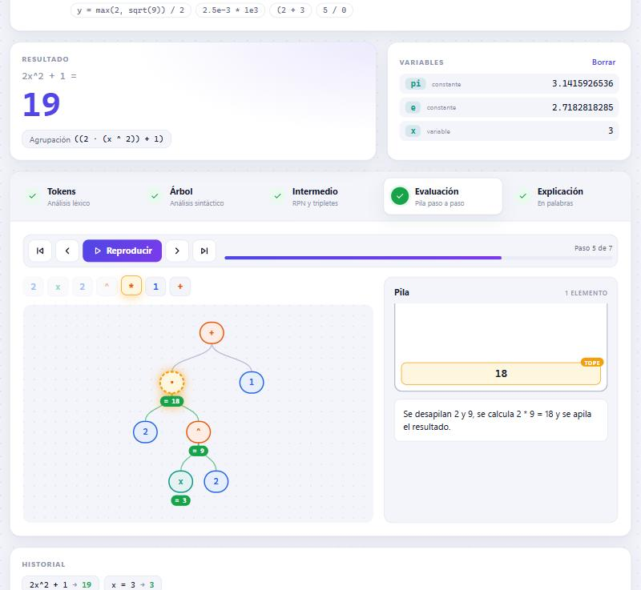
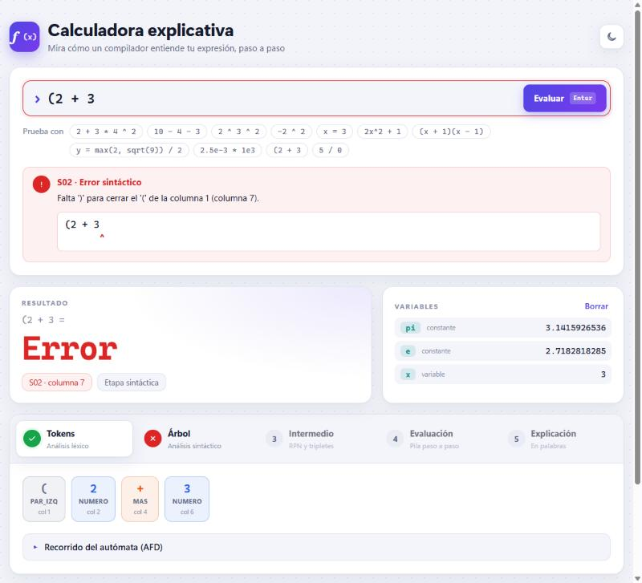

# Fase 4 — Implementación

**Proyecto 04 · Intérprete de expresiones matemáticas**

Este documento describe cómo se construyó el intérprete a partir de la especificación formal (Fase 2) y del diseño (Fase 3): la tecnología usada, la organización del código, lo que se implementó en cada paso del plan, la interfaz web, la terminal y los cambios que surgieron respecto al diseño.

---

## 1. Resumen

| Aspecto | Resultado |
|---|---|
| Lenguaje | JavaScript con módulos ES, ejecutado en el navegador y en Node.js 22 |
| Dependencias externas | Ninguna: no hay librerías, ni de parsing ni de interfaz |
| Uso de `eval()` o `Function()` | Ninguno: toda la lógica central está implementada a mano |
| Núcleo del intérprete | 13 módulos, 1449 líneas |
| Interfaz web | `index.html`, `estilos.css` y `ui.js`: 1580 líneas |
| Pruebas automáticas | 9 archivos, 1208 líneas y 266 pruebas, todas en verde |
| Cobertura del núcleo | 99.03 % de líneas, 95.99 % de ramas, 94.87 % de funciones |

---

## 2. Organización del código

Todo el código está en la carpeta `fase-4-implementacion/`. El núcleo (`src/`) no depende de la interfaz: la página web, la terminal y las pruebas usan la misma fachada, `interpretar()`.

| Archivo | Líneas | Responsabilidad |
|---|---|---|
| `src/tokens.js` | 53 | Tipos de token y palabras reservadas |
| `src/errores.js` | 80 | Clase `ErrorCalc` y catálogo de los 15 códigos de error |
| `src/lexer.js` | 201 | Analizador léxico: AFD con tabla de transiciones y retroceso |
| `src/ast.js` | 76 | Constructores de los nodos del árbol sintáctico |
| `src/parser.js` | 214 | Analizador sintáctico descendente recursivo LL(1) |
| `src/simbolos.js` | 88 | Tabla de símbolos y funciones predefinidas |
| `src/semantico.js` | 63 | Verificación semántica estática |
| `src/rpn.js` | 69 | Traducción a notación polaca inversa |
| `src/intermedio.js` | 110 | Traducción a tripletes y cuádruplos |
| `src/evaluador.js` | 185 | Evaluación de la RPN con pila |
| `src/explicador.js` | 150 | Explicación en lenguaje natural |
| `src/formato.js` | 86 | Presentación de números y del árbol como texto |
| `src/interprete.js` | 74 | Fachada que ejecuta todas las etapas |
| `src/ui.js` | 798 | Lógica de la interfaz web |
| `index.html`, `estilos.css` | 782 | Estructura y estilos de la interfaz |
| `cli.js` | 122 | Calculadora en la terminal |
| `servidor.js` | 50 | Servidor estático local para la interfaz |
| `tests/` | 1208 | Pruebas automáticas y casos de la especificación |

---

## 3. Desarrollo por pasos

La implementación siguió los cuatro pasos del plan de la Fase 3, de abajo hacia arriba: cada paso empezó cuando pasaron las pruebas del anterior.

### 3.1 Paso 1: análisis léxico

Se implementaron los tipos de token, el catálogo de errores y el autómata finito determinista de la especificación. El autómata no usa expresiones regulares: es una tabla de transiciones explícita, una fila por estado y una columna por clase de carácter.

```js
export const TRANSICIONES = Object.freeze({
  q0: fila(L01, { [DIGITO]: 'q1', [EXPONENTE]: 'q7', [LETRA]: 'q7', [SIGNO]: 'q8', [OPERADOR]: 'q8', [BLANCO]: 'q0' }),
  q1: fila(FIN, { [DIGITO]: 'q1', [EXPONENTE]: 'q4', [PUNTO]: 'q2' }),
  q2: fila(L02, { [DIGITO]: 'q3' }),
  q3: fila(FIN, { [DIGITO]: 'q3', [EXPONENTE]: 'q4' }),
  q4: fila(RETROCESO, { [DIGITO]: 'q6', [SIGNO]: 'q5' }),
  q5: fila(RETROCESO, { [DIGITO]: 'q6' }),
  q6: fila(FIN, { [DIGITO]: 'q6' }),
  q7: fila(FIN, { [DIGITO]: 'q7', [EXPONENTE]: 'q7', [LETRA]: 'q7' }),
  q8: fila(FIN),
});
```

Cada celda es un estado nuevo o una acción:
- **fin:** emite el token del estado actual.
- **retroceso:** vuelve al último estado de aceptación. Así `2e` se lee como `2` seguido de la constante `e`, y `2e+1` como el número 20.
- **L01** y **L02:** son errores léxicos con su columna.

Además, `tokenizarConTraza()` registra cada transición para que la interfaz muestre el recorrido del autómata.

**Pruebas:** `lexer.test.js` (48) y `errores.test.js` (6).

### 3.2 Paso 2: análisis sintáctico y semántico

El parser tiene una función por cada regla de la gramática. La precedencia sale de cómo se llaman entre sí, y la asociatividad, de cómo se construye cada nodo:

```js
// expresion → termino ( ( '+' | '-' ) termino )*
expresion() {
  let nodo = this.termino();
  while (this.es(T.MAS, T.MENOS)) {
    const op = this.consumir();
    // Pliegue por la izquierda → asociatividad izquierda: (10 - 4) - 3.
    nodo = crearBinario(op.lexema, nodo, this.termino(), op.columna);
  }
  return nodo;
}
```

```js
potenciaResto(base) {
  if (!this.es(T.POT)) return base;
  const op = this.consumir();
  // El exponente es un 'unario': admite signo (2 ^ -1) y, como 'unario' llega
  // de nuevo a 'potencia', la potencia asocia por la derecha: 2 ^ (3 ^ 2).
  return crearBinario('^', base, this.unario(), op.columna);
}
```

- **Suma y resta:** el ciclo de `expresion` envuelve lo ya construido, así que el árbol crece hacia la izquierda.
- **Potencia:** la llamada a `unario` resuelve primero el lado derecho, así que el árbol crece hacia la derecha.
- **Multiplicación implícita:** está en `termino` y solo se activa si lo que sigue es una variable, una función o un paréntesis.

En este paso también se implementaron la tabla de símbolos, con `pi` y `e` como constantes, las 10 funciones con su aridad y su dominio, y la verificación semántica de los errores E01, E03 y E04 antes de evaluar.

**Pruebas:** `parser.test.js` (63), `semantico.test.js` (23) y `formato.test.js` (5).

### 3.3 Paso 3: código intermedio y evaluación

Los tres formatos de código intermedio se generan recorriendo el árbol en postorden. Para los tripletes y los cuádruplos, la función `dir` emite las instrucciones de cada subárbol y devuelve dónde queda su resultado:

```js
const dir = (n) => {
  switch (n.tipo) {
    case TIPOS_NODO.NUMERO: return n.lexema;
    case TIPOS_NODO.VARIABLE: return n.nombre;
    case TIPOS_NODO.UNARIO: return emitir('neg', dir(n.operando));
    case TIPOS_NODO.BINARIO: {
      const a = dir(n.izq);
      const b = dir(n.der);
      return emitir(n.op, a, b);
    }
    case TIPOS_NODO.LLAMADA: {
      const args = n.args.map(dir);
      args.forEach((a) => emitir('param', a));
      return emitir('call', n.nombre, String(args.length));
    }
    ...
```

El evaluador ejecuta la notación polaca con una pila y detecta los errores que dependen de los valores. Este es el caso de un operador binario:

```js
const d = pila.pop();
const i = pila.pop();
if ((el.op === '/' || el.op === '%') && d === 0) {
  throw new ErrorCalc('E02', el.columna);
}
if (el.op === '^' && i === 0 && d < 0) {
  throw new ErrorCalc('E02', el.columna);   // 0 ^ -1 = 1 / 0
}
const r = OPERACIONES[el.op](i, d);
if (Number.isNaN(r)) {
  // p. ej. (-8) ^ (1/3): potencia de base negativa con exponente no entero
  throw new ErrorCalc('E05', el.columna, { funcion: el.op, valor: `${f(i)} ${el.op} ${f(d)}` });
}
comprobarFinito(r, el);
pila.push(r);
```

Cada paso queda registrado con la pila antes y después. Las asignaciones solo se aplican a la tabla de símbolos si toda la evaluación termina sin errores: la evaluación es **transaccional**. Si hay un error, la traza parcial se conserva para mostrar dónde se detuvo.

**Pruebas:** `intermedio.test.js` (42) y `evaluador.test.js` (23).

### 3.4 Paso 4: explicación e interfaces

El explicador recorre la traza y, para cada operación, compara el nodo con su padre en el árbol para decir por qué se calcula en ese momento. La fachada `interpretar()` une todas las etapas: nunca deja escapar un error del usuario, lo devuelve con la etapa donde ocurrió y conserva lo que produjeron las etapas anteriores.

Sobre esa fachada se construyeron la interfaz web, la terminal y el servidor local, descritos en las secciones 4, 5 y 6.

**Pruebas:** `interprete.test.js` (56), que ejecuta los 38 casos de la especificación en orden y en una misma sesión.

---

## 4. Interfaz web

La interfaz es una sola página, sin frameworks. Todo el contenido se crea con nodos del DOM, nunca con `innerHTML`, así que nada de lo que escribe el usuario se interpreta como HTML.

| Elemento | Funcionalidad |
|---|---|
| Entrada | Se escribe la expresión y se evalúa con el botón o con Enter. Tiene 11 ejemplos de un clic. |
| Resultado | Muestra la expresión, el valor, la agrupación con todos los paréntesis y las variables que se guardaron. |
| Variables | Muestra la tabla de símbolos con `pi`, `e` y las variables del usuario, y un botón para borrarlas. |
| Etapas | Cinco pasos: tokens, árbol, intermedio, evaluación y explicación. Cada uno se marca en verde si se completó y en rojo si falló. |
| Tokens | Una ficha por token y el recorrido del autómata, transición por transición. |
| Árbol | Árbol sintáctico en SVG, con colores por tipo de nodo y borde punteado en la multiplicación implícita. |
| Intermedio | Notación polaca inversa, tabla de tripletes y tabla de cuádruplos. |
| Evaluación | La pila paso a paso, con controles, reproducción automática, barra de progreso y el nodo activo resaltado en el árbol. |
| Explicación | Línea de tiempo con el motivo de cada operación. |
| Errores | Código, tipo, mensaje y columna, con el carácter culpable marcado en la entrada. |
| Historial | Las últimas 20 expresiones, para volver a cargarlas con un clic. |
| Tema | Claro u oscuro. Recuerda la elección y respeta la preferencia del sistema y la reducción de movimiento. |





---

## 5. Terminal

La terminal usa la misma fachada que la página web. Funciona de dos formas:

```bash
npm run cli
node fase-4-implementacion/cli.js "2 + 3 * 4" "x = 3"
```

La primera abre una sesión interactiva con los comandos `:vars`, `:borrar`, `:ayuda` y `:salir`. La segunda evalúa las expresiones dadas y termina. Para cada expresión imprime:

```
calc> 2 + 3 * 4
  Tokens:      2  +  3  *  4
  Agrupación:  (2 + (3 * 4))
  Árbol:
    +
    ├── 2
    └── *
        ├── 3
        └── 4
  RPN:         2 3 4 * +
  Tripletes:   (0) * 3 4 | (1) + 2 (0)
  Cuádruplos:  (*, 3, 4, t1) | (+, 2, t1, t2)
  Pila:        [2] → [2, 3] → [2, 3, 4] → [2, 12] → [14]
  Explicación:
    - Se calcula 3 * 4 = 12, porque * tiene mayor precedencia que +.
    - Por último, se calcula 2 + 12 = 14.
  = 14
```

---

## 6. Servidor local

Los navegadores bloquean los módulos ES cuando la página se abre con doble clic, así que `servidor.js` sirve la carpeta en http://localhost:8080. Usa solo `node:http`, atiende únicamente en la máquina local e impide salir de la carpeta del proyecto.

---

## 7. Cambios respecto al diseño

| Cambio | Motivo |
|---|---|
| `tokenizarConTraza()` además de `tokenizar()` | Para mostrar en la interfaz el recorrido del autómata, también cuando hay un error léxico. |
| Marca `seguidaDeParentesis` en las variables | Para sugerir las funciones disponibles cuando aparece un nombre desconocido seguido de `(`, como en `foo(3)`. |
| Traza parcial en los errores de ejecución | Para que la evaluación muestre la pila hasta el elemento que falló. |
| Error S07 y límite de 1000 tokens | Una expresión con unos 3000 paréntesis anidados desbordaba la pila de llamadas de JavaScript. El parser ahora la rechaza con un error controlado. |
| Notación científica para valores menores que 1e-6 | Para que `1e-15` no se muestre como `0` al redondear a 10 decimales. |
| Etapas en lugar de pestañas en la interfaz | Para mostrar de un vistazo en qué etapa falló una expresión. |

---

## 8. Cómo ejecutarlo

No hace falta instalar nada: solo se necesita Node.js 22 o superior. Todos los comandos se ejecutan desde la carpeta raíz del proyecto.

| Comando | Qué hace |
|---|---|
| `npm start` | Sirve la interfaz web en http://localhost:8080 |
| `npm run cli` | Abre la calculadora en la terminal |
| `npm test` | Ejecuta las 266 pruebas |
| `npm run cobertura` | Ejecuta las pruebas con el reporte de cobertura |

---

## 9. Resultado de las pruebas

| Archivo | Paso | Pruebas | Resultado |
|---|---|---|---|
| `lexer.test.js` | 1 | 48 | todas pasan |
| `errores.test.js` | 1 | 6 | todas pasan |
| `parser.test.js` | 2 | 63 | todas pasan |
| `semantico.test.js` | 2 | 23 | todas pasan |
| `formato.test.js` | 2 | 5 | todas pasan |
| `intermedio.test.js` | 3 | 42 | todas pasan |
| `evaluador.test.js` | 3 | 23 | todas pasan |
| `interprete.test.js` | 4 | 56 | todas pasan |
| **Total** | | **266** | **todas pasan** |

La validación completa (casos de la especificación, cobertura por módulo, revisión de la interfaz y cumplimiento de la rúbrica) está en el documento de la Fase 5.
