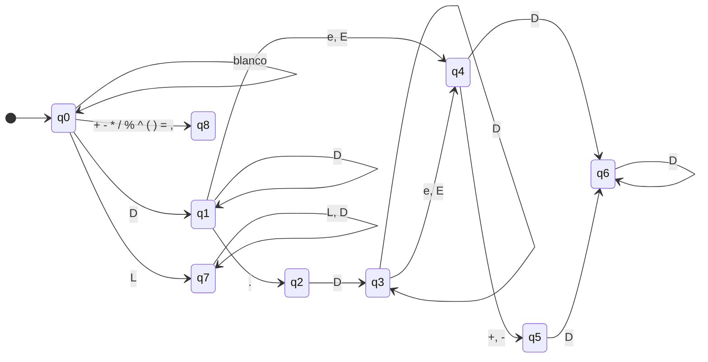
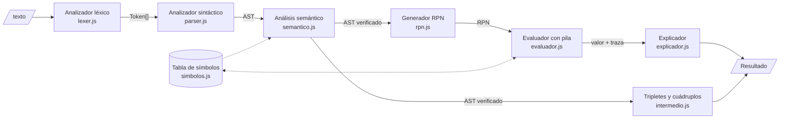
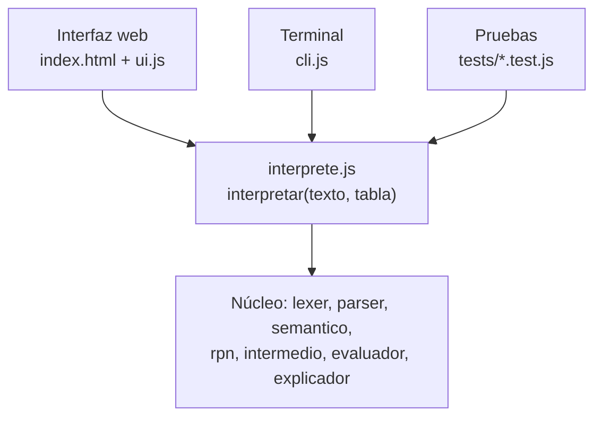

# Documento técnico
## Calculadora explicativa: intérprete de expresiones matemáticas

| | |
|---|---|
| Asignatura | Compiladores, proyecto integrador |
| Proyecto | 04 · Intérprete de expresiones matemáticas (nivel medio) |
| Unidades PAT | 2 (análisis de lenguajes) y 3 (código intermedio) |
| Integrantes | *[completar]* |
| Fecha | 19 de octubre de 2026 |

**Producto:** calculadora que explica cómo evalúa expresiones. Muestra tokens, árbol sintáctico, notación polaca inversa, tripletes, cuádruplos, la pila de evaluación paso a paso y una explicación en lenguaje natural.

## Índice

1. Problema y alcance
2. Especificación formal
3. Diseño
4. Validación
A. Anexo: casos de prueba
B. Anexo: sesión de la terminal

El guion de sustentación está aparte, en `fase-5-validacion/05-sustentacion.md`.

---

# Fase 1 — Problema y alcance

---

## 1. Problema

Las calculadoras comunes reciben una expresión como `2 + 3 * 4 ^ 2` y devuelven `50`, pero no muestran **cómo** llegaron a ese resultado. Para quien la usa, el proceso es una caja negra:

- No se ve que `^` se resuelve antes que `*`, y `*` antes que `+` (**precedencia**).
- No se ve por qué `10 - 4 - 3` da `3` y no `9`, ni por qué `2 ^ 3 ^ 2` da `512` y no `64` (**asociatividad**).
- Si la expresión está mal escrita (`3 + * 4`, `(2 + 3`), solo aparece "Error", sin decir **dónde** ni **por qué**.

Precisamente ese proceso es el que hace un compilador: separar el texto en tokens, comprobar que cumpla una gramática, construir un árbol y traducirlo a una forma intermedia que una máquina evalúa. Este proyecto hace visible ese proceso.

## 2. Solución propuesta

Una **calculadora que explica cómo evalúa expresiones**. Para cada entrada muestra:

1. **Tokens** reconocidos por el analizador léxico.
2. **Árbol sintáctico** (AST) construido por el analizador sintáctico.
3. **Código intermedio** en tres formas: notación polaca inversa (RPN), tripletes y cuádruplos.
4. **Traza de evaluación** con el estado de la pila en cada paso.
5. **Resultado**, o un **error explicado** con su tipo y la columna exacta.

## 3. Usuarios

| Usuario | Para qué la usa |
|---|---|
| Estudiantes de Compiladores | Ver en funcionamiento el análisis léxico y sintáctico, el AST y el código intermedio. |
| Estudiantes de matemáticas básicas | Entender el orden de las operaciones con ejemplos propios. |
| Docentes | Proyectar ejemplos en clase y mostrar errores típicos. |

## 4. Objetivos

**Objetivo general.** Desarrollar un intérprete de expresiones matemáticas que tokenice, analice y evalúe expresiones con operadores, variables y paréntesis, y explique paso a paso cada etapa del proceso.

**Objetivos específicos.**

1. Implementar un **analizador léxico** basado en un autómata finito determinista que reconozca los tokens del lenguaje y reporte errores léxicos con su posición.
2. Implementar un **analizador sintáctico descendente recursivo** (LL(1)) a partir de una gramática libre de contexto que respete la precedencia y la asociatividad de los operadores.
3. Generar el **árbol sintáctico** y traducirlo a **código intermedio** (notación polaca inversa, tripletes y cuádruplos). Evaluar la RPN con una **pila**.
4. Presentar una **explicación paso a paso** de la evaluación en una interfaz web, junto con mensajes de error comprensibles.

## 5. Alcance

### 5.1 Incluido

| Elemento | Detalle | Ejemplo |
|---|---|---|
| Números | Enteros y decimales | `42`, `3.14`, `0.5` |
| Notación científica | Exponente `e`/`E` con signo opcional | `1e10`, `2.5E-3`, `6.02e+23` |
| Operadores binarios | `+ - * / %` y potencia `^` | `7 % 3`, `2 ^ 10` |
| Multiplicación implícita | Factores yuxtapuestos cuando el de la derecha es variable, función o paréntesis. Misma precedencia y asociatividad que `*`. | `2x`, `3(4 + 1)`, `(a + b)(a - b)`, `2 sqrt(9)`, `x y` |
| Menos unario | Negación, incluso anidada | `-5`, `-(2 + 3)`, `--4` |
| Paréntesis | Anidamiento arbitrario | `((1 + 2) * (3 - 4))` |
| Variables | Asignación y uso; persisten durante la sesión | `x = 3`, luego `2 * x + 1` |
| Constantes | Predefinidas | `pi`, `e` |
| Funciones | `sqrt, abs, sin, cos, tan, ln, log, min, max, round` (palabras reservadas) | `sqrt(16) + max(2, 7)` |
| Código intermedio | RPN, tripletes `(op, arg1, arg2)` y cuádruplos `(op, arg1, arg2, temporal)` | `a = b * c + d` → `(0) * b c`, `(1) + (0) d`, `(2) = a (1)` |
| Errores léxicos | Carácter no válido | `3 + $` |
| Errores sintácticos | Estructura incorrecta | `3 + * 4`, `(2 + 3` |
| Errores semánticos | Variable no definida, división por cero, función desconocida o con aridad incorrecta | `y + 1`, `5 / 0`, `sqrt(1, 2)` |

### 5.2 Fuera de alcance

- Números complejos y fracciones exactas.
- Multiplicación implícita con un número a la derecha (`2 3`, `x 2`, `(1)2`): se reporta como error sintáctico porque es ambigua.
- Optimización del código intermedio (eliminación de subexpresiones comunes, plegado de constantes).
- Cálculo simbólico: derivadas, simplificación, resolución de ecuaciones.
- Matrices, vectores, definición de funciones por el usuario.
- Persistencia de variables entre sesiones.

## 6. Componentes técnicos de compiladores

La guía exige justificar al menos dos componentes técnicos centrales. Este proyecto aplica cuatro:

| Componente | Tema del PAT | Uso en el proyecto |
|---|---|---|
| Autómata finito determinista | Unidad 1-2 · Análisis léxico | Reconocer números (también en notación científica), identificadores, palabras reservadas y operadores. |
| Gramática libre de contexto + parser LL(1) | Unidad 2 · Análisis sintáctico | Validar la estructura, resolver la multiplicación implícita y construir el AST con la precedencia correcta. |
| Notación polaca inversa + pila | Unidad 3 · Código intermedio | Traducir el AST a una forma lineal y evaluarla. |
| Tripletes y cuádruplos | Unidad 3 · Código intermedio | Representar la expresión como código de tres direcciones. |

Como **regla del proyecto**, toda la lógica central se implementa a mano. No se usa `eval()`, `Function()` ni librerías de parsing.

## 7. Restricciones y decisiones técnicas

| Decisión | Elección | Justificación |
|---|---|---|
| Lenguaje | JavaScript (módulos ES) | El mismo código corre en el navegador (demo) y en Node.js (pruebas y terminal). |
| Dependencias | Ninguna | Se demuestra que la lógica es propia y el proyecto funciona sin instalar nada. |
| Interfaz | Página web local | Permite dibujar el árbol y la pila. Se sirve con `npm start` (ver diseño, sección 5.4). |
| Pruebas | `node --test` (incluido en Node.js 22) | No requiere frameworks externos. |
| Aritmética | Punto flotante de 64 bits (`Number`) | Suficiente para el alcance. La precisión se documenta como limitación. |

## 8. Estructura del repositorio

```
Calculadora/
├── README.md, PLAN.md, package.json
├── fase-1-problema/          Este documento
├── fase-2-especificacion/    Modelo formal
├── fase-3-diseno/            Arquitectura y modelos
├── fase-4-implementacion/    Código: src/, tests/, index.html, cli.js, servidor.js
│   └── src/                  lexer, parser, semantico, rpn, intermedio, evaluador, explicador, interprete, ui
└── fase-5-validacion/        Validación, sustentación, evidencias y documento técnico
```

Cada fase tiene su propia carpeta. Los archivos de `src/`, `index.html` y `cli.js` se crean en las fases 3 y 4. La lista completa de módulos está en el [diseño](../fase-3-diseno/03-diseno.md#2-módulos).

## 9. Criterios de éxito

El proyecto se considera logrado si:

1. Evalúa correctamente todas las expresiones de la tabla de casos de prueba de la Fase 2.
2. `2 + 3 * 4` → `14`, `10 - 4 - 3` → `3`, `2 ^ 3 ^ 2` → `512` y `-2 ^ 2` → `-4`.
3. Con `x = 3`: `2x` → `6`, `(x + 1)(x - 1)` → `8`, `1 / 2x` → `1.5`. Además, `2.5e-3 * 1e3` → `2.5`.
4. Todo error indica tipo (léxico, sintáctico o semántico), mensaje y columna.
5. Cada evaluación muestra tokens, árbol, RPN, tripletes, cuádruplos, traza de la pila y resultado.
6. Funciona sin instalar dependencias.

## 10. Riesgos

| Riesgo | Mitigación |
|---|---|
| Ambigüedad del `-` (binario o unario) | Se resuelve en la gramática con la regla `unario`, no en el lexer. |
| Asociatividad de `^` mal implementada | Regla gramatical con recursión por la derecha y pruebas dedicadas. |
| Dibujar el árbol en la web consume tiempo | Primero una versión textual con sangría; el SVG se agrega después. |
| `x(3)`: ¿llamada a función o `x * 3`? | Las funciones son palabras reservadas que reconoce el lexer. Por eso `x(3)` siempre es `x * 3`. |
| `1 / 2x`: ¿`(1/2)·x` o `1/(2x)`? | La multiplicación implícita tiene la misma precedencia que `*` y asocia por la izquierda, así que da `(1/2)·x`. La interfaz lo muestra en el árbol para que no haya sorpresas. |
| `2e`, `2e+1`: ¿notación científica o la constante `e`? | El lexer aplica la coincidencia más larga: `2e+1` es `20`. Si después de la `e` no viene un dígito (`2e`, `2e + x`), se toma como `2 · e`. |
| Errores de redondeo (`0.1 + 0.2`) | Se muestra el resultado redondeado a 10 decimales y se documenta la limitación. |

---

# Fase 2 — Especificación formal

Este documento define el lenguaje que acepta la calculadora: su léxico, su sintaxis, su semántica y el código intermedio que genera. Todo el código de la Fase 4 se implementa a partir de esta especificación.

Convenciones:
- Las columnas se cuentan desde 1.
- `ε` es la cadena vacía y `$` el fin de la entrada (token `EOF`).
- En la gramática, `num`, `id` y `fn` abrevian los tokens `NUMERO`, `IDENT` y `FUNCION`.

---

## 1. Análisis léxico

### 1.1 Alfabeto

| Clase | Caracteres |
|---|---|
| Dígito `D` | `0`–`9` |
| Letra `L` | `a`–`z`, `A`–`Z`, `_` |
| Operadores y signos | `+ - * / % ^ ( ) = ,` |
| Punto | `.` |
| Blancos | espacio, tabulador (se ignoran) |

Cualquier otro carácter produce el error léxico **L01**.

### 1.2 Tokens

| Token | Expresión regular | Ejemplos |
|---|---|---|
| `NUMERO` | `[0-9]+(\.[0-9]+)?([eE][+-]?[0-9]+)?` | `42`, `3.14`, `1e10`, `2.5E-3` |
| `FUNCION` | `sqrt \| abs \| sin \| cos \| tan \| ln \| log \| min \| max \| round` | `sqrt`, `max` |
| `IDENT` | `[A-Za-z_][A-Za-z0-9_]*` (que no sea `FUNCION`) | `x`, `total`, `x2`, `pi` |
| `MAS` | `\+` | `+` |
| `MENOS` | `-` | `-` |
| `POR` | `\*` | `*` |
| `DIV` | `/` | `/` |
| `MOD` | `%` | `%` |
| `POT` | `\^` | `^` |
| `PAR_IZQ` | `\(` | `(` |
| `PAR_DER` | `\)` | `)` |
| `ASIGNA` | `=` | `=` |
| `COMA` | `,` | `,` |
| `EOF` | fin de la entrada | |

Cada token guarda: `tipo`, `lexema`, `valor` (solo `NUMERO`) y `columna` (la de su primer carácter).

Notas:
- **Funciones como palabras reservadas.** El lexer reconoce un identificador y lo busca en la tabla de funciones. Si está, emite `FUNCION`; si no, `IDENT`. Así `x(3)` siempre es `x · 3`.
- **Constantes.** `pi` y `e` son `IDENT` predefinidos de solo lectura en la tabla de símbolos, no tokens especiales.
- **`xy` es un solo identificador**, no `x · y`. Para multiplicar se escribe `x y` o `x*y`.
- El `-` siempre es `MENOS`. Decidir si es binario o unario le corresponde a la gramática, no al lexer.

### 1.3 Autómata finito determinista



| Estado | Significado | ¿Acepta? | Token |
|---|---|---|---|
| q0 | Inicio | no | |
| q1 | Parte entera | **sí** | `NUMERO` |
| q2 | Punto leído, falta la parte decimal | no | |
| q3 | Parte decimal | **sí** | `NUMERO` |
| q4 | `e`/`E` leída, falta el exponente | no | |
| q5 | Signo del exponente leído | no | |
| q6 | Exponente | **sí** | `NUMERO` |
| q7 | Identificador | **sí** | `IDENT` o `FUNCION` |
| q8 | Operador o signo | **sí** | según el carácter |

**Tabla de transiciones.** "fin" significa que se emite el token del estado actual y se vuelve a q0 con el mismo carácter.

| Estado | `D` | `e` `E` | otra `L` | `.` | `+` `-` | `* / % ^ ( ) = ,` | blanco | otro |
|---|---|---|---|---|---|---|---|---|
| q0 | q1 | q7 | q7 | L01 | q8 | q8 | q0 | L01 |
| q1 | q1 | q4 | fin | q2 | fin | fin | fin | fin |
| q2 | q3 | L02 | L02 | L02 | L02 | L02 | L02 | L02 |
| q3 | q3 | q4 | fin | fin | fin | fin | fin | fin |
| q4 | q6 | retroceso | retroceso | retroceso | q5 | retroceso | retroceso | retroceso |
| q5 | q6 | retroceso | retroceso | retroceso | retroceso | retroceso | retroceso | retroceso |
| q6 | q6 | fin | fin | fin | fin | fin | fin | fin |
| q7 | q7 | q7 | q7 | fin | fin | fin | fin | fin |
| q8 | fin | fin | fin | fin | fin | fin | fin | fin |

**Coincidencia más larga con retroceso.** El lexer consume todo lo que puede. Si queda en un estado que no acepta (q4 o q5), retrocede hasta el último estado de aceptación (q1 o q3), emite el `NUMERO` hasta antes de la `e` y sigue leyendo desde la `e`. Esto resuelve el conflicto con la constante `e`:

| Entrada | Tokens |
|---|---|
| `2e3` | `NUMERO(2000)` |
| `2e+1` | `NUMERO(20)` |
| `2e` | `NUMERO(2)` `IDENT(e)` → `2 · e` |
| `2e+x` | `NUMERO(2)` `IDENT(e)` `MAS` `IDENT(x)` → `2·e + x` |
| `2x` | `NUMERO(2)` `IDENT(x)` → `2 · x` |

En cambio, un punto sin dígitos después (`3.`, `3.+1`) **no retrocede** y produce el error **L02**, porque casi siempre es un número a medio escribir.

---

## 2. Análisis sintáctico

### 2.1 Precedencia y asociatividad

| Nivel | Operador | Asociatividad | Regla que lo implementa |
|---|---|---|---|
| 1 (menor) | `=` | derecha | `sentencia` |
| 2 | `+` `-` binarios | izquierda | `expresion` |
| 3 | `*` `/` `%` y multiplicación implícita | izquierda | `termino` |
| 4 | `-` unario | derecha | `unario` |
| 5 (mayor) | `^` | derecha | `potencia` |
| — | `( )`, llamadas a función | agrupan | `primario` |

Cada nivel tiene su propia regla. Una regla solo llama a la del nivel siguiente, así que los operadores de mayor precedencia quedan más abajo en el árbol y se evalúan primero. La asociatividad izquierda se obtiene con repetición (`( op X )*`, que se pliega por la izquierda) y la derecha con recursión por la derecha.

### 2.2 Gramática en EBNF (la que se implementa)

```
sentencia  → expresion ( '=' sentencia )?
expresion  → termino ( ( '+' | '-' ) termino )*
termino    → unario ( ( '*' | '/' | '%' ) unario | atomo potencia_resto )*
unario     → '-' unario | potencia
potencia   → primario potencia_resto
potencia_resto → ( '^' unario )?
primario   → NUMERO | atomo
atomo      → IDENT | FUNCION '(' argumentos ')' | '(' expresion ')'
argumentos → expresion ( ',' expresion )*
```

Decisiones de diseño:

- **Asignación.** No es `IDENT '=' expresion` porque eso necesitaría ver dos tokens adelante (`x` puede ser el inicio de una expresión o de una asignación). Se analiza `expresion ( '=' sentencia )?` y luego se verifica que el lado izquierdo sea una sola variable (error **S06** si no). Así la gramática sigue siendo LL(1) y `a = b = 4` se asocia por la derecha.
- **Multiplicación implícita.** Es la alternativa `atomo potencia_resto` de `termino`. Como un `atomo` solo puede empezar por `IDENT`, `FUNCION` o `(`, un número a la derecha nunca se multiplica implícitamente: `2 3` es error **S03**.
- **`-2 ^ 2 = -4`.** El `-` unario está en un nivel menor que `^`, así que se aplica al resultado de la potencia.
- **`2 ^ -1 = 0.5`.** El exponente de `^` es un `unario`, por lo que admite signo.

### 2.3 Gramática en BNF (para el análisis LL(1))

Es la misma gramática, con la repetición reemplazada por no terminales con prima.

| # | Producción |
|---|---|
| 1 | S → E S' |
| 2 | S' → = S |
| 3 | S' → ε |
| 4 | E → T E' |
| 5 | E' → + T E' |
| 6 | E' → - T E' |
| 7 | E' → ε |
| 8 | T → U T' |
| 9 | T' → * U T' |
| 10 | T' → / U T' |
| 11 | T' → % U T' |
| 12 | T' → A P' T' |
| 13 | T' → ε |
| 14 | U → - U |
| 15 | U → P |
| 16 | P → R P' |
| 17 | P' → ^ U |
| 18 | P' → ε |
| 19 | R → num |
| 20 | R → A |
| 21 | A → id |
| 22 | A → fn ( L ) |
| 23 | A → ( E ) |
| 24 | L → E L' |
| 25 | L' → , E L' |
| 26 | L' → ε |

Correspondencia: S = `sentencia`, E = `expresion`, T = `termino`, U = `unario`, P = `potencia`, P' = `potencia_resto`, R = `primario`, A = `atomo`, L = `argumentos`.

La gramática **no tiene recursión por la izquierda** ni prefijos comunes entre alternativas.

### 2.4 Conjuntos PRIMEROS y SIGUIENTES

| No terminal | PRIMEROS | SIGUIENTES |
|---|---|---|
| S | `- num id fn (` | `$` |
| S' | `= ε` | `$` |
| E | `- num id fn (` | `= ) , $` |
| E' | `+ - ε` | `= ) , $` |
| T | `- num id fn (` | `+ - = ) , $` |
| T' | `* / % id fn ( ε` | `+ - = ) , $` |
| U | `- num id fn (` | `* / % id fn ( + - = ) , $` |
| P | `num id fn (` | `* / % id fn ( + - = ) , $` |
| P' | `^ ε` | `* / % id fn ( + - = ) , $` |
| R | `num id fn (` | `^ * / % id fn ( + - = ) , $` |
| A | `id fn (` | `^ * / % id fn ( + - = ) , $` |
| L | `- num id fn (` | `)` |
| L' | `, ε` | `)` |

### 2.5 Demostración de que es LL(1)

Una gramática es LL(1) si, para cada no terminal con varias alternativas, (a) los PRIMEROS de las alternativas son disjuntos y (b) si una alternativa deriva `ε`, los PRIMEROS de las demás no se cruzan con los SIGUIENTES del no terminal.

| No terminal | Alternativas no vacías | SIGUIENTES (por la alternativa `ε`) | Intersección |
|---|---|---|---|
| S' | `{=}` | `{$}` | ∅ ✔ |
| E' | `{+}`, `{-}` | `{= ) , $}` | ∅ ✔ |
| T' | `{*}`, `{/}`, `{%}`, `{id fn (}` | `{+ - = ) , $}` | ∅ ✔ |
| U | `{-}`, `{num id fn (}` | — | ∅ ✔ |
| P' | `{^}` | `{* / % id fn ( + - = ) , $}` | ∅ ✔ |
| R | `{num}`, `{id fn (}` | — | ∅ ✔ |
| A | `{id}`, `{fn}`, `{(}` | — | ∅ ✔ |
| L' | `{,}` | `{)}` | ∅ ✔ |

Todas las intersecciones son vacías, así que **la gramática es LL(1)**. El caso delicado es T': la multiplicación implícita empieza por `id fn (` y ninguno de esos tokens puede seguir a un término, por eso no hay conflicto con `T' → ε`. Excluir `num` del inicio de la multiplicación implícita no es necesario para que la gramática sea LL(1). Es una decisión de diseño para rechazar entradas ambiguas para el usuario, como `2 3` o `x 2`.

### 2.6 Tabla de análisis LL(1)

Cada celda indica qué producción aplicar según el no terminal (fila) y el token actual (columna). Las celdas vacías son errores de sintaxis.

| | num | id | fn | ( | ) | + | - | * | / | % | ^ | = | , | $ |
|---|---|---|---|---|---|---|---|---|---|---|---|---|---|---|
| **S** | 1 | 1 | 1 | 1 | | | 1 | | | | | | | |
| **S'** | | | | | | | | | | | | 2 | | 3 |
| **E** | 4 | 4 | 4 | 4 | | | 4 | | | | | | | |
| **E'** | | | | | 7 | 5 | 6 | | | | | 7 | 7 | 7 |
| **T** | 8 | 8 | 8 | 8 | | | 8 | | | | | | | |
| **T'** | | 12 | 12 | 12 | 13 | 13 | 13 | 9 | 10 | 11 | | 13 | 13 | 13 |
| **U** | 15 | 15 | 15 | 15 | | | 14 | | | | | | | |
| **P** | 16 | 16 | 16 | 16 | | | | | | | | | | |
| **P'** | | 18 | 18 | 18 | 18 | 18 | 18 | 18 | 18 | 18 | 17 | 18 | 18 | 18 |
| **R** | 19 | 20 | 20 | 20 | | | | | | | | | | |
| **A** | | 21 | 22 | 23 | | | | | | | | | | |
| **L** | 24 | 24 | 24 | 24 | | | 24 | | | | | | | |
| **L'** | | | | | 26 | | | | | | | | 25 | |

Ninguna celda tiene dos producciones, lo que confirma que la gramática es LL(1).

El intérprete usa un **parser descendente recursivo**: una función por no terminal, que decide la producción mirando el token actual como en esta tabla. La pila del autómata de pila es, en ese caso, la pila de llamadas de las funciones.

### 2.7 Ejemplo: autómata de pila con `-2 ^ 2`

Tokens: `- num ^ num $`. La pila se escribe con el tope a la derecha.

| Pila | Entrada | Acción |
|---|---|---|
| `$ S` | `- num ^ num $` | 1: S → E S' |
| `$ S' E` | `- num ^ num $` | 4: E → T E' |
| `$ S' E' T` | `- num ^ num $` | 8: T → U T' |
| `$ S' E' T' U` | `- num ^ num $` | 14: U → - U |
| `$ S' E' T' U -` | `- num ^ num $` | emparejar `-` |
| `$ S' E' T' U` | `num ^ num $` | 15: U → P |
| `$ S' E' T' P` | `num ^ num $` | 16: P → R P' |
| `$ S' E' T' P' R` | `num ^ num $` | 19: R → num |
| `$ S' E' T' P' num` | `num ^ num $` | emparejar `num` |
| `$ S' E' T' P'` | `^ num $` | 17: P' → ^ U |
| `$ S' E' T' U ^` | `^ num $` | emparejar `^` |
| `$ S' E' T' U` | `num $` | 15: U → P |
| `$ S' E' T' P` | `num $` | 16: P → R P' |
| `$ S' E' T' P' R` | `num $` | 19: R → num |
| `$ S' E' T' P' num` | `num $` | emparejar `num` |
| `$ S' E' T' P'` | `$` | 18: P' → ε |
| `$ S' E' T'` | `$` | 13: T' → ε |
| `$ S' E'` | `$` | 7: E' → ε |
| `$ S'` | `$` | 3: S' → ε |
| `$` | `$` | **aceptar** |

El `^` quedó dentro del alcance del `-` unario: la expresión es `-(2 ^ 2) = -4`.

### 2.8 Árboles de derivación y sintácticos

**`2 + 3 * x`.** Derivación por la izquierda (resumida):

```
S ⇒ E S' ⇒ T E' S' ⇒* num E' S' ⇒ num + T E' S' ⇒* num + num T' E' S'
  ⇒ num + num * U T' E' S' ⇒* num + num * id T' E' S' ⇒* num + num * id
```

Árbol de derivación (algunas ramas que derivan `ε` se omiten para simplificar):

```
                 S
                 |
                 E
          ┌──────┴──────┐
          T             E'
          |       ┌─────┼─────┐
          U       +     T     E'(ε)
          |          ┌──┴──┐
          P          U     T'
          |          |   ┌─┼──┐
          R          P   *  U  T'(ε)
          |          |      |
         num(2)      R      P
                     |      |
                   num(3)   R
                            |
                            A
                            |
                          id(x)
```

Árbol sintáctico abstracto (AST), que es lo que muestra la interfaz:

```
      +
     / \
    2   *
       / \
      3   x
```

**`2 ^ 3 ^ 2`** (asociatividad derecha) y **`10 - 4 - 3`** (asociatividad izquierda):

```
    ^                 -
   / \               / \
  2   ^             -   3
     / \           / \
    3   2        10   4
  = 2^9 = 512    = 6 - 3 = 3
```

**`1 / 2x`** (multiplicación implícita con la precedencia de `*`):

```
      *
     / \
    /   x
   / \
  1   2      = (1/2)·x
```

---

## 3. Análisis semántico

### 3.1 Tabla de símbolos

| Nombre | Tipo | Valor inicial | Modificable |
|---|---|---|---|
| `pi` | constante | 3.141592653589793 | no |
| `e` | constante | 2.718281828459045 | no |
| variables del usuario | variable | se crea al asignar | sí |

Las variables duran mientras la sesión esté abierta.

### 3.2 Funciones predefinidas

| Función | Aridad | Dominio | Descripción |
|---|---|---|---|
| `sqrt(a)` | 1 | a ≥ 0 | raíz cuadrada |
| `abs(a)` | 1 | todos | valor absoluto |
| `sin(a)`, `cos(a)`, `tan(a)` | 1 | todos (radianes) | trigonométricas |
| `ln(a)` | 1 | a > 0 | logaritmo natural |
| `log(a)` | 1 | a > 0 | logaritmo base 10 |
| `round(a)` | 1 | todos | redondeo al entero más cercano |
| `min(a, b, …)`, `max(a, b, …)` | 1 o más | todos | mínimo y máximo |

### 3.3 Reglas semánticas

| Construcción | Regla |
|---|---|
| Variable | Debe existir en la tabla de símbolos (si no, **E01**). |
| `a / b`, `a % b` | `b ≠ 0` (si no, **E02**). |
| `a % b` | El resultado toma el signo de `a`: `-7 % 3 = -1`. |
| `a ^ b` | `0 ^ 0 = 1`. `0 ^ negativo` es una división por cero (**E02**). |
| Llamada a función | El número de argumentos debe coincidir con la aridad (**E03**) y cada argumento debe estar en el dominio (**E05**). |
| Asignación | El lado izquierdo debe ser una variable (**S06**) y no una constante (**E04**). Su valor es el valor asignado. |
| Cualquier resultado | Debe ser un número finito (si no, **E06**). |
| Presentación | El resultado se redondea a 10 decimales y se quitan los ceros a la derecha. Los valores distintos de 0 con valor absoluto menor que 1e-6 se muestran en notación científica con 10 cifras significativas (`1e-15`, no `0`). |

### 3.4 Definición dirigida por la sintaxis (construcción del AST)

| Regla EBNF | Acción semántica |
|---|---|
| `sentencia → expresion ( '=' sentencia )?` | Si hay `=`: comprobar que `expresion` sea `Variable(v)`; nodo = `Asignacion(v, sentencia.nodo)`. Si no: nodo = `expresion.nodo`. |
| `expresion → termino₁ ( op termino₂ )*` | nodo = `termino₁.nodo`; por cada repetición: nodo = `Binario(op, nodo, termino₂.nodo)` (pliegue por la izquierda). |
| `termino → unario₁ ( op unario₂ \| atomo potencia_resto )*` | Igual que `expresion`. En la alternativa implícita, `atomo potencia_resto` se construye como una `potencia` y nodo = `Binario('*', nodo, ese nodo, implicita = true)`. |
| `unario → '-' unario₁` | nodo = `Unario('-', unario₁.nodo)` |
| `potencia → primario ( '^' unario )?` | nodo = `Binario('^', primario.nodo, unario.nodo)` si hay `^`; si no, `primario.nodo`. |
| `primario → NUMERO` | nodo = `Numero(valor)` |
| `atomo → IDENT` | nodo = `Variable(nombre)` |
| `atomo → FUNCION '(' argumentos ')'` | nodo = `Llamada(nombre, [args])` |
| `atomo → '(' expresion ')'` | nodo = `expresion.nodo` (los paréntesis no generan nodo). |

---

## 4. Código intermedio

Los tres formatos se generan con un **recorrido en postorden** del AST: primero los hijos de izquierda a derecha y después el nodo.

### 4.1 Notación polaca inversa (RPN)

| Nodo | RPN |
|---|---|
| `Numero(n)` | `n` |
| `Variable(v)` | `v` |
| `Binario(op, i, d)` | `i d op` |
| `Unario('-', h)` | `h neg` (se usa `neg` para no confundirlo con la resta) |
| `Llamada(f, a₁…aₙ)` | `a₁ … aₙ f[n]` |
| `Asignacion(v, e)` | `&v e =` (`&v` indica la variable destino, no su valor) |

**Evaluación con pila:**

| Elemento | Acción |
|---|---|
| número | apilar |
| variable `v` | apilar su valor (**E01** si no existe) |
| `&v` | apilar la referencia a `v` |
| `+ - * / % ^` | desapilar `d`, desapilar `i`, apilar `i op d` |
| `neg` | desapilar `a`, apilar `-a` |
| `f[n]` | desapilar `n` valores, apilar `f(…)` |
| `=` | desapilar el valor, desapilar `&v`, guardar en `v`, apilar el valor |

Al final, la pila tiene un solo elemento: el resultado.

### 4.2 Tripletes

Formato: `(i) operador arg1 arg2`. Un argumento es un número, una variable o una referencia `(k)` al resultado del triplete `k`.

| Nodo | Tripletes emitidos | Dirección del resultado |
|---|---|---|
| `Numero`, `Variable` | ninguno | el propio número o nombre |
| `Binario(op, i, d)` | `(k) op dir(i) dir(d)` | `(k)` |
| `Unario('-', h)` | `(k) neg dir(h) —` | `(k)` |
| `Llamada(f, a₁…aₙ)` | primero se generan todos los argumentos; luego `param dir(aⱼ) —` por cada uno y `(k) call f n` | `(k)` |
| `Asignacion(v, e)` | `(k) = v dir(e)` | `(k)` |

Si la expresión es solo un número o una variable, no se emiten tripletes.

### 4.3 Cuádruplos

Formato: `(operador, arg1, arg2, resultado)`. Es igual que en los tripletes, pero cada resultado se guarda en un temporal nuevo `t1, t2, …` en lugar de referirse por posición. La asignación se escribe `(=, dir(e), —, v)` y `param` no tiene resultado.

### 4.4 Ejemplos

**`a = b * c + d`**

| Tripletes | Cuádruplos |
|---|---|
| `(0) * b c` | `(*, b, c, t1)` |
| `(1) + (0) d` | `(+, t1, d, t2)` |
| `(2) = a (1)` | `(=, t2, —, a)` |

RPN: `&a b c * d + =`

**`-2 ^ 2`**

| Tripletes | Cuádruplos |
|---|---|
| `(0) ^ 2 2` | `(^, 2, 2, t1)` |
| `(1) neg (0) —` | `(neg, t1, —, t2)` |

RPN: `2 2 ^ neg`

**`(x + 1)(x - 1)`**

| Tripletes | Cuádruplos |
|---|---|
| `(0) + x 1` | `(+, x, 1, t1)` |
| `(1) - x 1` | `(-, x, 1, t2)` |
| `(2) * (0) (1)` | `(*, t1, t2, t3)` |

RPN: `x 1 + x 1 - *`

**`y = max(2, sqrt(9)) / 2`**

| Tripletes | Cuádruplos |
|---|---|
| `(0) param 9 —` | `(param, 9, —, —)` |
| `(1) call sqrt 1` | `(call, sqrt, 1, t1)` |
| `(2) param 2 —` | `(param, 2, —, —)` |
| `(3) param (1) —` | `(param, t1, —, —)` |
| `(4) call max 2` | `(call, max, 2, t2)` |
| `(5) / (4) 2` | `(/, t2, 2, t3)` |
| `(6) = y (5)` | `(=, t3, —, y)` |

RPN: `&y 2 9 sqrt[1] max[2] 2 / =` → `y = 1.5`

---

## 5. Catálogo de errores

Todo error se reporta con **código, tipo, mensaje y columna**. La interfaz subraya la columna en la entrada.

| Código | Tipo | Causa | Ejemplo | Mensaje |
|---|---|---|---|---|
| L01 | Léxico | Carácter no válido | `3 + $` | Carácter no válido '$' (columna 5). |
| L02 | Léxico | Número incompleto | `3.` | Se esperaba un dígito después del punto decimal (columna 2). |
| S01 | Sintáctico | Falta un operando | `3 + * 4` | Se esperaba un número, variable, función o '(' y se encontró '*' (columna 5). |
| S02 | Sintáctico | Paréntesis sin cerrar | `(2 + 3` | Falta ')' para cerrar el '(' de la columna 1 (columna 7). |
| S03 | Sintáctico | Sobra un token / falta un operador | `2 3`, `2 + 3)` | Se esperaba un operador o el fin de la expresión y se encontró '3' (columna 3). |
| S04 | Sintáctico | Función sin paréntesis | `sqrt 4` | Se esperaba '(' después de 'sqrt' (columna 6). |
| S05 | Sintáctico | Entrada vacía | ` ` | La expresión está vacía. |
| S06 | Sintáctico | Destino de asignación inválido | `x + 1 = 3` | Solo se puede asignar a una variable (columna 7). |
| S07 | Sintáctico | Más de 1000 tokens (agregado en la Fase 5) | `((((…1…))))` con 3000 paréntesis | La expresión es demasiado larga (máximo 1000 tokens) (columna N). |
| E01 | Semántico | Variable no definida | `y + 1` | La variable 'y' no está definida (columna 1). |
| E02 | Semántico | División por cero | `5 / 0`, `5 % 0`, `0 ^ -1` | División por cero (columna 3). |
| E03 | Semántico | Aridad incorrecta | `sqrt(1, 2)` | 'sqrt' espera 1 argumento y recibió 2 (columna 1). |
| E04 | Semántico | Asignación a constante | `pi = 3` | 'pi' es una constante y no se puede modificar (columna 1). |
| E05 | Semántico | Fuera de dominio | `sqrt(-1)`, `ln(0)` | 'sqrt' no está definida para -1 (columna 1). |
| E06 | Semántico | Resultado no finito | `10 ^ 400` | El resultado es demasiado grande (columna 4). |

Ajuste respecto a la Fase 1: como las funciones son palabras reservadas, un nombre desconocido seguido de `(` (`foo(3)`) se interpreta como `foo · 3`. Si `foo` no existe se reporta **E01** con la pista "¿quisiste llamar a una función? Disponibles: sqrt, abs, …".

El análisis se detiene en el **primer error**. No hay recuperación de errores, porque cada entrada es una sola expresión corta.

---

## 6. Casos de prueba esperados

Los casos se ejecutan en orden, en una misma sesión (las variables persisten).

### 6.1 Casos válidos

| # | Entrada | RPN | Resultado | Qué prueba |
|---|---|---|---|---|
| 1 | `2 + 3 * 4` | `2 3 4 * +` | 14 | precedencia |
| 2 | `(2 + 3) * 4` | `2 3 + 4 *` | 20 | paréntesis |
| 3 | `10 - 4 - 3` | `10 4 - 3 -` | 3 | asociatividad izquierda |
| 4 | `100 / 10 / 5` | `100 10 / 5 /` | 2 | asociatividad izquierda |
| 5 | `2 ^ 3 ^ 2` | `2 3 2 ^ ^` | 512 | asociatividad derecha |
| 6 | `-2 ^ 2` | `2 2 ^ neg` | -4 | unario vs. potencia |
| 7 | `(-2) ^ 2` | `2 neg 2 ^` | 4 | unario entre paréntesis |
| 8 | `2 ^ -1` | `2 1 neg ^` | 0.5 | exponente negativo |
| 9 | `--4` | `4 neg neg` | 4 | unario anidado |
| 10 | `7 % 3 + 1` | `7 3 % 1 +` | 2 | módulo |
| 11 | `2.5e-3 * 1e3` | `2.5e-3 1e3 *` | 2.5 | notación científica |
| 12 | `x = 3` | `&x 3 =` | 3 | asignación |
| 13 | `2x` | `2 x *` | 6 | multiplicación implícita |
| 14 | `2x^2` | `2 x 2 ^ *` | 18 | implícita vs. potencia |
| 15 | `(x + 1)(x - 1)` | `x 1 + x 1 - *` | 8 | implícita entre paréntesis |
| 16 | `1 / 2x` | `1 2 / x *` | 1.5 | implícita con precedencia de `*` |
| 17 | `x(3)` | `x 3 *` | 9 | variable seguida de paréntesis |
| 18 | `sqrt(16) + max(2, 7)` | `16 sqrt[1] 2 7 max[2] +` | 11 | funciones |
| 19 | `round(10 / 3)` | `10 3 / round[1]` | 3 | función con expresión |
| 20 | `2pi` | `2 pi *` | 6.2831853072 | constante |
| 21 | `2e` | `2 e *` | 5.4365636569 | retroceso del lexer |
| 22 | `2e+1` | `2e+1` | 20 | coincidencia más larga |
| 23 | `a = b = 4` | `&a &b 4 = =` | 4 | asignación encadenada |
| 24 | `a + b` | `a b +` | 8 | variables persistentes |

### 6.2 Casos de error

| # | Entrada | Código | Columna |
|---|---|---|---|
| 25 | `3 + $` | L01 | 5 |
| 26 | `3.` | L02 | 2 |
| 27 | `3 + * 4` | S01 | 5 |
| 28 | `(2 + 3` | S02 | 7 |
| 29 | `2 3` | S03 | 3 |
| 30 | `sqrt 4` | S04 | 6 |
| 31 | *(vacío)* | S05 | 1 |
| 32 | `x + 1 = 3` | S06 | 7 |
| 33 | `y + 1` | E01 | 1 |
| 34 | `5 / 0` | E02 | 3 |
| 35 | `sqrt(1, 2)` | E03 | 1 |
| 36 | `pi = 3` | E04 | 1 |
| 37 | `sqrt(-1)` | E05 | 1 |
| 38 | `10 ^ 400` | E06 | 4 |

### 6.3 Casos de código intermedio

Los cuatro ejemplos de la sección 4.4 son casos de prueba de tripletes y cuádruplos.

---

# Fase 3 — Diseño

Este documento describe cómo se organiza el software que implementa la [especificación formal](../fase-2-especificacion/02-especificacion.md): módulos, estructuras de datos, flujo de ejecución, interfaz y plan de pruebas.

---

## 1. Arquitectura

El intérprete es una **tubería de etapas**, igual que las fases de un compilador. Cada etapa recibe la salida de la anterior y es una función pura, salvo el evaluador, que modifica la tabla de símbolos.



Por encima de la tubería hay una **fachada** (`interprete.js`) que ejecuta todas las etapas y devuelve un único objeto con lo que produjo cada una. La interfaz web, la CLI y las pruebas usan solo esa fachada, así que el núcleo no depende de cómo se muestre.



### 1.1 Separación de los errores por etapa

| Etapa | Detecta | Códigos |
|---|---|---|
| Léxico | caracteres no válidos, números incompletos | L01, L02 |
| Sintáctico | estructura incorrecta, destino de asignación inválido, expresión demasiado larga | S01–S07 |
| Semántico (estático, antes de ejecutar) | variable no definida, aridad, asignación a constante | E01, E03, E04 |
| Evaluación (en tiempo de ejecución) | división por cero, dominio, desbordamiento | E02, E05, E06 |

El análisis semántico puede hacerse antes de evaluar porque, dentro de una sentencia, todos los usos de variables están en la expresión de la derecha y se evalúan **antes** de cualquier asignación. Por ejemplo, en `a = b = a + 1` se comprueba que exista `a` antes de calcular nada.

---

## 2. Módulos

| Archivo | Responsabilidad | Entrada | Salida |
|---|---|---|---|
| `src/errores.js` | Clase `ErrorCalc` y catálogo de mensajes | código, columna, datos | excepción |
| `src/tokens.js` | Tipos de token y palabras reservadas | — | constantes |
| `src/lexer.js` | AFD de la sección 1.3 de la especificación | `string` | `Token[]` |
| `src/ast.js` | Constructores de nodos del AST | datos del nodo | `Nodo` |
| `src/parser.js` | Parser descendente recursivo, una función por regla | `Token[]` | `Nodo` |
| `src/simbolos.js` | Tabla de símbolos y funciones predefinidas | — | `TablaSimbolos`, `FUNCIONES` |
| `src/semantico.js` | Verificación estática (E01, E03, E04) | `Nodo`, `TablaSimbolos` | nada, o lanza `ErrorCalc` |
| `src/rpn.js` | Recorrido en postorden → notación polaca inversa | `Nodo` | `ElementoRPN[]` |
| `src/intermedio.js` | Recorrido en postorden → tripletes y cuádruplos | `Nodo` | `Triplete[]`, `Cuadruplo[]` |
| `src/evaluador.js` | Evaluación de la RPN con pila | `ElementoRPN[]`, `TablaSimbolos` | `{ valor, traza, asignaciones }` |
| `src/explicador.js` | Explicación en lenguaje natural | `Resultado` | `string[]` |
| `src/interprete.js` | Fachada que ejecuta la tubería | `string`, `TablaSimbolos` | `Resultado` |
| `src/formato.js` | Presentación de números (10 decimales) y del AST como texto | valores | `string` |
| `src/ui.js` | Lógica de la interfaz web | eventos del DOM | DOM |
| `index.html`, `estilos.css` | Estructura y estilo de la interfaz | — | — |
| `cli.js` | Bucle interactivo en la terminal | líneas de texto | texto |
| `servidor.js` | Servidor estático local (sin dependencias) | — | HTTP en `localhost:8080` |

### 2.1 Interfaces públicas

```js
// lexer.js
tokenizar(texto: string): Token[]                  // lanza ErrorCalc L01, L02
tokenizarConTraza(texto: string): { tokens, traza } // además, cada transición del AFD

// parser.js
analizar(tokens: Token[]): Nodo                    // lanza ErrorCalc S01–S07

// semantico.js
verificar(ast: Nodo, tabla: TablaSimbolos): void   // lanza ErrorCalc E01, E03, E04

// rpn.js
generarRPN(ast: Nodo): ElementoRPN[]

// intermedio.js
generarTripletes(ast: Nodo): Triplete[]
generarCuadruplos(ast: Nodo): Cuadruplo[]

// evaluador.js
evaluarRPN(rpn: ElementoRPN[], tabla: TablaSimbolos): { valor, traza, asignaciones }
                                                   // lanza ErrorCalc E01, E02, E05, E06

// explicador.js
explicar(resultado: Resultado): string[]

// interprete.js
interpretar(texto: string, tabla: TablaSimbolos): Resultado   // nunca lanza
```

---

## 3. Estructuras de datos

### 3.1 Token

```js
{ tipo: 'NUMERO', lexema: '2.5e-3', valor: 0.0025, columna: 1 }
{ tipo: 'IDENT',  lexema: 'x',                     columna: 6 }
{ tipo: 'MAS',    lexema: '+',                     columna: 8 }
```

`tipo` es uno de los definidos en `tokens.js`. `valor` solo existe en `NUMERO`. El último token siempre es `EOF`, con la columna `longitud + 1`.

### 3.2 Nodos del AST

Todos los nodos tienen `id` (entero único, para enlazar el árbol con la traza en la interfaz), `tipo` y `columna`.

| Tipo | Campos propios | Columna que guarda |
|---|---|---|
| `Numero` | `valor`, `lexema` | inicio del número |
| `Variable` | `nombre` | inicio del nombre |
| `Unario` | `op: '-'`, `operando` | el `-` |
| `Binario` | `op`, `izq`, `der`, `implicita: boolean` | el operador, o el inicio del operando derecho si es implícita |
| `Llamada` | `nombre`, `args: Nodo[]` | inicio del nombre de la función |
| `Asignacion` | `nombre`, `valor: Nodo` | inicio del nombre de la variable |

Además, todo nodo puede tener `entreParentesis: true`. Los paréntesis no generan nodo propio, pero el explicador necesita saberlo para decir "se evalúa primero porque está entre paréntesis".

Una `Variable` seguida directamente de `(` en una multiplicación implícita (`foo(3)`) lleva además `seguidaDeParentesis: true`. Si la variable no existe, el análisis semántico usa esa marca para agregar a E01 la pista con las funciones disponibles.

Ejemplo, `2x + 1`:

```js
{ id: 4, tipo: 'Binario', op: '+', columna: 4, implicita: false,
  izq: { id: 3, tipo: 'Binario', op: '*', columna: 2, implicita: true,
         izq: { id: 1, tipo: 'Numero', valor: 2, lexema: '2', columna: 1 },
         der: { id: 2, tipo: 'Variable', nombre: 'x', columna: 2 } },
  der: { id: 5, tipo: 'Numero', valor: 1, lexema: '1', columna: 6 } }
```

### 3.3 Elemento de la RPN

```js
{ clase: 'num',  texto: '2',       valor: 2,                   nodoId: 1, columna: 1 }
{ clase: 'var',  texto: 'x',       nombre: 'x',                nodoId: 2, columna: 2 }
{ clase: 'ref',  texto: '&y',      nombre: 'y',                nodoId: 9, columna: 1 }
{ clase: 'op',   texto: '*',       op: '*',                    nodoId: 3, columna: 2 }
{ clase: 'neg',  texto: 'neg',                                 nodoId: 6, columna: 1 }
{ clase: 'fn',   texto: 'max[2]',  nombre: 'max', aridad: 2,   nodoId: 7, columna: 1 }
{ clase: 'asig', texto: '=',                                   nodoId: 9, columna: 3 }
```

`nodoId` permite resaltar en el árbol el nodo que se está evaluando, y `columna` sirve para reportar errores de ejecución en la posición correcta.

### 3.4 Triplete y cuádruplo

```js
// Triplete: arg1 y arg2 son texto: un número, un nombre, '(k)' o '—'
{ indice: 0, op: '*', arg1: 'b', arg2: 'c' }

// Cuádruplo: resultado es un temporal 't1', una variable o '—'
{ op: '*', arg1: 'b', arg2: 'c', resultado: 't1' }
```

### 3.5 Paso de la traza

```js
{
  paso: 5,
  elemento: '*',                          // texto del elemento RPN
  accion: 'operar',                       // apilar | operar | negar | llamar | asignar
  operandos: [3, 16],
  resultado: 48,
  pilaAntes: [2, 3, 16],
  pilaDespues: [2, 48],
  nodoId: 3,
  descripcion: 'Se desapilan 3 y 16, se calcula 3 * 16 = 48 y se apila el resultado.'
}
```

### 3.6 Tabla de símbolos

```js
class TablaSimbolos {
  existe(nombre): boolean
  obtener(nombre): number          // lanza E01 si no existe
  esConstante(nombre): boolean
  asignar(nombre, valor): void     // lanza E04 si es constante
  variables(): { nombre, valor, constante }[]
  reiniciar(): void                // borra las variables del usuario
}
```

Las funciones predefinidas se describen en una tabla aparte, no en la de símbolos, porque son palabras reservadas:

```js
FUNCIONES = {
  sqrt: { aridadMin: 1, aridadMax: 1, dominio: ([a]) => a >= 0, calcular: ([a]) => Math.sqrt(a) },
  max:  { aridadMin: 1, aridadMax: Infinity, dominio: () => true, calcular: (args) => Math.max(...args) },
  ...
}
```

### 3.7 Resultado de `interpretar`

```js
{
  entrada: 'y = 2x + 1',
  tokens: Token[] | null,
  ast: Nodo | null,
  rpn: ElementoRPN[] | null,
  tripletes: Triplete[] | null,
  cuadruplos: Cuadruplo[] | null,
  traza: PasoTraza[] | null,
  valor: number | null,
  asignaciones: { nombre, valor }[],
  explicacion: string[],
  error: ErrorCalc | null,
  etapaFallida: 'lexico' | 'sintactico' | 'semantico' | 'evaluacion' | null
}
```

Si una etapa falla, las anteriores conservan su resultado y las siguientes quedan en `null`. Así la interfaz puede mostrar, por ejemplo, los tokens de una expresión con error de sintaxis.

Además, `trazaLexica` guarda el recorrido del AFD (`tokenizarConTraza`), y se conserva aunque falle el lexer. Si falla la evaluación, `traza` tiene los pasos ejecutados hasta el error (`ErrorCalc.trazaParcial`), y la interfaz marca en la RPN el elemento que falló.

### 3.8 Error

```js
class ErrorCalc extends Error {
  codigo   // 'S02'
  tipo     // 'léxico' | 'sintáctico' | 'semántico'
  columna  // 7
  pista    // texto opcional, p. ej. la lista de funciones disponibles
}
```

Los mensajes viven en un solo catálogo (`errores.js`) con plantillas como `"Falta ')' para cerrar el '(' de la columna {abre}"`. Así todos los textos de error están en un único lugar y son fáciles de revisar.

---

## 4. Flujo de ejecución

```
interpretar(texto, tabla):
  r ← resultado vacío
  intentar:
    r.tokens     ← tokenizar(texto)                     etapa = léxico
    r.ast        ← analizar(r.tokens)                   etapa = sintáctico
    verificar(r.ast, tabla)                             etapa = semántico
    r.rpn        ← generarRPN(r.ast)
    r.tripletes  ← generarTripletes(r.ast)
    r.cuadruplos ← generarCuadruplos(r.ast)
    {valor, traza, asignaciones} ← evaluarRPN(r.rpn, tabla)   etapa = evaluación
    r.explicacion ← explicar(r)
  si ocurre ErrorCalc e:
    r.error ← e;  r.etapaFallida ← etapa
  devolver r
```

**Evaluación transaccional.** El evaluador anota las asignaciones en una lista temporal y solo las aplica a la tabla de símbolos si toda la evaluación termina sin errores. Así, una expresión que falla nunca deja variables a medio asignar.

### 4.1 Parser descendente recursivo

Una función por regla de la gramática EBNF. Cada una mira el token actual (`actual()`) y consume con `esperar(tipo)`, que lanza el error sintáctico correspondiente si el token no coincide.

```
sentencia():
  izq ← expresion()
  si actual es '=':
    col ← consumir '='
    si izq no es Variable → error S06 en col
    devolver Asignacion(izq.nombre, sentencia())     // recursión → asociatividad derecha
  devolver izq

expresion():
  nodo ← termino()
  mientras actual ∈ {'+', '-'}:
    op ← consumir
    nodo ← Binario(op, nodo, termino())             // pliegue → asociatividad izquierda
  devolver nodo

termino():
  nodo ← unario()
  repetir:
    si actual ∈ {'*', '/', '%'}:      op ← consumir; nodo ← Binario(op, nodo, unario())
    si actual ∈ {IDENT, FUNCION, '('}: nodo ← Binario('*', nodo, potenciaDesde(atomo()), implícita)
    si no: salir
  devolver nodo

analizar(tokens):
  ast ← sentencia()
  si actual no es EOF → error S03 (sobra un token o falta un operador)
  devolver ast
```

### 4.2 Explicador

Para cada paso de la traza que hace una operación, el explicador busca el nodo en el AST y su padre, y elige el motivo con estas reglas, en orden:

| Condición | Motivo que muestra |
|---|---|
| El nodo está entre paréntesis | "porque está entre paréntesis" |
| Es `Binario` con `implicita` | "multiplicación implícita: `2x` equivale a `2 * x`" |
| El padre es un operador de menor precedencia | "porque `*` tiene mayor precedencia que `+`" |
| El padre es el mismo nivel y el nodo es el hijo izquierdo | "por asociatividad izquierda, se resuelve primero la operación de la izquierda" |
| Es `^` y es el hijo derecho de otro `^` | "por asociatividad derecha, la potencia se resuelve de derecha a izquierda" |
| Es `Unario` | "menos unario: cambia el signo" |
| Es `Llamada` | "se aplica la función `sqrt` a su argumento" |

Ejemplo, con `2 + 3 * 4 ^ 2`:

1. Se reconocieron 7 tokens: `2`, `+`, `3`, `*`, `4`, `^`, `2`.
2. Se calcula `4 ^ 2 = 16` primero, porque `^` tiene mayor precedencia que `*`.
3. Se calcula `3 * 16 = 48`, porque `*` tiene mayor precedencia que `+`.
4. Se calcula `2 + 48 = 50`.
5. Resultado: **50**.

---

## 5. Interfaz web

### 5.1 Boceto

```
┌────────────────────────────────────────────────────────────────────────┐
│  Calculadora explicativa                                               │
├────────────────────────────────────────────────────────────────────────┤
│  ┌──────────────────────────────────────────────────────┐ ┌──────────┐ │
│  │ 2 + 3 * 4 ^ 2                                        │ │ Evaluar  │ │
│  └──────────────────────────────────────────────────────┘ └──────────┘ │
│  Ejemplos: [2+3*4] [2^3^2] [-2^2] [2x] [(x+1)(x-1)] [sqrt(16)+max(2,7)] │
│                                                                        │
│  ┌ Resultado ─────────────┐  ┌ Variables ───────────────────────────┐  │
│  │          50            │  │ pi  3.1415926536  (constante)        │  │
│  └────────────────────────┘  │ e   2.7182818285  (constante)        │  │
│                              │ x   3                         [borrar]│  │
│                              └──────────────────────────────────────┘  │
│  [ Tokens ] [ Árbol ] [ Código intermedio ] [ Evaluación ] [ Explicación ]
│  ┌──────────────────────────────────────────────────────────────────┐  │
│  │            (+)                     Paso 3 de 7                    │  │
│  │           /   \                    Elemento: ^                    │  │
│  │         2     (*)                  Pila: [2, 3, 4, 2] → [2, 3, 16]│  │
│  │              /   \                                                │  │
│  │             3    [^]  ← resaltado  "4 ^ 2 = 16, porque ^ tiene    │  │
│  │                 /   \               mayor precedencia que *"      │  │
│  │                4     2                                            │  │
│  │                                    [⏮] [◀] [▶] [⏭] [▶ Reproducir]│  │
│  └──────────────────────────────────────────────────────────────────┘  │
│  Historial: 2 + 3 * 4 ^ 2 = 50 · x = 3 · 2x = 6                        │
└────────────────────────────────────────────────────────────────────────┘
```

Con un error, aparece un aviso debajo de la entrada y el carácter culpable se subraya:

```
  ( 2 + 3
         ^
  S02 · Error sintáctico: falta ')' para cerrar el '(' de la columna 1 (columna 7).
```

### 5.2 Pestañas

| Pestaña | Contenido |
|---|---|
| Tokens | Una ficha por token, con un color por tipo (número, identificador, función, operador) y su columna. |
| Árbol | AST dibujado en SVG. Cada nodo se colorea por tipo y las multiplicaciones implícitas se marcan con línea punteada. |
| Código intermedio | Tres subtablas: RPN, tripletes y cuádruplos. |
| Evaluación | Traza paso a paso con la pila dibujada como columna de celdas. Se avanza con botones o con las flechas del teclado, y el nodo del paso actual se resalta en el árbol. |
| Explicación | La lista de frases del explicador. |

**Diseño visual (versión final).** Las pestañas se muestran como una línea de 5 etapas numeradas. Cada etapa se marca como completada (✓ verde), fallida (✕ roja) o no alcanzada según `etapaFallida`, así el usuario ve de un vistazo en qué fase del compilador se detuvo la expresión. Hay además:
- un botón de tema claro u oscuro, que se recuerda en `localStorage` y, si no hay elección, sigue la preferencia del sistema;
- aristas curvas en el árbol, con el valor calculado de cada nodo en una insignia;
- una pila dibujada como recipiente, con una animación al apilar y una barra de progreso de la traza;
- la explicación como línea de tiempo, con el cálculo de cada paso resaltado.

Las animaciones se desactivan con `prefers-reduced-motion`.

### 5.3 Dibujo del árbol

Algoritmo sencillo en dos pasadas, sin librerías:
1. **Posición horizontal:** recorrido en inorden. Cada hoja ocupa la siguiente columna libre y cada nodo interno se centra entre su primer y su último hijo.
2. **Posición vertical:** profundidad del nodo × separación fija.

Después se dibujan las aristas (`<line>`) y los nodos (`<circle>` + `<text>`). El tamaño del SVG se ajusta al número de hojas y a la profundidad.

### 5.4 Ejecución en el navegador

Los navegadores bloquean los módulos ES (`<script type="module">`) cuando la página se abre con doble clic (`file://`). Por eso se incluye `servidor.js`, un servidor estático de unas 30 líneas que usa solo `node:http`:

```bash
npm start        # sirve la carpeta en http://localhost:8080
```

Alternativa sin Node: `python -m http.server 8080`.

Esto ajusta la decisión de la Fase 1 ("basta con abrirla en el navegador"): sigue sin haber dependencias, pero hace falta ese único comando.

### 5.5 Terminal (`cli.js`)

```
$ npm run cli
calc> 2 + 3 * 4
  Tokens:    2  +  3  *  4
  RPN:       2 3 4 * +
  Tripletes: (0) * 3 4 | (1) + 2 (0)
  Pila:      [2] → [2,3] → [2,3,4] → [2,12] → [14]
  = 14
calc> :vars      muestra la tabla de símbolos
calc> :ayuda     muestra la sintaxis
calc> :salir
```

---

## 6. Plan de pruebas

Se usa `node --test`, sin dependencias. Los 38 casos de la especificación se guardan una sola vez en `tests/casos.js` y los usan varias pruebas.

| Archivo | Qué verifica | Fase |
|---|---|---|
| `tests/lexer.test.js` | Tokens y columnas, notación científica, retroceso con `e`, funciones reservadas, L01 y L02 | 4.1 |
| `tests/parser.test.js` | Forma del AST: precedencia, asociatividad, unarios, implícita, asignación encadenada, S01–S07 | 4.2 |
| `tests/semantico.test.js` | E01, E03 y E04 antes de evaluar | 4.2 |
| `tests/rpn.test.js` | RPN de los casos 1–24 | 4.3 |
| `tests/intermedio.test.js` | Tripletes y cuádruplos de los ejemplos de la sección 4.4 | 4.3 |
| `tests/evaluador.test.js` | Valores, traza de la pila, E02, E05, E06, evaluación transaccional | 4.3 |
| `tests/interprete.test.js` | Los 38 casos de extremo a extremo, en orden y en una misma sesión | 4.3 |

El criterio de salida de la Fase 4 es que `npm test` pase completo.

---

## 7. Orden de implementación (Fase 4)

| Hito | Archivos |
|---|---|
| 4.1 Lexer | `errores.js`, `tokens.js`, `lexer.js`, `tests/lexer.test.js` |
| 4.2 Parser + semántico | `ast.js`, `parser.js`, `simbolos.js`, `semantico.js`, `formato.js` (AST como texto), pruebas |
| 4.3 Intermedio, evaluación, explicación e interfaz | `rpn.js`, `intermedio.js`, `evaluador.js`, `explicador.js`, `interprete.js`, `ui.js`, `index.html`, `estilos.css`, `cli.js`, `servidor.js`, pruebas |

---

# Fase 5 — Validación

Este documento muestra que la herramienta cumple el reto, la especificación y la rúbrica. Todas las cifras salen de ejecutar el código y se pueden reproducir con los comandos indicados.

---

## 1. Resumen

| Indicador | Resultado | Cómo reproducirlo |
|---|---|---|
| Pruebas automáticas | **266 de 266** en verde (27 grupos, 8 archivos) | `npm test` |
| Casos de la especificación | **42 de 42** correctos (24 válidos, 14 de error y 4 de código intermedio) | `npm run evidencias` |
| Cobertura de líneas | **99.03 %** | `npm run cobertura` |
| Cobertura de ramas | **95.99 %** | `npm run cobertura` |
| Cobertura de funciones | **94.87 %** | `npm run cobertura` |
| Dependencias externas | **0** | `package.json` |
| Uso de `eval()` / `Function()` | **ninguno** | buscar en `src/` |

## 2. Requisitos del reto

| Requisito (catálogo de proyectos) | Cómo se cumple | Evidencia |
|---|---|---|
| Procesar expresiones con operadores, variables y paréntesis | `+ - * / % ^`, menos unario, paréntesis anidados, variables con asignación y persistencia, constantes y funciones | Casos 1–24 |
| Realizar tokenización | Lexer escrito como tabla de transiciones de un AFD, sin expresiones regulares | `src/lexer.js`, 48 pruebas |
| Realizar parsing | Parser descendente recursivo LL(1), una función por regla de la gramática | `src/parser.js`, 63 pruebas |
| Respetar precedencia y asociatividad | Un nivel de la gramática por nivel de precedencia; pliegue por la izquierda y recursión por la derecha | Casos 1–9, 16; pruebas "precedencia" y "asociatividad" |
| Mostrar árbol sintáctico **o** notación polaca inversa | Se muestran **ambos**, además de tripletes y cuádruplos | Pestañas Árbol y Código intermedio |
| Producto: calculadora que explica cómo evalúa | Traza de la pila paso a paso, resaltado del nodo en el árbol y explicación en lenguaje natural del motivo de cada operación | Pestañas Evaluación y Explicación |

## 3. Pruebas automáticas

### 3.1 Por archivo

| Archivo | Pruebas | Qué verifica |
|---|---|---|
| `tests/lexer.test.js` | 48 | Tokens y columnas, notación científica, retroceso del AFD (`2e`, `2e+1`), palabras reservadas, L01 y L02 |
| `tests/parser.test.js` | 63 | Agrupación del AST con precedencia, asociatividad, unarios, multiplicación implícita y asignación encadenada; S01–S07 |
| `tests/semantico.test.js` | 23 | Tabla de símbolos, funciones predefinidas, E01 (con pista), E03 y E04 |
| `tests/intermedio.test.js` | 42 | RPN de los 24 casos válidos; tripletes y cuádruplos de la sección 4.4 |
| `tests/evaluador.test.js` | 23 | Valores, estado de la pila en cada paso, asignaciones transaccionales, E02, E05 y E06 |
| `tests/interprete.test.js` | 56 | Los 38 casos de extremo a extremo en una misma sesión, resultados parciales y explicación |
| `tests/formato.test.js` | 5 | Redondeo a 10 decimales y árbol como texto |
| `tests/errores.test.js` | 6 | Catálogo de errores y formato de los mensajes |
| **Total** | **266** | |

### 3.2 Cobertura

| Módulo | Líneas | Ramas | Funciones |
|---|---|---|---|
| `ast.js` | 100 % | 100 % | 100 % |
| `errores.js` | 100 % | 90 % | 100 % |
| `evaluador.js` | 95.68 % | 93.48 % | 90.91 % |
| `explicador.js` | 99.33 % | 95.65 % | 100 % |
| `formato.js` | 100 % | 91.43 % | 100 % |
| `intermedio.js` | 98.18 % | 92.31 % | 100 % |
| `interprete.js` | 100 % | 83.33 % | 100 % |
| `lexer.js` | 99.50 % | 98.39 % | 100 % |
| `parser.js` | 100 % | 100 % | 100 % |
| `rpn.js` | 98.55 % | 92.31 % | 100 % |
| `semantico.js` | 100 % | 100 % | 100 % |
| `simbolos.js` | 98.86 % | 97.50 % | 83.87 % |
| `tokens.js` | 100 % | 100 % | 100 % |

Casi todas las líneas sin cubrir son **código defensivo** que no se alcanza con entradas válidas del lenguaje:
- Las ramas `default` que lanzan "nodo desconocido" o "elemento RPN desconocido".
- La comprobación de que la pila termina con un solo elemento.
- La revalidación de E04 dentro del evaluador, que ya garantiza el análisis semántico.
- El caso `entre N y M argumentos` de `describirAridad`, que ninguna función predefinida usa.

`ui.js` no está en la tabla porque necesita un navegador. Se validó a mano (sección 5).

## 4. Casos de la especificación

El detalle completo, generado al ejecutar el intérprete, está en [evidencias/casos.md](evidencias/casos.md). Resumen:

| Grupo | Casos | Correctos |
|---|---|---|
| Válidos (precedencia, asociatividad, unarios, científica, implícita, variables, funciones, constantes) | 24 | 24 |
| Errores léxicos (L01, L02) | 2 | 2 |
| Errores sintácticos (S01–S06) | 6 | 6 |
| Errores semánticos estáticos (E01, E03, E04) | 3 | 3 |
| Errores de ejecución (E02, E05, E06) | 3 | 3 |
| Código intermedio (RPN, tripletes, cuádruplos) | 4 | 4 |
| **Total** | **42** | **42** |

En [evidencias/sesion-cli.txt](evidencias/sesion-cli.txt) hay una sesión de la terminal con 16 ejemplos que muestra tokens, árbol, RPN, tripletes, cuádruplos, pila, explicación y errores con su marca de columna.

### 4.1 Hallazgo corregido en esta fase

Al probar casos límite se encontró que una expresión con unos **3000 paréntesis anidados** desbordaba la pila de llamadas de JavaScript (`RangeError`). Se corrigió así:
- El parser rechaza las expresiones de más de **1000 tokens** con el error nuevo **S07**, agregado a la especificación.
- Hay pruebas de que 1000 tokens (499 paréntesis anidados, o una suma de 500 términos) se evalúan completos y de que 3000 paréntesis dan S07.
- La CLI captura cualquier error interno para que el modo interactivo no se cierre.

## 5. Validación de la interfaz web

Se probó en el navegador integrado con `npm start`:

| Verificación | Resultado |
|---|---|
| Ejemplo `2 + 3 * 4 ^ 2` | Resultado 50 y agrupación `(2 + (3 * (4 ^ 2)))` ✔ |
| `y = max(2, sqrt(9)) / 2`, pestaña Evaluación | 8 pasos; en el paso 5 la pila es `[&y, 3]` y el nodo `max` está resaltado; la variable `y = 1.5` aparece en la tabla ✔ |
| `2 + 5 / 0` | E02 en la columna 7 con la marca `^`; la traza parcial se detiene en `[2, 5, 0]` y `/` aparece marcado en la RPN ✔ |
| `3 + $` | L01 en la columna 5; el recorrido del AFD se abre solo y marca la fila del error ✔ |
| Historial | Registra las expresiones con su resultado o código de error ✔ |
| Ancho de teléfono (375 px) | Sin desplazamiento horizontal en ninguna de las 5 pestañas ✔ |
| Consola del navegador | Sin errores ✔ |
| Tema oscuro y claro | Ambos revisados en pantalla; el botón de tema alterna y recuerda la elección ✔ |
| Línea de etapas | Con `2 + 5 / 0`: tokens, árbol e intermedio en verde y evaluación en rojo ✔ |

### 5.1 Capturas para el documento final

Las capturas las debe tomar el equipo en su propio navegador (`npm start` → http://localhost:8080) y guardarlas en `fase-5-validacion/evidencias/capturas/`:

| Archivo sugerido | Qué mostrar |
|---|---|
| `01-tokens.png` | `2.5e-3 * 1e3` en la pestaña Tokens, con el recorrido del AFD abierto |
| `02-arbol.png` | `2 + 3 * 4 ^ 2` en la pestaña Árbol |
| `03-intermedio.png` | `y = max(2, sqrt(9)) / 2` en Código intermedio (RPN, tripletes, cuádruplos) |
| `04-evaluacion.png` | El mismo ejemplo en Evaluación, a mitad de la traza |
| `05-explicacion.png` | `2x^2 + 1` (con `x = 3`) en Explicación |
| `06-error-sintactico.png` | `(2 + 3` con la marca de columna |
| `07-error-ejecucion.png` | `2 + 5 / 0` en Evaluación, con la traza parcial |
| `08-movil.png` | Cualquier ejemplo con el ancho de un teléfono |

## 6. Cumplimiento de la rúbrica

| Criterio | Peso | Evidencia |
|---|---|---|
| Aplicación de conceptos de compiladores | 30 % | Cuatro componentes implementados a mano: AFD (`lexer.js`), gramática LL(1) y parser descendente recursivo (`parser.js`), análisis semántico con tabla de símbolos (`semantico.js`, `simbolos.js`), y código intermedio en RPN, tripletes y cuádruplos evaluado con pila (`rpn.js`, `intermedio.js`, `evaluador.js`). |
| Funcionamiento técnico del sistema | 25 % | 266 pruebas y 42 de 42 casos correctos; interfaz web y CLI funcionando; errores con código, tipo y columna; evaluación transaccional. |
| Gramáticas, autómatas y estructuras | 20 % | [Especificación](../fase-2-especificacion/02-especificacion.md): AFD con diagrama y tabla de transiciones, gramática EBNF y BNF, PRIMEROS y SIGUIENTES, demostración LL(1), tabla LL(1) y traza del autómata de pila. [Diseño](../fase-3-diseno/03-diseno.md): AST, tabla de símbolos, elementos RPN y traza. |
| Documentación y calidad del código | 15 % | Documento técnico por fases; cada módulo comentado y referenciado a su sección de la especificación; una función por regla de la gramática; sin dependencias; 99 % de cobertura de líneas. |
| Sustentación y dominio conceptual | 10 % | [Guion de sustentación](05-sustentacion.md) con demo, respuesta a la pregunta clave y banco de preguntas. |

La guía pide además:
- **"No basta con integrar una librería"**: no hay dependencias ni se usa `eval()`. Toda la lógica central está en `src/`.
- **"Justificar al menos dos componentes técnicos centrales"**: hay cuatro, justificados en la Fase 1 (sección 6) y en la sustentación.

## 7. Limitaciones conocidas

| Limitación | Ejemplo | Comentario |
|---|---|---|
| Aritmética de punto flotante | `0.1 + 0.2` vale internamente 0.30000000000000004 | Se muestra `0.3` por el redondeo a 10 decimales. |
| `round` redondea las mitades hacia +∞ | `round(-2.5) = -2` | Es el comportamiento de `Math.round`. |
| Trigonometría solo en radianes | `sin(90)` ≠ 1 | No hay modo de grados. |
| Sin `+` unario | `+5` → S01 | Fuera del alcance de la gramática. |
| Solo se informa el primer error | `3 + * 4 )` → solo S01 | No hay recuperación de errores (decisión de la Fase 2). |
| Identificadores solo ASCII | `año` → L01 | Alfabeto definido en la especificación, sección 1.1. |
| `xy` es una sola variable | `xy` ≠ `x · y` | Se escribe `x y` o `x*y`. |
| Máximo 1000 tokens por expresión | — | Límite S07 para evitar el desbordamiento de la pila. |
| La interfaz necesita un servidor local | Doble clic en `index.html` no carga los módulos | Se usa `npm start` (ver diseño, sección 5.4). |

---

# Anexo A. Casos de prueba

Generado por `npm run evidencias` ejecutando el intérprete. Los casos se ejecutan en orden y en una misma sesión (las variables persisten).

**Resultado: 42 de 42 casos correctos.**

### Casos válidos

| # | Entrada | RPN obtenida | Esperado | Obtenido | Estado |
|---|---|---|---|---|---|
| 1 | `2 + 3 * 4` | `2 3 4 * +` | 14 | 14 | ✅ |
| 2 | `(2 + 3) * 4` | `2 3 + 4 *` | 20 | 20 | ✅ |
| 3 | `10 - 4 - 3` | `10 4 - 3 -` | 3 | 3 | ✅ |
| 4 | `100 / 10 / 5` | `100 10 / 5 /` | 2 | 2 | ✅ |
| 5 | `2 ^ 3 ^ 2` | `2 3 2 ^ ^` | 512 | 512 | ✅ |
| 6 | `-2 ^ 2` | `2 2 ^ neg` | -4 | -4 | ✅ |
| 7 | `(-2) ^ 2` | `2 neg 2 ^` | 4 | 4 | ✅ |
| 8 | `2 ^ -1` | `2 1 neg ^` | 0.5 | 0.5 | ✅ |
| 9 | `--4` | `4 neg neg` | 4 | 4 | ✅ |
| 10 | `7 % 3 + 1` | `7 3 % 1 +` | 2 | 2 | ✅ |
| 11 | `2.5e-3 * 1e3` | `2.5e-3 1e3 *` | 2.5 | 2.5 | ✅ |
| 12 | `x = 3` | `&x 3 =` | 3 | 3 | ✅ |
| 13 | `2x` | `2 x *` | 6 | 6 | ✅ |
| 14 | `2x^2` | `2 x 2 ^ *` | 18 | 18 | ✅ |
| 15 | `(x + 1)(x - 1)` | `x 1 + x 1 - *` | 8 | 8 | ✅ |
| 16 | `1 / 2x` | `1 2 / x *` | 1.5 | 1.5 | ✅ |
| 17 | `x(3)` | `x 3 *` | 9 | 9 | ✅ |
| 18 | `sqrt(16) + max(2, 7)` | `16 sqrt[1] 2 7 max[2] +` | 11 | 11 | ✅ |
| 19 | `round(10 / 3)` | `10 3 / round[1]` | 3 | 3 | ✅ |
| 20 | `2pi` | `2 pi *` | 6.2831853072 | 6.2831853072 | ✅ |
| 21 | `2e` | `2 e *` | 5.4365636569 | 5.4365636569 | ✅ |
| 22 | `2e+1` | `2e+1` | 20 | 20 | ✅ |
| 23 | `a = b = 4` | `&a &b 4 = =` | 4 | 4 | ✅ |
| 24 | `a + b` | `a b +` | 8 | 8 | ✅ |

### Casos de error

| # | Entrada | Esperado | Obtenido | Etapa | Mensaje | Estado |
|---|---|---|---|---|---|---|
| 25 | `3 + $` | L01 col 5 | L01 col 5 | lexico | Carácter no válido '$' (columna 5). | ✅ |
| 26 | `3.` | L02 col 2 | L02 col 2 | lexico | Se esperaba un dígito después del punto decimal (columna 2). | ✅ |
| 27 | `3 + * 4` | S01 col 5 | S01 col 5 | sintactico | Se esperaba un número, variable, función o '(' y se encontró '*' (columna 5). | ✅ |
| 28 | `(2 + 3` | S02 col 7 | S02 col 7 | sintactico | Falta ')' para cerrar el '(' de la columna 1 (columna 7). | ✅ |
| 29 | `2 3` | S03 col 3 | S03 col 3 | sintactico | Se esperaba un operador o el fin de la expresión y se encontró '3' (columna 3). | ✅ |
| 30 | `sqrt 4` | S04 col 6 | S04 col 6 | sintactico | Se esperaba '(' después de 'sqrt' (columna 6). | ✅ |
| 31 | *(vacía)* | S05 col 1 | S05 col 1 | sintactico | La expresión está vacía. | ✅ |
| 32 | `x + 1 = 3` | S06 col 7 | S06 col 7 | sintactico | Solo se puede asignar a una variable (columna 7). | ✅ |
| 33 | `y + 1` | E01 col 1 | E01 col 1 | semantico | La variable 'y' no está definida (columna 1). | ✅ |
| 34 | `5 / 0` | E02 col 3 | E02 col 3 | evaluacion | División por cero (columna 3). | ✅ |
| 35 | `sqrt(1, 2)` | E03 col 1 | E03 col 1 | semantico | 'sqrt' espera 1 argumento y recibió 2 (columna 1). | ✅ |
| 36 | `pi = 3` | E04 col 1 | E04 col 1 | semantico | 'pi' es una constante y no se puede modificar (columna 1). | ✅ |
| 37 | `sqrt(-1)` | E05 col 1 | E05 col 1 | evaluacion | 'sqrt' no está definida para -1 (columna 1). | ✅ |
| 38 | `10 ^ 400` | E06 col 4 | E06 col 4 | evaluacion | El resultado es demasiado grande (columna 4). | ✅ |

### Código intermedio

#### `a = b * c + d` ✅

RPN: `&a b c * d + =`

| Tripletes | Cuádruplos |
|---|---|
| `(0) * b c` | `(*, b, c, t1)` |
| `(1) + (0) d` | `(+, t1, d, t2)` |
| `(2) = a (1)` | `(=, t2, —, a)` |

#### `-2 ^ 2` ✅

RPN: `2 2 ^ neg`

| Tripletes | Cuádruplos |
|---|---|
| `(0) ^ 2 2` | `(^, 2, 2, t1)` |
| `(1) neg (0) —` | `(neg, t1, —, t2)` |

#### `(x + 1)(x - 1)` ✅

RPN: `x 1 + x 1 - *`

| Tripletes | Cuádruplos |
|---|---|
| `(0) + x 1` | `(+, x, 1, t1)` |
| `(1) - x 1` | `(-, x, 1, t2)` |
| `(2) * (0) (1)` | `(*, t1, t2, t3)` |

#### `y = max(2, sqrt(9)) / 2` ✅

RPN: `&y 2 9 sqrt[1] max[2] 2 / =`

| Tripletes | Cuádruplos |
|---|---|
| `(0) param 9 —` | `(param, 9, —, —)` |
| `(1) call sqrt 1` | `(call, sqrt, 1, t1)` |
| `(2) param 2 —` | `(param, 2, —, —)` |
| `(3) param (1) —` | `(param, t1, —, —)` |
| `(4) call max 2` | `(call, max, 2, t2)` |
| `(5) / (4) 2` | `(/, t2, 2, t3)` |
| `(6) = y (5)` | `(=, t3, —, y)` |

---

# Anexo B. Sesión de la terminal

Generada con `npm run evidencias` (ejecuta `cli.js` con 16 ejemplos).

```text
calc> 2 + 3 * 4 ^ 2
  Tokens:      2  +  3  *  4  ^  2
  Agrupación:  (2 + (3 * (4 ^ 2)))
  Árbol:
    +
    ├── 2
    └── *
        ├── 3
        └── ^
            ├── 4
            └── 2
  RPN:         2 3 4 2 ^ * +
  Tripletes:   (0) ^ 4 2 | (1) * 3 (0) | (2) + 2 (1)
  Cuádruplos:  (^, 4, 2, t1) | (*, 3, t1, t2) | (+, 2, t2, t3)
  Pila:        [2] → [2, 3] → [2, 3, 4] → [2, 3, 4, 2] → [2, 3, 16] → [2, 48] → [50]
  Explicación:
    - Se calcula 4 ^ 2 = 16, porque ^ tiene mayor precedencia que *.
    - Se calcula 3 * 16 = 48, porque * tiene mayor precedencia que +.
    - Por último, se calcula 2 + 48 = 50.
  = 50

calc> 10 - 4 - 3
  Tokens:      10  -  4  -  3
  Agrupación:  ((10 - 4) - 3)
  Árbol:
    -
    ├── -
    │   ├── 10
    │   └── 4
    └── 3
  RPN:         10 4 - 3 -
  Tripletes:   (0) - 10 4 | (1) - (0) 3
  Cuádruplos:  (-, 10, 4, t1) | (-, t1, 3, t2)
  Pila:        [10] → [10, 4] → [6] → [6, 3] → [3]
  Explicación:
    - Se calcula 10 - 4 = 6, por asociatividad izquierda: entre operadores del mismo nivel se resuelve primero la operación de la izquierda.
    - Por último, se calcula 6 - 3 = 3.
  = 3

calc> 2 ^ 3 ^ 2
  Tokens:      2  ^  3  ^  2
  Agrupación:  (2 ^ (3 ^ 2))
  Árbol:
    ^
    ├── 2
    └── ^
        ├── 3
        └── 2
  RPN:         2 3 2 ^ ^
  Tripletes:   (0) ^ 3 2 | (1) ^ 2 (0)
  Cuádruplos:  (^, 3, 2, t1) | (^, 2, t1, t2)
  Pila:        [2] → [2, 3] → [2, 3, 2] → [2, 9] → [512]
  Explicación:
    - Se calcula 3 ^ 2 = 9, por asociatividad derecha: las potencias se resuelven de derecha a izquierda.
    - Por último, se calcula 2 ^ 9 = 512.
  = 512

calc> -2 ^ 2
  Tokens:      -  2  ^  2
  Agrupación:  (-(2 ^ 2))
  Árbol:
    neg
    └── ^
        ├── 2
        └── 2
  RPN:         2 2 ^ neg
  Tripletes:   (0) ^ 2 2 | (1) neg (0) —
  Cuádruplos:  (^, 2, 2, t1) | (neg, t1, —, t2)
  Pila:        [2] → [2, 2] → [4] → [-4]
  Explicación:
    - Se calcula 2 ^ 2 = 4, porque ^ tiene mayor precedencia que el menos unario.
    - Por último, se calcula -(4) = -4.
  = -4

calc> x = 3
  Tokens:      x  =  3
  Agrupación:  (x = 3)
  Árbol:
    x =
    └── 3
  RPN:         &x 3 =
  Tripletes:   (0) = x 3
  Cuádruplos:  (=, 3, —, x)
  Pila:        [&x] → [&x, 3] → [3]
  Explicación:
    - Se asigna x = 3.
  = 3

calc> 2x^2 + 1
  Tokens:      2  x  ^  2  +  1
  Agrupación:  ((2 · (x ^ 2)) + 1)
  Árbol:
    +
    ├── * (implícita)
    │   ├── 2
    │   └── ^
    │       ├── x
    │       └── 2
    └── 1
  RPN:         2 x 2 ^ * 1 +
  Tripletes:   (0) ^ x 2 | (1) * 2 (0) | (2) + (1) 1
  Cuádruplos:  (^, x, 2, t1) | (*, 2, t1, t2) | (+, t2, 1, t3)
  Pila:        [2] → [2, 3] → [2, 3, 2] → [2, 9] → [18] → [18, 1] → [19]
  Explicación:
    - Se calcula 3 ^ 2 = 9, porque ^ tiene mayor precedencia que *.
    - Se calcula 2 * 9 = 18 (multiplicación implícita), porque * tiene mayor precedencia que +.
    - Por último, se calcula 18 + 1 = 19.
  = 19

calc> (x + 1)(x - 1)
  Tokens:      (  x  +  1  )  (  x  -  1  )
  Agrupación:  ((x + 1) · (x - 1))
  Árbol:
    * (implícita)
    ├── +
    │   ├── x
    │   └── 1
    └── -
        ├── x
        └── 1
  RPN:         x 1 + x 1 - *
  Tripletes:   (0) + x 1 | (1) - x 1 | (2) * (0) (1)
  Cuádruplos:  (+, x, 1, t1) | (-, x, 1, t2) | (*, t1, t2, t3)
  Pila:        [3] → [3, 1] → [4] → [4, 3] → [4, 3, 1] → [4, 2] → [8]
  Explicación:
    - Se calcula 3 + 1 = 4, porque está entre paréntesis.
    - Se calcula 3 - 1 = 2, porque está entre paréntesis.
    - Por último, se calcula 4 * 2 = 8 (multiplicación implícita).
  = 8

calc> y = max(2, sqrt(9)) / 2
  Tokens:      y  =  max  (  2  ,  sqrt  (  9  )  )  /  2
  Agrupación:  (y = (max(2, sqrt(9)) / 2))
  Árbol:
    y =
    └── /
        ├── max()
        │   ├── 2
        │   └── sqrt()
        │       └── 9
        └── 2
  RPN:         &y 2 9 sqrt[1] max[2] 2 / =
  Tripletes:   (0) param 9 — | (1) call sqrt 1 | (2) param 2 — | (3) param (1) — | (4) call max 2 | (5) / (4) 2 | (6) = y (5)
  Cuádruplos:  (param, 9, —, —) | (call, sqrt, 1, t1) | (param, 2, —, —) | (param, t1, —, —) | (call, max, 2, t2) | (/, t2, 2, t3) | (=, t3, —, y)
  Pila:        [&y] → [&y, 2] → [&y, 2, 9] → [&y, 2, 3] → [&y, 3] → [&y, 3, 2] → [&y, 1.5] → [1.5]
  Explicación:
    - Se calcula sqrt(9) = 3, porque es un argumento de max.
    - Se calcula max(2, 3) = 3, porque es un operando de /.
    - Se calcula 3 / 2 = 1.5, que es el valor que se asigna a y.
    - Se asigna y = 1.5.
  = 1.5

calc> 2.5e-3 * 1e3
  Tokens:      2.5e-3  *  1e3
  Agrupación:  (2.5e-3 * 1e3)
  Árbol:
    *
    ├── 2.5e-3
    └── 1e3
  RPN:         2.5e-3 1e3 *
  Tripletes:   (0) * 2.5e-3 1e3
  Cuádruplos:  (*, 2.5e-3, 1e3, t1)
  Pila:        [0.0025] → [0.0025, 1000] → [2.5]
  Explicación:
    - Se calcula 0.0025 * 1000 = 2.5.
  = 2.5

calc> 3 + $

  3 + $
      ^
  L01 · Error léxico: Carácter no válido '$' (columna 5).

calc> (2 + 3
  Tokens:      (  2  +  3

  (2 + 3
        ^
  S02 · Error sintáctico: Falta ')' para cerrar el '(' de la columna 1 (columna 7).

calc> 2 3
  Tokens:      2  3

  2 3
    ^
  S03 · Error sintáctico: Se esperaba un operador o el fin de la expresión y se encontró '3' (columna 3).

calc> foo(3)
  Tokens:      foo  (  3  )
  Agrupación:  (foo · 3)
  Árbol:
    * (implícita)
    ├── foo
    └── 3

  foo(3)
  ^
  E01 · Error semántico: La variable 'foo' no está definida (columna 1).
  ¿Quisiste llamar a una función? Disponibles: sqrt, abs, sin, cos, tan, ln, log, round, min, max.

calc> sqrt(1, 2)
  Tokens:      sqrt  (  1  ,  2  )
  Agrupación:  sqrt(1, 2)
  Árbol:
    sqrt()
    ├── 1
    └── 2

  sqrt(1, 2)
  ^
  E03 · Error semántico: 'sqrt' espera 1 argumento y recibió 2 (columna 1).

calc> pi = 3
  Tokens:      pi  =  3
  Agrupación:  (pi = 3)
  Árbol:
    pi =
    └── 3

  pi = 3
  ^
  E04 · Error semántico: 'pi' es una constante y no se puede modificar (columna 1).

calc> 2 + 5 / 0
  Tokens:      2  +  5  /  0
  Agrupación:  (2 + (5 / 0))
  Árbol:
    +
    ├── 2
    └── /
        ├── 5
        └── 0
  RPN:         2 5 0 / +
  Tripletes:   (0) / 5 0 | (1) + 2 (0)
  Cuádruplos:  (/, 5, 0, t1) | (+, 2, t1, t2)
  Pila:        [2] → [2, 5] → [2, 5, 0]

  2 + 5 / 0
        ^
  E02 · Error semántico: División por cero (columna 7).
```
